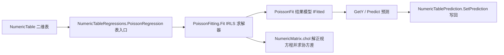

## 用户需求

基于 `DataFittings/Poisson/readme.md` 的理论描述，在 `linear-netcore5.vbproj` 项目中构建泊松回归算法代码。范围经确认为「核心模型 + 诊断」，明确不实现准泊松、负二项、零膨胀等扩展模型；交付形式为「全量交付」，包含算法库、统一二维表入口、兼容既有接口的结果模型、控制台测试报告以及文档/包描述更新。

## 产品概述

新增一套用于非负整数计数型响应变量的回归建模能力：通过对数链接函数把自变量的线性组合与期望计数关联，用极大似然迭代求解系数，并给出统计推断与过度离散诊断，最终以与现有回归工具一致的方式对外提供拟合、预测与结果查看。

## 核心 Features

- **计数建模**：对数链接、自动截距、非负整数计数校验，迭代极大似然求解至收敛，并暴露收敛状态与迭代次数。
- **暴露量 offset**：支持按人年/人口等暴露量对计数标准化，拟合事件发生率。
- **统计推断**：输出系数、标准误、Z 值以及指数化后的发生率比 IRR。
- **拟合诊断**：残差偏差、残差自由度、离散比（用于判断过离散）、零模型偏差与基于偏差的伪 R²。
- **预测与表联动**：给出期望计数与逐样本拟合值，并可把预测写回二维表。
- **统一入口与测试报告**：从二维表特征列/标签列一键拟合；控制台自检覆盖系数恢复、offset、预测、诊断量、异常输入与收敛，并生成审计报告。

## 技术栈选型

沿用现有工程，不引入新框架或第三方依赖：

- **语言/工程**：VB.NET，SDK-style `linear-netcore5.vbproj`，TargetFrameworks 为 `net10.0`，RootNamespace 为 `Microsoft.VisualBasic.Data.Bootstrapping`，新增子命名空间 `Poisson`。
- **数值计算**：复用工程已引用的 `Microsoft.VisualBasic.Math.LinearAlgebra`（`NumericMatrix`、`Vector`、Cholesky 分解 `.chol()` / `Solve` / `SPD`，见 `Ridge/RidgeFitting.vb`）、`RectangularArray.Matrix(Of Double)`；`System.Math` 的 `Exp`/`Log`。
- **复用既有契约**：`IFitted`（`Linear/IFitted.vb`）、`IFitError` / `TestPoint`（`TestPoint.vb`）、`Formula`（`Math/Algebra/Polynomial/Formula.vb`，`LinearAlgebra` 命名空间）、`NumericTable`（Core.vbproj）、`NumericTableRegressions` 私有 helper、`NumericTablePrediction.SetPrediction`。
- **log(y!) 项**：优先用局部整数累加实现（计数为小整数、零依赖、避免跨工程耦合）；若确认 `Math.Statistics.SpecialFunctions.gammaln` 已被本工程引用，可作为等价替代。

## 实现方案

**策略**：以 GLM 的 IRLS / Newton–Raphson 求解泊松回归的 MLE，与 `Logistic` 的固定学习率梯度下降不同，对数规范链接给出正定海塞矩阵 `X'WX`，因此二次收敛、迭代次数少、无需调学习率，且可直接复用 `RidgeFitting.vb` 已验证的 Cholesky 正规方程解法，技术债最小。

**关键决策与理由**：

- **设计矩阵默认自动补一列常量截距**（与 `MultipleLinearRegression` 无截距的约定相反，须在 XML 文档中显式说明）；系数长度 = 特征数 + 1。
- `η = Xβ + log(exposure)`，`μ = exp(η)`；对 `η` 做溢出钳制、`μ` 设下限（如 1e-12）以避免工作响应 `z = η − logOffset + (y − μ)/μ` 除零。参数名定为 `exposure`（要求全为正数），内部取 log，避免调用方混淆「传 t 还是传 log t」。
- 每轮：`W = diag(μ)`，解 `(X'WX) β = X'W z`；收敛判据取 `max|Δβ|` 或对数似然增量小于 `tolerance`，上限 `maxIterations`；不收敛时置 `Converged=False` 并给出明确信息，不静默返回。
- 协方差取 `(X'WX)⁻¹`（`chol.Solve(NumericMatrix.Identity(p))`），`SE = sqrt(diag)`，`Z = β/SE`，`IRR = exp(β)`。
- 诊断：`D = 2Σ[y·log(y/μ) − (y − μ)]`（y 为 0 的项取 0）、`df = n − p`、`DispersionRatio = D/df`（远大于 1 提示过离散）、零模型（仅截距）偏差、`PseudoR2 = 1 − D_model/D_null`、可选 AIC 与 Pearson χ²/df。**不**实现扩展模型。
- **R2 契约**：`IFitted.R2` 返回基于偏差的伪 R² 并在文档写明，绝不像 `LogisticFit` 那样写死为 1。
- **预测语义**：`PoissonPolynomial`（继承 `Formula`）的 `Evaluate` 返回 `exp(intercept + Σβx)`，使 `GetY(ParamArray x)` 与 `NumericTablePrediction.SetPrediction`（调用 `fitted.GetY(row)`）语义一致；带 offset 时 `GetY` 返回「率」，另提供 `Predict(x, exposure)` 返回期望计数并在文档中说明。

**性能与可靠性**：单轮复杂度 `O(n·p² + p³)`（构造 `X'WX` 与 Cholesky），p 较小时开销可忽略；热路径单次遍历样本累加 `W`/梯度、复用缓冲区、避免逐样本分配矩阵；offset 作为向量加到 `η` 不新增矩阵列；`X'WX` 非正定（完全共线/分离）时经 `SPD` 检查抛出可读异常；输入按 `RidgeFitting` 风格逐一校验（空、行数不匹配、行宽不一致、y 非有限非负整数、exposure 非正或长度不符、`maxIterations` / `tolerance` 非法）。

## 实现注意事项（执行细节）

- 表入口必须复用 `ResponseVector` / `FeatureMatrix` / `FeatureNameList`，仅新增一个 `Extension` 方法与必要的 `Imports`； Region 归入 `classification && regularized` 附近或新建 `count regression` 区。
- 新 .vb 文件由 SDK 默认 glob 自动编译，无需改 Compile 项；测试代码放在已被 `Compile Remove="_smoketest\**"` 排除的目录，或同步新增排除规则，避免被主工程重复编译。
- **DebugAudit 测试**：按用户规则使用 `G:\pixelArtist\src\framework\Microsoft.VisualBasic.Core\src\ApplicationServices\Debugger\DebugAudit.vb`（`Namespace ApplicationServices.Debugging`）。注意 `Check` 带 `Conditional("DEBUG")` 特性、Release 下会被消除，测试应改用无条件生效的 `Test` / `Require` / `AreEqual` / `CheckThrows(Of TException)`，配合 `Snapshot` / `Mark` / `Dump` / `SaveReport(path)` 输出 JSON 报告，并以 `FailureCount` 设置 `Environment.ExitCode`。测试工程需显式引用 Core.vbproj（参照 `test/test.vbproj` 的 ProjectReference 写法）。
- **影响面控制**：只改 `NumericTableRegressions.vb`（新增方法）、`linear-netcore5.vbproj`（仅 Description / PackageTags / PackageReleaseNotes，可能加一条 test 排除规则）、`README.md`、测试工程文件；不改动框架版本、配置节与无关算法；保留 `Poisson/readme.md` 原有理论内容不删改。

## 架构设计

分层：数值求解器（纯计算） → 结果模型（统计量 + `IFitted`） → 公共表入口（扩展方法） → 测试/报告。数据流如下：



## 目录结构

汇总：在 `DataFittings/Poisson/` 新建算法与结果模型；在 `NumericTableRegressions.vb` 增加统一入口；复用 `_smoketest` 控制台工程新增 DebugAudit 自检；更新包元数据与文档。

```
DataFittings/
├── Poisson/
│   ├── PoissonFitting.vb        # [NEW] IRLS/Newton–Raphson 求解器模块。实现 Fit(x,y,exposure,maxIterations,tolerance,featureNames,addIntercept)、设计矩阵补截距、参数校验、μ/工作响应/权重迭代、Cholesky 解正规方程、协方差与收敛判定；返回 PoissonFit。中文 XML 文档说明数学形式、截距与 offset 约定。
│   ├── PoissonFit.vb            # [NEW] 结果模型，实现 IFitted。保存系数/截距、featureNames、StandardErrors、ZValues、IncidenceRateRatios、Deviance、NullDeviance、ResidualDf、DispersionRatio、PseudoR2、Converged、Iterations、FittedValues、ErrorTest、offset 摘要；提供 GetY(ParamArray x)、Predict(x, exposure)、R2（伪 R²）、Polynomial、ToString。
│   ├── PoissonPolynomial.vb     # [NEW] 继承 Formula 的对数链接多项式。Evaluate 返回 exp(Intercept + Σ Factors(i)*x(i))；按 RidgePolynomial.vb 模板覆盖两个 MustOverride ToString 重载，输出含 exp 的公式文本。
│   ├── NamespaceDoc.vb          # [NEW] Poisson 命名空间级 XML 注释，说明泊松回归适用范围与不覆盖扩展模型。
│   └── readme.md                # [MODIFY] 仅追加「本库实现与调用示例」小节（表入口、参数、IRR/离散比解读）；保留原有理论正文不变。
├── NumericTableRegressions.vb   # [MODIFY] 新增 Extension 方法 PoissonRegression(table, y, exposure, maxIterations, tolerance, Silent)，复用 ResponseVector/FeatureMatrix/FeatureNameList，exposure 可从指定列名读取暴露量；转调 PoissonFitting.Fit。
├── linear-netcore5.vbproj       # [MODIFY] 在 Description / PackageTags / PackageReleaseNotes 中补充 poisson 回归；如测试放在新目录则补一条 Compile Remove 排除规则；其余配置不动。
├── README.md                    # [MODIFY] 核心能力表增加 ...Data.Bootstrapping.Poisson 行，快速上手增加泊松回归 vbnet 示例，实现要点补充对数链接/offset/过度离散诊断说明。
└── _smoketest/
    ├── smoketest.vbproj         # [MODIFY] 参照 test/test.vbproj 增加对 Core.vbproj 的显式 ProjectReference，确保 DebugAudit 可编译。
    ├── PoissonTest.vb           # [NEW] 控制台自检模块。用 DebugAudit 的 Test/Require/AreEqual/CheckThrows/Snapshot/Mark 记录：已知 β 合成计数下系数恢复、IRR、offset 标准化、μ 预测、伪 R²/离散比、收敛标志、非法输入异常、与 SetPrediction 写回联动；调用 Dump 与 SaveReport 生成报告，返回是否全部通过。
    └── Program.vb               # [MODIFY] 在 Main 中调用 PoissonTest 的自检入口并把结果并入 failures/Environment.ExitCode，保留既有冒烟测试。
```

## 关键代码结构（接口级签名，不含实现）

求解器对外唯一入口（供表入口与测试共用）：

```
Public Function Fit(x As Double()(), y As Double(),
                     Optional exposure As Double() = Nothing,
                     Optional maxIterations As Integer = 100,
                     Optional tolerance As Double = 0.00000001,
                     Optional featureNames As String() = Nothing,
                     Optional addIntercept As Boolean = True) As PoissonFit
```

结果模型需被 `IFitted`、表入口、预测写回共同依赖的公开契约：

```
Public Class PoissonFit : Implements IFitted
    Public Property Coefficients As Double()
    Public Property Intercept As Double
    Public Property StandardErrors As Double()
    Public Property ZValues As Double()
    Public Property IncidenceRateRatios As Double()
    Public Property Deviance As Double
    Public Property NullDeviance As Double
    Public Property ResidualDf As Integer
    Public ReadOnly Property DispersionRatio As Double
    Public ReadOnly Property PseudoR2 As Double
    Public Property Converged As Boolean
    Public Property Iterations As Integer
    Public Function GetY(ParamArray x As Double()) As Double Implements IFitted.GetY
    Public Function Predict(x As Double(), Optional exposure As Double = 1.0) As Double
End Class
```

## Agent Extensions

### SubAgent

- **code-explorer**
- Purpose: 在编码前一次性核实跨工程事实：`gammaln`/`LogGamma` 与 `NumericMatrix.chol`、`CholeskyDecomposition.Solve` 分别归属哪个工程、是否已被 `linear-netcore5.vbproj` 引用；`Poisson` 命名空间/类型是否与现有类型冲突；`NumericTable` 的 `GetLabel`/`Feature`/`NumericRows` 精确签名。
- Expected outcome: 给出可引用的确切命名空间与 API 清单，确认求解器可复用 Cholesky 方案、log 阶乘可本地实现、测试工程能通过 Core.vbproj 引用 DebugAudit，避免编译期返工。