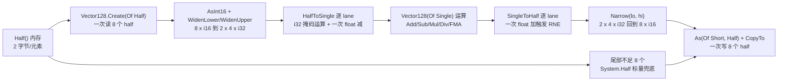
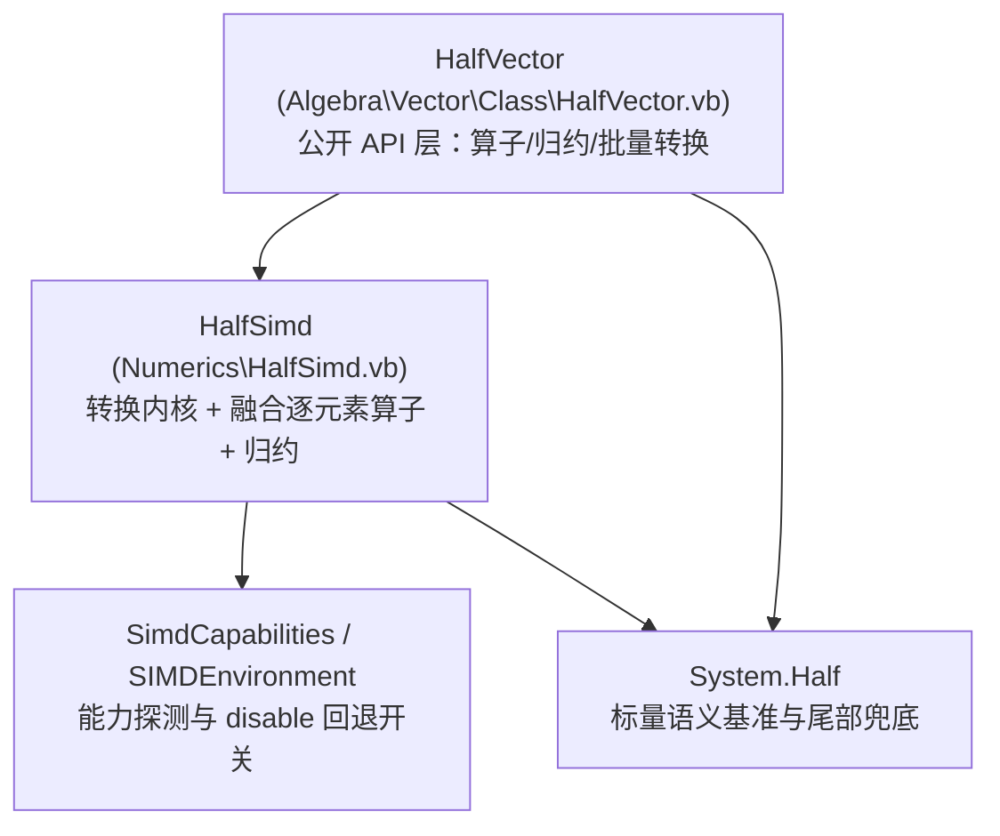

## 需求概述

对 `Algebra\Vector\Class\HalfVector.vb` 进行半精度性能优化改造，采用 **BCL `System.Half`** 作为底层标量类型，并**自研基于 `Vector128` 的半精度 SIMD 内核（8 路）**，以"Half 存储 + 8 路融合算子"替代现有"逐元素 LINQ + half 转 single 计算后再转回 half"的实现。

## 核心目标

1. **底层类型切换**：退役本地 `Numerics.Half` / `Numerics.HalfHelper`，`Half` 绑定到 `System.Half`，消除每次转换 2 次堆分配（`BitConverter.GetBytes`）与 5 次静态表索引。
2. **8 路 SIMD 内核**：自研 half 与 single 的向量化互转（把 `System.Half` 的无分支转换算法逐 lane 改写为 `Vector128(Of Integer)` / `Vector128(Of Single)` 运算），一次迭代处理 8 个 half。
3. **融合算子**：转换、运算、转回在同一个 8 路循环内完成，不产生 `Single()` 中间数组；尾部不足 8 个的元素走 `System.Half` 标量路径兜底。
4. **语义逐位一致**：内核结果必须与 `System.Half` 标量路径（`(Half)(CSng(a) + CSng(b))`）逐位相同，含 round-to-nearest-even、次正规、正负零、NaN payload、溢出到无穷。
5. **不引入 NuGet 依赖**（工程 `GeneratePackageOnBuild=True`，保持 GPL3 打包依赖干净）。

## 边界与约束

- 仅改造 `Math` 工程（`net10.0`）；不改 `Microsoft.VisualBasic.Core` 中的 `SimdEngine`（它基于 `Vector(Of T)`，不支持 Half）。
- 现有 `Sum`/`Mean` 的 Double 累加语义必须保持，不能因向量化改变数值结果。
- 幂运算符 `^` 无对应 SIMD 指令，保留标量路径，不做向量化。
- 删除本地 `Numerics.Half` 属破坏性变更，需先完成下游引用扫描。

## 技术栈

- 语言/框架：VB.NET，`Math.NET5.vbproj`（`net10.0`，`RootNamespace=Microsoft.VisualBasic.Math`，`GeneratePackageOnBuild=True`，未设 `OptionStrict`）
- 向量指令：`System.Runtime.Intrinsics.Vector128`（`Vector128(Of Short/Integer/Single)`，`WidenLower`/`WidenUpper`/`Narrow`/`As(Of T,U)`/`BitwiseAnd`/`BitwiseOr`/`AndNot`/`ShiftLeft`/`ShiftRightArithmetic`/`Equals`/`Min`/`Max`/`Create`/`CopyTo`）
- 能力探测与开关：复用 `Microsoft.VisualBasic.Math.SIMD` 的 `SimdCapabilities`（`IsHardwareAccelerated`/`IsAvx2`/`Description`）与 `SIMDEnvironment`（`IsEnabled`、`config = SIMDConfiguration.disable`）
- 分配策略：复用 `SimdEngine.NewArray` 的 `GC.AllocateUninitializedArray` 模式

## 实现方案

### 核心思路

`System.Half` 的两个方向转换在 BCL 中都是**无分支**实现（`Half.cs` 中的 `explicit operator Single(Half)` 与 `explicit operator Half(float)`），全流程只由 AND/OR/ADD/SUB/SHL 与**一次浮点加或减**构成，因此可以按 lane 完全并行化：

- `(Single)half`：取符号 → 次正规掩码 → `bits <<= 13` → 按掩码清零 → 加偏置（Inf/NaN 车道偏置再加一倍）→ 一次 float 减法做次正规修正 → 拼回符号。
- `(Half)single`：取符号 → NaN 掩码（`v == v` 得到全 1）→ 取绝对值 → 与 65520 取小 → 与 `0x38800000` 位型取大 → 构造偏置指数并**用一次 float 加法触发 RNE 舍入** → 整数减法/移位/掩码 → 拼符号与 NaN 指数。

把上述每一步替换成 `Vector128` 的对应运算，即得到 8 路转换内核；在此之上做 float lane 的 `Add/Subtract/Multiply/Divide/MultiplyAdd`，再转回 half lane，就是融合算子。

由于 BCL 的 `Half.op_Addition` 本身就是 `(Half)((float)left + (float)right)`，**只要转换是 RNE，融合内核与标量 `a+b` 逐位一致**，可直接做差分回归测试。

### 8 路数据流



### 关键技术决策与权衡

| 决策 | 选择 | 理由 |
| --- | --- | --- |
| 转换实现 | 自研 `Vector128` 位运算内核 | net10.0 的 `System.Runtime.Intrinsics.X86` **没有 F16C 类**，`Vector128.ConvertToSingle` 只有 `Int32/UInt32` 重载，无现成半精度 SIMD 转换；`System.Numerics.Tensors` 又不在 net10 框架内（本机 ref pack 已确认缺失），需 NuGet |
| 向量宽度 | `Vector128`（8 half/迭代） | 与 `Widen`/`Narrow` 的 16/32 位通道天然匹配；`Vector(Of Half)` 不受支持 |
| 中间结果 | 不落地 `Single()` 数组 | 融合算子避免两趟额外内存遍历；仅在归约与批量管道场景使用 float 暂存 |
| Lane 拆分 | 用 `WidenLower`/`WidenUpper` 而非 `Widen` 元组返回 | 避免 VB 对具名元组元素的绑定差异；`Narrow(lo, hi)` 正好是其逆运算 |
| 舍入正确性 | 复用 BCL 的"浮点加法触发 RNE"技巧 | 天然获得 round-to-nearest-even，且与 `System.Half` 逐位一致 |
| 回退开关 | 接入 `SIMDEnvironment` | 与既有 `SimdBenchmark` 的"disable 走标量回退"对比方式一致 |


## 实现细节与风险防控

### 必须实测确认的四点（当前环境无法编译）

1. `Vector128.WidenLower(Vector128(Of Short))` / `WidenUpper` / `Narrow(Vector128(Of Integer), Vector128(Of Integer))` 的重载存在性与 lane 排布（顺序错误会导致结果错位，须用**全 65536 个位型**的差分测试钉死）。
2. `Vector128.Equals(Of T)` 的返回值是否为"相等时全 1 掩码"（决定次正规掩码与 NaN 掩码的取法）。
3. `Vector128.Min(Of T)` 的 NaN 语义：必须用 `Min`（NaN 传播）而**不能**用 `MinNative`（平台 `minps` 语义返回第二操作数），否则 NaN/溢出车道与 BCL 不一致。
4. `Vector128.Create(Of Half)(array, index)` / `CopyTo(Of Half)` 在 net10 是否对 `Half` 可用；若不可用，改用 `MemoryMarshal.Cast(Of Half, Short)` + `LoadUnsafe`/`StoreUnsafe`。

### VB 语言陷阱（务必规避）

- 局部/参数变量**不可命名为 `half`**（与类型 `Half` 同名时后续 `Half.Xxx` 会解析到变量而报错）；同理避免 `value` 与属性同名。
- `&amp;H80000000` 在 VB 中是 `Long` 而非 `Integer`，符号掩码常量必须写成 `Integer.MinValue`；其余常量（`0x38800000`、`0x38000000`、`0x0FFFE000`、`0x7F80_0000`、`0x0680_0000`、`0x3F00_0000`）均在 `Integer` 范围内，可直接写 `&amp;H...`。
- 工程 `RemoveIntegerChecks=True`，整数溢出不检查，与内核的位运算假设一致，但常量赋值仍要保证类型正确。
- `Option Strict Off`：所有收窄转换要显式写 `CType(..., Half)`，避免隐式转换混入额外开销与歧义。

### 性能要点

- 结果数组一律 `GC.AllocateUninitializedArray`（复用 `SimdEngine.NewArray` 思路），避免运行时零初始化。
- 仅在长度不小于 8 且 `SIMDEnvironment.IsEnabled` 时走向量路径；否则直接标量循环（避免短向量的内核启动开销）。
- 归约（`Sum`/`Dot`/`Norm`）保持 **Double 累加**：先按 float lane 分块求和，再 widen 到 double 累加器，防止改变既有数值结果。
- 长度超过 `SimdParallel.MinParallelLength` 时可选分块并行（与本仓库 `SimdParallel` 惯例一致），本轮先实现串行内核，并行作为后续可选项。
- `^`（幂）无 SIMD 指令，保留标量 `MathF.Pow` 逐元素路径，不做向量化。

## 架构设计



- `HalfVector` 只做 API 与语义编排（参数校验、长度对齐、结果包装），不含向量细节。
- `HalfSimd` 是纯内核（`Friend Module`），只接受 `Half()` / `Single()` 与标量，不感知 `HalfVector` 类型。
- `System.Half` 同时承担"正确性基准"与"标量回退/尾部兜底"两个角色。

## 目录结构

```
Math/
├── Numerics/
│   ├── Half.vb                # [DELETE] 本地半精度类型，退役（含 GetTypeCode=255、±0 不等、截断舍入等缺陷）
│   ├── HalfHelper.vb          # [DELETE] 表驱动转换助手，退役（每次转换分配 Byte()）
│   └── HalfSimd.vb            # [NEW] 半精度 SIMD 内核：8 路 half 与 single 互转、融合逐元素算子、归约；
                               #       按 Region 组织：constants / convert / elementwise / reduce / scalar-fallback
├── Algebra/Vector/Class/
│   └── HalfVector.vb          # [MODIFY] 切换到 System.Half；移除全部 LINQ 逐元素算子，改为调用 HalfSimd；
                               #       新增 ToSingle()/FromSingles()/原地算子/Dot/Norm/Min/Max；保留 Sum/Mean 的 Double 累加语义
└── test/
    ├── HalfSimdTest.vb        # [NEW] 差分自测：全位型遍历 + 边界值 + 长度对齐 + 与标量路径逐位比对
    └── SimdBenchmark.vb       # [MODIFY] 追加 half 章节，沿用 BenchApi 的 disable 与向量化两档对比与 sink 防消除惯例
```

## 关键代码结构

```
Namespace Numerics

    ''' <summary>半精度 SIMD 内核（bit-exact 等价 System.Half 标量转换语义）</summary>
    Friend Module HalfSimd

        Friend Const Lanes As Integer = 8

        ' ---- 转换内核（对外：批量；内部：8 路 lane）----
        Friend Sub ConvertToSingle(src As Half(), dst As Single(), Optional start As Integer = 0, Optional length As Integer = -1)
        Friend Sub ConvertToHalf(src As Single(), dst As Half(), Optional start As Integer = 0, Optional length As Integer = -1)

        ' ---- 融合逐元素算子（Half 进 Half 出，无中间数组）----
        Friend Function Add(a As Half(), b As Half()) As Half()
        Friend Function Subtract(a As Half(), b As Half()) As Half()
        Friend Function Multiply(a As Half(), b As Half()) As Half()
        Friend Function Divide(a As Half(), b As Half()) As Half()
        Friend Function AddScalar(a As Half(), s As Single) As Half()
        Friend Function MultiplyScalar(a As Half(), s As Single) As Half()
        Friend Function MultiplyAdd(a As Half(), b As Half(), addend As Single) As Half()
        Friend Sub AddInPlace(a As Half(), b As Half())
        Friend Sub MultiplyScalarInPlace(a As Half(), s As Single)

        ' ---- 归约（保持 Double 累加语义）----
        Friend Function Sum(a As Half()) As Double
        Friend Function Dot(a As Half(), b As Half()) As Double
        Friend Function Norm(a As Half()) As Double
        Friend Function Min(a As Half()) As Half
        Friend Function Max(a As Half()) As Half

        ' ---- 内部 lane 内核（private）----
        ' Private Function LanesToSingle(x As Vector128(Of Integer)) As Vector128(Of Single)
        ' Private Function LanesToHalf(v As Vector128(Of Single)) As Vector128(Of Integer)
    End Module
End Namespace
```

`HalfVector` 侧对应的改造形态（示意）：

```
' 旧：New HalfVector(From x As Half In v Select x + add)
' 新：数组直写 + 8 路融合内核 + 标量尾部
Dim src = v.buffer
Dim out = GC.AllocateUninitializedArray(Of Half)(src.Length)
HalfSimd.AddScalar(src, CSng(add), out)   ' 内部完成 8 路循环与尾部兜底
Return New HalfVector(out)
```

## 可用的 Agent 扩展

### SubAgent

- **code-explorer**
- 用途：跨目录/跨仓库扫描 `Microsoft.VisualBasic.Math.Numerics.Half`、`HalfHelper`、`HalfVector` 的全部下游引用，确认本地 `Half` 退役的影响面（本仓库内已知仅 3 个文件，但 mzkit 等下游仓库未验证）。
- 预期结果：给出受影响文件清单与是否需要保留兼容壳的结论。
- 注意：本仓库 LSP 对 VB 无 documentSymbol provider，找引用需回退到 `search_content` 全文检索（已在前期探索中确认）。

### Skill

- **lsp-code-analysis**
- 用途：对 `HalfVector.vb` 的算子与 `Vector(Of T)` 基类成员做定义/引用导航与影响分析，确认可直接调用的成员（`buffer`、`Array`、`Length`、`Item`）与改造点。
- 预期结果：精确的成员签名与调用点清单，避免误用基类 API。