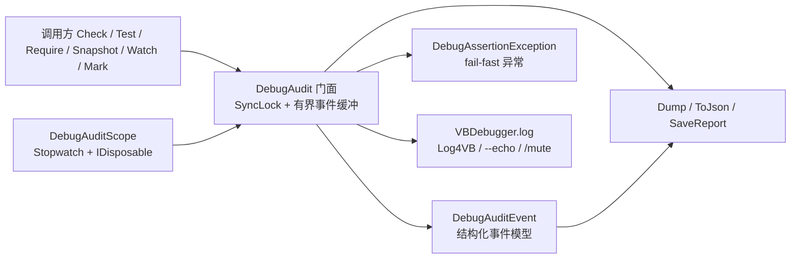

## Product Overview

为运行期调试提供一个可观测、可导出、线程安全的审计模块：程序运行时可以随时记录变量值、检查条件、测量代码段耗时，并在失败时既打印调试信息、也可选择立即中断，最终把这些审计记录汇总成表格或 JSON 导出。

## Core Features

- **变量快照**：一次性登记一组 `(名称, 值)`，随时取回当前快照；并发调用不报错、不串数据。
- **条件检查与断言**：
- 兼容原有 `Check(条件, 消息)` 用法，条件不成立时记录失败并输出到调试终端（受 `--echo`、`/mute` 控制）；
- 提供不会中断流程的 `Test`（返回是否通过）与必定抛异常的 `Require`（fail-fast），以及全局开关让 `Check` 也能抛异常；
- 失败记录包含表达式原文、自定义消息、文件名、行号、成员名、时间戳、线程号。
- **取值/比较/异常检查**：`V(表达式)` 自动回显表达式原文与值；提供相等比较与“期望抛出某类异常”的检查。
- **耗时作用域**：以 `Using` 语法包裹代码段，结束时自动记录名称与耗时，可顺带登记段内变量。
- **审计事件流**：快照、断言、作用域、标记点统一进入有上限的事件缓冲，可查询总数、最近一次失败、失败次数，支持一键清空。
- **报表输出**：把当前变量快照、失败清单、事件列表渲染为对齐的文本表格；或导出为合法 JSON 文件，便于事后分析。
- **健壮性**：名称为空、文件名为空、行号未知等边界情况不抛异常；输出统一走既有调试日志通道，静默模式下不打扰终端。

## Visual Effect

终端输出风格与既有调试日志一致：断言失败为黄色告警级别的一行文本（形如 `Assertion failed: x > 0 at Foo (D:\a.vb:12)`），作用域与标记为普通信息行；`Dump()` 输出的是一张带表头、列宽对齐的字符表格，可直接粘贴进日志或提交说明。

## Tech Stack Selection

- **语言/运行时**：VB.NET，`net10.0`（现有工程 `Microsoft.VisualBasic.Core\src\Core.vbproj`，RootNamespace `Microsoft.VisualBasic`，AssemblyName `Microsoft.VisualBasic.Runtime`）
- **零新增依赖**：日志复用 `VBDebugger.log` / `My.Log4VB`；表格复用 `ConsoleTableBuilder`；JSON 复用 `Microsoft.VisualBasic.Serialization.JSON.JsonContract`（内部 System.Text.Json），并保留手写兜底
- **验证**：复用 `test\test.vbproj` 控制台自测（新增 `--debugaudit` 分派），不引入测试框架

## Implementation Approach

采用「兼容门面 + 结构化事件模型 + 独立作用域对象」的最小分层：`DebugAudit` 模块保持现有 4 个成员的调用方式不变，内部把状态收敛到一个受 `SyncLock` 保护的有界事件缓冲与一个原子替换的快照字典；所有失败路径统一走一个 `RecordFailure` 私有方法，由其决定「记录事件 → 输出日志 → 可选抛异常」的顺序。关键取舍：

1. **成功路径必须零成本**：`Check`/`Test` 在条件成立时只做一次布尔判断并 `Return True`，不分配字符串、不进锁、不调用日志（`CallerFilePath`/`CallerArgumentExpression` 都是编译期常量，仅失败分支使用）。
2. **兼容优先**：`Snapshot`、`Check`、`GetCaptures`、`V` 的签名与返回类型保持不变；`Check` 继续保留 `<Conditional("DEBUG")>`（Release 中调用被整体消除），因此新增的 `Test`/`Require` 一律**不加** `Conditional`——VB 中把 `Conditional` 用于带返回值的方法不可靠，需要在 Release 生效的能力只能走这两个成员。
3. **输出不自行判断静默与否**：不直接读 `VBDebugger.m_level`/`Mute`，而是统一调用 `VBDebugger.log(...)`，由其内部完成 `Log4VB` 重定向 → `--echo` 等级 → `/mute` 的既有判定，避免双份语义。
4. **有界内存 + 简单数据结构**：事件缓冲用 `List(Of DebugAuditEvent)`，超过 `MaxEvents`（默认 256）时一次性 `RemoveRange` 丢弃最旧的一批；失败与作用域都是低频操作，无需环形索引或分片锁。
5. **性能**：成功路径 O(1)/无分配；失败路径 O(1) + 单次 `SyncLock`；`GetCaptures`/`Dump`/`ToJson` 为 O(n) 拷贝，文档中标注为「适合调试期低频调用」。
6. **不引入技术债**：不新建日志/序列化/表格基础设施，不修改 `Assert.vb`、`VBDebugger` 的既有行为（如确需新成员只在 `DebugAudit` 侧新增）。

## Implementation Notes

- **命名空间**：文件内仍写相对的 `Namespace ApplicationServices.Debugging`（实际全名 `Microsoft.VisualBasic.ApplicationServices.Debugging`）；`VBDebugger` 在根命名空间，可裸名调用。
- **Imports 纪律**：仅需 `System.Runtime.CompilerServices`、`System.Threading`、`System.IO`、`Microsoft.VisualBasic.ApplicationServices.Debugging.Logging`（`MSG_TYPES`）、`...ApplicationServices.Terminal`（`AnsiColor`）、`...Terminal.TablePrinter`（`ConsoleTableBuilder`）。**禁止**引入 `Microsoft.VisualBasic.Language` / `...ComponentModel.Collection`，否则 `Dictionary`/`List` 会被同名类型遮蔽；若引入表格命名空间后出现解析歧义，则集合类型写 `System.Collections.Generic.*` 全名。
- **VB 陷阱**：Module 成员不能写 `Shared`；局部变量不可与所在函数/属性同名（大小写不敏感）；`File`/`Path` 类型名易被同名局部变量遮蔽，改用 `sourceFile`/`pathFile` 等命名，文件操作写 `IO.File.WriteAllText`；异常构造参数不用 `file`、`error`、`call`、`next`、`step` 等保留字。
- **并发**：`captures` 用「构建临时字典 → 单次赋值替换引用」实现原子快照；读取方在锁内做浅拷贝；事件列表的读接口返回数组副本，避免外部持有内部列表。
- **日志**：仅失败（`MSG_TYPES.WRN` + `AnsiColor.BrightYellow`）、作用域/标记（`MSG_TYPES.DEBUG` 或 `INF` + 柔和颜色）；不打印大对象内容（`value.ToString` 超过阈值时截断，避免日志膨胀）；不输出任何密钥/凭据类字段。
- **导出**：`ToJson` 先用 `JsonContract.GetObjectJson(events, indent:=True)`，捕获异常后退化为手写 JSON（`StringBuilder` + 转义），保证「导出永不因序列化失败而崩溃」；`SaveReport` 写盘失败只记一条告警，不抛。
- **爆炸半径**：仅新增文件 + 单文件重写 + 测试工程两处小改，不改动公共 API 签名；`GetCaptures` 改为返回副本属于行为增强，需在 XML 文档中明确说明。

## Architecture Design



## Directory Structure

```
Microsoft.VisualBasic.Core/
├── src/ApplicationServices/Debugger/
│   ├── DebugAudit.vb                          # [MODIFY] 门面模块重写。保留 Snapshot/Check/GetCaptures/V 的签名与语义；captures 改为单锁保护、Snapshot 原子替换、GetCaptures 返回副本；修正失败消息格式为 "<msg> at <Member> (<File>:<Line>)"；补充完整 XML 文档；新增状态属性（FailureCount/Events/LastFailure/MaxEvents/ThrowOnFailure/Reset）与 Test/Require/AreEqual/CheckThrows/Watch/Mark/Dump/ToJson/SaveReport/ClearCaptures，内部统一走私有 RecordFailure（记录事件 → VBDebugger.log → 按开关抛异常）。条件成立时不得分配对象或加锁。
│   ├── DebugAuditEvent.vb                     # [NEW] 结构化审计事件。定义 DebugAuditEventKind 枚举（Capture/Assertion/Scope/Mark）与 Public 类 DebugAuditEvent：Time、Kind、Level、Expression、Message、File、Line、Member、ThreadId、ElapsedMs、Succeeded；提供 ToString 的一行格式化（含位置后缀）与手动 JSON 片段方法（fallback 用）。属性需可读可写以便 JsonContract 序列化。
│   ├── DebugAuditScope.vb                     # [NEW] 计时作用域。Public NotInheritable Class DebugAuditScope : Implements IDisposable；持有 Stopwatch 与名称、作用域内 Dictionary(Of String, Object)；提供 Set(name, value)、Get(name)、Values 只读副本；Dispose 幂等（_disposed 守卫），停止计时后调用门面把值合并进 captures 并记录一条 Scope 事件，过程不得抛异常。
│   └── Exception/DebugAssertionException.vb   # [NEW] fail-fast 异常。Public Class DebugAssertionException : Inherits Exception，携带 Expression/File/Line/Member 只读属性，消息形如 "Assertion failed: <expr> at <Member> (<File>:<Line>)"；提供 Shared Create 工厂，构造参数命名避开 File/Path 等易遮蔽名。
└── test/
    ├── Program.vb                             # [MODIFY] 在既有 args(0) 分派链中追加：If args(0) = "--debugaudit" Then Call DebugAuditSelfTest.Run() : Return（放在 --simd 分支附近）。
    └── test/DebugAuditSelfTest.vb             # [NEW] 自测模块。Friend Module + Private failedChecks 计数 + Public Sub Run()，结尾失败则 Throw（与 NumericTableExtensionsTest 风格一致）。覆盖：V 的表达式回显；Check 成功不记录/失败记录且消息含 "at ... (文件:行)"；GetCaptures 返回副本；Snapshot 空名跳过与并发压力（Parallel.For 1000 次不抛异常）；Test 返回 False 不抛、Require 抛 DebugAssertionException 且字段正确；ThrowOnFailure 开关行为；Watch 耗时>0、Set 值合并、嵌套与重复 Dispose；Mark 记录；MaxEvents 上限（设小值后验证 Count）；Dump 文本含键名与失败表达式；ToJson 能被 System.Text.Json.JsonDocument.Parse 解析；Reset 清空；VBDebugger.Mute=True 时失败不写标准输出。所有断言结束前必须恢复 ThrowOnFailure/Mute 原值。
```

## Key Code Structures

```
' DebugAudit（门面，现有成员签名不变，截取新增部分）
Public Module DebugAudit
    Property ThrowOnFailure As Boolean          ' 默认 False；True 时 Check 失败抛 DebugAssertionException
    Property MaxEvents As Integer               ' 默认 256，下限 1
    ReadOnly Property FailureCount As Integer
    ReadOnly Property Events As DebugAuditEvent()
    ReadOnly Property LastFailure As DebugAuditEvent

    Function Test(condition As Boolean, Optional msg As String = Nothing,
                  <CallerArgumentExpression("condition")> Optional expr As String = Nothing,
                  <CallerFilePath> Optional sourceFile As String = Nothing,
                  <CallerLineNumber> Optional line As Integer = -1,
                  <CallerMemberName> Optional callee As String = Nothing) As Boolean

    Function Require(condition As Boolean, Optional msg As String = Nothing,
                     <CallerArgumentExpression("condition")> Optional expr As String = Nothing,
                     <CallerFilePath> Optional sourceFile As String = Nothing,
                     <CallerLineNumber> Optional line As Integer = -1,
                     <CallerMemberName> Optional callee As String = Nothing) As Boolean

    Function Watch(name As String, Optional logOnExit As Boolean = True) As DebugAuditScope
    Sub Mark(name As String, Optional value As Object = Nothing)
    Function Dump(Optional includeEvents As Boolean = True) As String
    Function ToJson(Optional indent As Boolean = True) As String
    Sub SaveReport(sourceFile As String)
End Module

' DebugAuditEvent（JSON 可序列化的扁平模型）
Public Enum DebugAuditEventKind As Integer
    Capture = 0
    Assertion = 1
    Scope = 2
    Mark = 3
End Enum

Public Class DebugAuditEvent
    Property Time As Date
    Property Kind As DebugAuditEventKind
    Property Level As String          ' "warn" | "info" | "debug"
    Property Expression As String
    Property Message As String
    Property File As String
    Property Line As Integer
    Property Member As String
    Property ThreadId As Integer
    Property ElapsedMs As Double
    Property Succeeded As Boolean
End Class
```

## Agent Extensions

### Skill

- **lsp-code-analysis**
- Purpose: 在收尾阶段做影响面核对，确认 `Snapshot`/`Check`/`GetCaptures`/`V` 在整个解决方案中确实没有外部调用者，并核对新成员是否与既有符号重名（如 `Assert.AreEqual`、`VBDebugger.Assert`）。
- Expected outcome: 输出「无外部调用点」或具体冲突清单，作为不改动其他工程的前提证据。