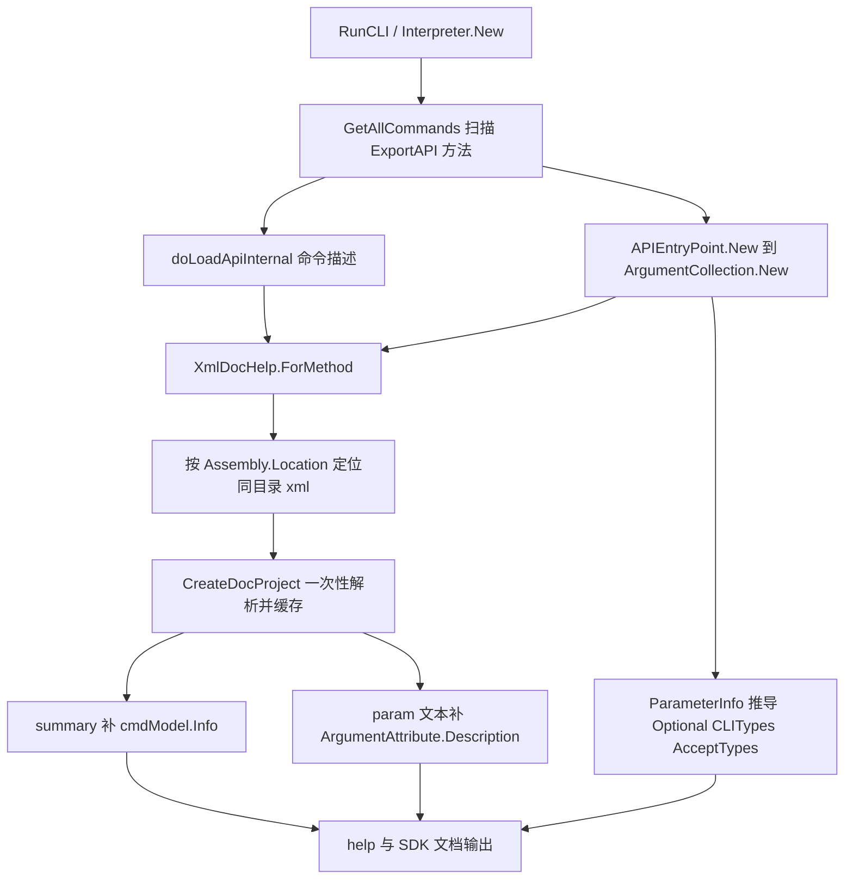

## 产品概述

在现有 VB.NET 命令行框架中新增「从 .NET assembly 的 XML 注释文档自动生成帮助信息」的能力，复用项目内已有的 XML 注释解析程序，使开发者不再需要为每个命令行函数手写 Description 属性、为每个参数手写 Argument 属性。

## 核心功能

- **命令描述自动补全**：读取目标方法 XML 注释的 `&lt;summary&gt;` 文本，用作命令帮助的描述信息（等价于 Description 属性的文本）。
- **参数说明自动补全**：读取 `&lt;param name="xxxxx"&gt;` 文本，用作对应 Argument 属性的描述文本。
- **参数元信息反射推导**：Argument 属性中的 optional、CLITypes 类型、AcceptTypes 由 MethodInfo 的 ParameterInfo 反射得出，无需手写。
- **属性优先、XML 补全**：已手写的 Description / Argument 值一律保留，XML 注释只补充缺失部分；框架自身既有命令的帮助输出不回归。
- **运行时自动生效**：解释器扫描命令时自动定位并读取命令方法所在程序集同目录的 XML 注释文档；现有 CLI 程序零改动。
- **容错与兼容**：XML 文档缺失、陈旧、无对应节点、`&lt;param&gt;` 为空时静默回退到原有属性行为，不影响程序启动与命令执行。
- **示例简化与验收**：移除 `test/Program.vb` 中冗余的手写属性，为 `&lt;param&gt;` 填写真实说明；通过 `test.exe --help "--test-arguments"` 与 `test.exe --help "--markdown"` 查看自动生成结果，`a`/`b` 为必填整数、`c` 为可选双精度浮点数，三者说明均来自注释。

## 技术栈选型

- 语言/运行时：Visual Basic .NET，net10.0；现有库项目 `src/Core.vbproj`（`RootNamespace=Microsoft.VisualBasic`，`AssemblyName=Microsoft.VisualBasic.Runtime`，`GenerateDocumentationFile=True`，SDK 默认通配 Compile，新增 `.vb` 自动纳入编译）。
- 复用组件：`src/ApplicationServices/VBDev/XmlDoc` 中的 `ProjectSpace.CreateDocProject`、`Project` / `ProjectType` / `ProjectMember`（`Summary`、`Declare`、`GetParameterDocument`），以及 `Serialization/APIExtensions.vb` 的 `TrimAssemblyDoc`。二者与 `src/CommandLine` 同属一个程序集，引用不构成程序集循环依赖。
- 复用属性模型：`System.ComponentModel.DescriptionAttribute`、`CommandLine.Reflection.ArgumentAttribute`、`CLITypes` 枚举、`ExportApiModel` / `APIEntryPoint` 帮助模型；不引入新第三方依赖、不改动工程文件。

## 实现策略

在 `src/CommandLine/Reflection` 新增一个「XML 文档桥接」模块，把「程序集路径 → XML 文件 → 方法注释节点」封装成一次性的懒加载缓存；然后在两个既有帮助数据源处做最小补丁：

1. `Interpreter.doLoadApiInternal`（`Interpreters/Interpreter.vb:543`）中 `cmdModel.Info` 的取值改为「手写 Description 优先，否则取 `&lt;summary&gt;`」。
2. `ArgumentCollection.Sub New(methodInfo)`（`Reflection/ArgumentCollection.vb:185`）在读取既有 `&lt;Argument&gt;` 属性之后，遍历 `methodInfo.GetParameters()`：已有同名属性则仅补全空白 `Description`，否则合成一个 `ArgumentAttribute`（`Optional` ← `IsOptional/HasDefaultValue`，`TokenType` ← 参数类型映射，`AcceptTypes` ← `{ParameterType}`，`Description` ← `&lt;param name&gt;`）。

这样 `ManualBuilder.PrintHelp`、`APIEntryPoint.argumentNote`、`SDKManual` 等所有视图层无需改动即可自动获得完整帮助；`APIDelegate.Execute` 的运行时参数绑定也不受影响（合成属性仅用于帮助模型）。

## 关键技术决策与权衡

- **不修改全局扩展 `ScriptMeta.Description()`**（`src/Extensions/Reflection/ScriptMeta.vb:104`）：它被大量无关代码使用且没有 XML 文件上下文参数，改动副作用面过大；改为在 `Interpreter` 命令装载处局部回退。
- **运行时合成属性对象而非给 MethodInfo 追加真实 Attribute**：.NET 无法给已编译方法追加 Attribute 实例；`ArgumentAttribute` 本身是普通类可实例化，`Description` 直接以文本注入 `cmdModel.Info`，语义等价且对调用方透明。
- **用对象图 + `Declare` 精确匹配重载**：XML docKey 形如 `M:test.Program.test_arguments(System.Int32,System.Int32,System.Double)`；`ProjectMember.Declare` 保留了去 `M:` 的完整签名，可消歧重载。类型全名中的嵌套 `+` 归一化为 `.`、ByRef 去掉 `&`、泛型按元数处理；精确匹配失败时退化为「短名 + 参数个数」匹配，再失败返回空文档。
- **空注释哨兵处理**：`ProjectMember.ReadParameters`（`ProjectMember.vb:159`）把空 `&lt;param&gt;` 填成 `"-"`，必须过滤；`GetParameterDocument` 未命中返回空串。
- **性能**：每个程序集仅解析一次 XML（`ConcurrentDictionary(Of String, Lazy(Of Project))` + 负缓存），`File.Exists` 前置短路；仅在命令缺少描述或存在未声明参数时才触发加载，避免框架自身 2 MB XML 被无谓解析。单次查找为字典 O(1)，参数合成 O(参数个数)，无 N+1 文件读取；合成后沿用原 `Order By Optional, TokenType` 顺序并重建字典以稳定枚举顺序。

## 实现注意事项（防回归）

- `Interpreter.getAPI`（:513）的 `Try/Catch` 会在异常时记录日志并返回 `Nothing`，**导致命令被丢弃**；因此新增桥接模块必须完全异常安全（缺文件、XML 非法、节点缺失一律返回空文档），不得抛异常。
- 重复键保护：`_params` 以 `Name` 为键，合成前用 `TrimParamPrefix`（`CLITools.vb:353`）并把 `-` 归一为 `_` 后比对（`Delegate.vb:227` 的 `MatchArgumentName` 规则），`ContainsKey` 去重；名称统一采用 `--&lt;参数名&gt;` 前缀。
- 跳过自动注入型参数（`As CommandLine`），避免把解释器内部参数显示到帮助里；`Description` 属性 setter 会把 `\n` 拆行，注入前先把注释中的多余空白/换行压平。
- 日志：不在每个命令上打日志；仅在加载失败时按需写一条 debug 级信息（不输出路径以外的敏感内容），避免日志风暴。
- 影响范围控制：不改 `Usage` / `Example` 属性读取逻辑，不动视图层与 `test.vbproj`（已确认第 11 行 `GenerateDocumentationFile=True`）；`test/Program.vb` 的 `Main` 及其它命令函数保持原样，只删除冗余属性并补注释文本。
- 用户常驻规则：本计划不新增 console 测试程序，验收以 `--help` 输出为准；若实现过程中额外新增测试代码，须按项目位置使用 `src/ApplicationServices/Debugger/DebugAudit.vb` 记录测试结果并生成报告。

## 架构设计



## 目录结构

```
g:/pixelArtist/src/framework/Microsoft.VisualBasic.Core/
├── src/CommandLine/Reflection/
│   ├── XmlDocHelp.vb                 # [NEW] XML 注释桥接模块。职责：按 MethodInfo.DeclaringType.Assembly.Location 定位 Path.ChangeExtension(..., ".xml")；用 ConcurrentDictionary + Lazy 缓存 ProjectSpace.CreateDocProject 结果（含负缓存，全程 Try/Catch 不抛异常）；由 MethodInfo 生成 docKey 并在 Project 的方法集合中按 Declare 精确/退化匹配，返回 XmlMethodDoc（Summary、ParameterDocument(name)）；提供 ParameterInfo 到 CLITypes / AcceptTypes 的映射与自动注入型参数判定。
│   └── ArgumentCollection.vb        # [MODIFY] 改造 Sub New(methodInfo)：保留原 GetCustomAttributes(ArgumentAttribute) 与排序逻辑；随后遍历 GetParameters()，按「属性优先、XML 补全」合并：已有属性仅补空 Description，缺失参数合成 ArgumentAttribute（Name 为 --参数名，Optional/IsOptional，TokenType/映射，AcceptTypes={ParameterType}，Description 来自 param 注释）；ContainsKey 去重、过滤 "-" 哨兵、重建有序字典。
├── src/CommandLine/Interpreters/
│   └── Interpreter.vb               # [MODIFY] doLoadApiInternal（约 543-557 行）：cmdModel.Info 改为 methodInfo.Description() 优先、为空时取 XmlDocHelp.ForMethod(methodInfo).Summary；Usage / Example 读取逻辑保持不变；确保不引入新的异常路径。
└── test/
    └── Program.vb                   # [MODIFY] 移除 test_markdown 的冗余 Description 属性（保留 summary）；移除 test_arguments 的冗余 Argument 属性，并为 a/b/c 三个 param 填写真实说明文本；清理因此不再使用的 Imports System.ComponentModel；其余命令函数与 Main 保持不动，作为「零属性也能自动生成帮助」的验收示例。
```

（说明：`src/Core.vbproj`、`test/test.vbproj`、`src/Extensions/Reflection/ScriptMeta.vb`、`Interpreters/View/*`、`EntryPoints/APIEntryPoint.vb` 均无需改动。）

## 关键代码结构（新增模块的接口约定，可按实现微调）

```
' 文件: src/CommandLine/Reflection/XmlDocHelp.vb，命名空间 CommandLine.Reflection
Public Module XmlDocHelp
    Public Function ForMethod(method As MethodInfo) As XmlMethodDoc
    Public Function ToCLITypes(parameterType As Type) As CLITypes
    Public Function IsInjectedParameter(parameter As ParameterInfo) As Boolean
End Module

Public NotInheritable Class XmlMethodDoc
    Public ReadOnly Property Summary As String
    Public ReadOnly Property IsEmpty As Boolean
    Public Function ParameterDocument(name As String) As String
End Class
```

## Agent Extensions

### SubAgent

- **code-explorer**
- Purpose: 在实现开始前复核 `ProjectSpace.CreateDocProject` / `ProjectMember.Declare` / `GetParameterDocument` 的确切签名，以及 `ArgumentCollection`、`cmdModel.Info`、`--help` 渲染链路的全部调用点，确认没有遗漏的帮助数据源或属性读取路径。
- Expected outcome: 产出一份经代码验证的调用点清单与 docKey 匹配样例（含 `test.xml` 中 `M:test.Program.test_arguments(System.Int32,System.Int32,System.Double)`），据此确认只需修改上述 3 个框架文件与 1 个示例文件，且不触碰全局 `Description()` 扩展。