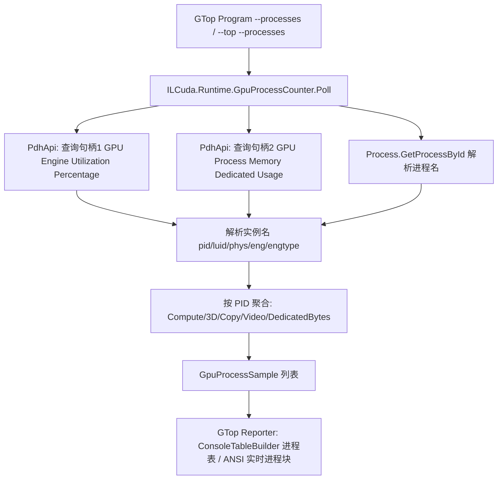

## 产品概述

为 GTop（基于 NVML 的 NVIDIA GPU 性能监测 CLI）新增"按进程"监控能力：列出当前正在使用 CUDA 进行计算的进程，并展示每个进程的 GPU CUDA 核心（计算引擎）利用率、GPU 显存占用、以及数据拷贝（拷贝引擎）利用率。

## 核心功能

- 进程枚举：列出正在使用 GPU 计算的进程（PID + 进程名）。
- 每进程 CUDA 核心利用率：来自 Windows 性能计数器 GPU Engine 的 Compute/3D 引擎利用率（%）。
- 每进程显存占用：来自 GPU Process Memory 的 Dedicated Usage（MB）。
- 每进程数据拷贝：以 Copy 引擎利用率（%）作代理（Windows 无法按进程给出字节吞吐）。
- 附赠：每进程 3D%、编码器%、解码器% 利用率。
- 命令行形态：
- `--processes` / `-p`：打印一次进程二维表后退出。
- `--top --processes`：在实时仪表盘下方追加刷新进程表。
- 复用既有 `--interval` / `--duration` / `--plain` / `--rows`。
- 降级：无计数器集、非 Windows、无权限时给出友好提示，绝不崩溃。

## 技术栈

- 语言/框架：VB.NET（net10.0），与既有 ILCuda / GTop 工程一致。
- 进程级 GPU 数据源：Windows 性能计数器（PDH，`pdh.dll`）P/Invoke；命令行 UI 复用既有 `ConsoleTableBuilder` 与 ANSI 库。
- 工程关系：GTop 已引用 ILCuda，无需改动 `GTop.vbproj` / `ILCuda.vbproj`（新增 .vb 由 SDK 自动包含）。

## 实现方案

采用"ILCuda 新增 PDH 互操作 + 托管封装，GTop 只做渲染"的两层结构，严格不修改任何既有 CUDA 计算代码。

关键决策与依据（均已核实）：

- NVML 在 Windows 上 `nvmlDeviceGetProcessUtilization` 不可用、`nvmlDeviceGetComputeRunningProcesses` 只给每进程显存且 pid 语义存疑，因此每进程利用率**必须走 PDH**。
- 用 `\GPU Engine(*)\Utilization Percentage`（实例名 `pid_<PID>_luid_..._phys_<N>_eng_<M>_engtype_<Type>`，Type ∈ 3D/Compute/Copy/VideoDecode/VideoEncode）获取每进程引擎利用率；CUDA 计算核心对应 `Compute`（部分负载可能计入 `3D`，两列分列展示，口径对齐任务管理器）。
- 用 `\GPU Process Memory(*)\Dedicated Usage` 获取每进程显存（字节）。
- 用 `PdhAddEnglishCounter` 规避中文系统计数器名本地化。
- 每进程字节吞吐 Windows 不提供，按用户确认以 Copy 引擎利用率 % 作代理。
- 速率型计数器需两次 CollectQueryData；Poll 内部做一次预热。
- 全程异常隔离：缺计数器集 / 进程已退出 / 无权限 → 返回空或留空名，不中断。

性能与可靠性：轮询低频（复用现有 interval，默认 1s）；一次 PDH 采集为常数次调用；`PdhGetFormattedCounterArray` 采用"先取容量、再按需重试"避免缓冲区不足；进程名解析用 `Process.GetProcessById` 并容错。

## 实现要点（防回归）

- 与 `NvmlApi.vb` 完全同风格：`Friend` DllImport + `Public` 的异常/检查；新增 `PdhException`（仿 `NvmlException`）承载 PDH_STATUS 与 API 名。
- PDH 结构体务必显式 `[StructLayout(LayoutKind.Sequential)]`；`PDH_FMT_COUNTERVALUE` 的 `CStatus` 决定取值字段（LongValue/DoubleValue/LargeValue）。
- 实例名是多字符串缓冲，须按 `\0` 分隔正确解析；`PdhGetFormattedCounterArray` 返回 `PDH_MORE_DATA` 时按 `BufferSize` 扩容重试。
- 复用现有 `Bar` 阈值着色逻辑与格式化助手；新增函数避免 VB 大小写不敏感的重名（局部变量不可与函数同名）。
- 保持 ILCuda 零第三方 NuGet 依赖与"不依赖 Console"原则：PDH 封装只产出纯数据，排版交由 GTop。
- Windows-only：`PdhApi` 的 P/Invoke 在非 Windows 上不加载，`IsAvailable()` 用 try/catch 降级。

## 架构设计



## 目录结构

- ILCuda（仅新增）：
- `Interop/PdhApi.vb` [NEW]：pdh.dll P/Invoke 与结构体。
- `Interop/CUresult/PdhException.vb` [NEW]：PDH 异常。
- `Runtime/GpuProcessCounters.vb` [NEW]：托管封装与数据模型。
- GTop（仅修改现有文件）：
- `Program.vb` [MODIFY]：新增 `--processes` 解析与分发、PDH 生命周期。
- `Reporter.vb` [MODIFY]：新增进程表与实时进程块渲染。

## 关键代码结构（PDH 互操作核心声明）

```
' ILCuda/Interop/PdhApi.vb
<StructLayout(LayoutKind.Sequential)>
Public Structure PDH_FMT_COUNTERVALUE
    Public CStatus As UInteger
    Public DoubleValue As Double   ' 与 LongValue/LargeValue 共用联合体，按 CStatus 取值
End Structure

<StructLayout(LayoutKind.Sequential)>
Public Structure PDH_FMT_COUNTERVALUE_ITEM
    Public SzName As IntPtr        ' 实例名（多字符串缓冲中的一项）
    Public FmtValue As PDH_FMT_COUNTERVALUE
End Structure

<DllImport("pdh.dll", CharSet:=CharSet.Unicode)> Public Shared Function PdhOpenQueryW(...) As UInteger
<DllImport("pdh.dll", CharSet:=CharSet.Unicode)> Public Shared Function PdhAddEnglishCounterW(...) As UInteger
<DllImport("pdh.dll")> Public Shared Function PdhCollectQueryData(hQuery As IntPtr) As UInteger
<DllImport("pdh.dll", CharSet:=CharSet.Unicode)> Public Shared Function PdhGetFormattedCounterArrayW(...) As UInteger ' PDH_MORE_DATA -> 扩容重试
```