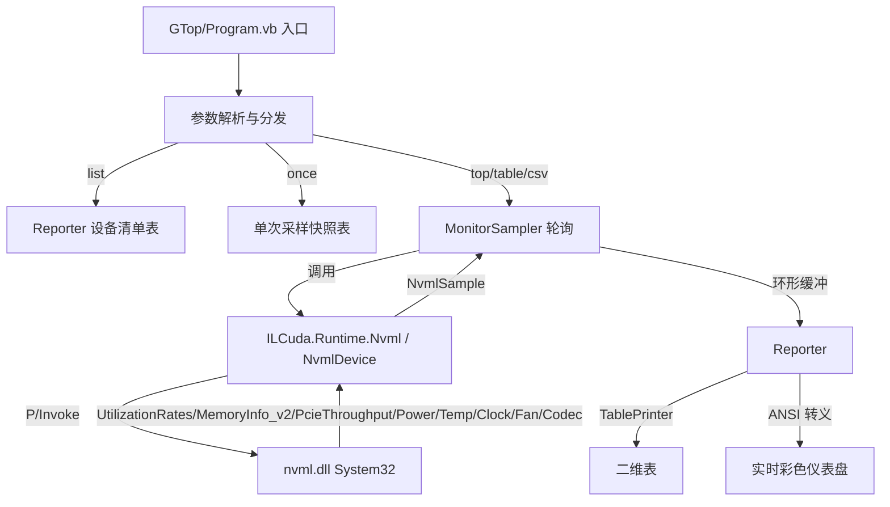

## 用户需求

在当前工作区中，基于 ILCuda\ILCuda.vbproj 提供的 GPU API 封装，构建一个 NVIDIA GPU 性能监测命令行工具，监控 CUDA 核心（SM）利用率、设备数据拷贝（PCIe 吞吐）、GPU 显存利用率等指标；命令行界面使用 Microsoft.VisualBasic.Core 的 ANSI 转义序列与 TablePrinter 打印二维表格。

## 产品概述

一个独立的命令行监控程序（GTop），通过为 ILCuda 新增的 NVML 互操作封装读取整卡实时指标，并以表格快照、历史采样表、类 htop 实时刷新仪表盘三种形态呈现。NVML 随显示驱动发布，无需额外安装、无需 CUDA Toolkit、无需建立 CUDA 上下文即可监控全卡。

## 核心功能

- 设备枚举：列出全部 NVIDIA GPU（序号、名称、UUID、计算能力、PCIe 代际）。
- CUDA 核心/SM 利用率：取自 NVML 利用率采样（gpu%）。
- 显存利用率：取自 NVML 显存信息（已用/总量比例）及显存控制器利用率。
- 设备数据拷贝：取自 NVML PCIe 吞吐（TX/RX，MB/s）。
- 附赠指标：功耗、温度、SM/显存时钟、风扇转速、编解码器利用率。
- 命令行形态：单次快照（--once）、设备清单（--list）、历史采样二维表（--table）、CSV 导出（--csv）、实时刷新仪表盘（--top）、管道友好无颜色模式（--plain）。

## 技术栈选择

- 语言/框架：VB.NET（net10.0 / x64），与现有 ILCuda、GTop 工程一致。
- GPU 监控数据源：新增 NVML 互操作层，`DllImport("nvml.dll")`（运行时从 C:\Windows\System32 解析，无需路径扫描）。
- 命令行 UI：Microsoft.VisualBasic.Core 的 `ApplicationServices.Terminal.TablePrinter.ConsoleTableBuilder`（二维表）与 `ApplicationServices.Terminal.ANSI`（AnsiEscapeCodes / AnsiColor / ConsoleFormat，用于覆盖式实时刷新与阈值着色）。
- 工程关系：GTop 已引用 ILCuda.vbproj，无需改动 GTop.vbproj 与 ILCuda.vbproj（新增 .vb 由 SDK 自动包含）。

## 实现方案

采用"ILCuda 新增纯 NVML 互操作层 + GTop CLI 消费"两层结构。ILCuda 侧仅新增文件，严格不修改任何现有 CUDA 计算代码（CudaDriverApi.vb、CudaDevice.vb、CudaMemory.vb、CudaEngine.vb 及 Kernels/IL2Cuda/Math 等红线文件保持不变）。新增的 NvmlApi.vb 沿用 CudaDriverApi.vb 的 `Check()` 包装风格，NvmlException.vb 仿 CudaException.vb 的错误承载风格；Runtime/Nvml.vb 仿 CudaDevice.vb 的设备枚举/属性风格，提供托管 `Nvml`/`NvmlDevice` 与纯数据 `NvmlSample`，供 GTop 直接消费。

关键决策与权衡：

- 显存利用率与数据拷贝吞吐必须由 NVML 提供（CUDA Driver API 本身无 SM 实时利用率、无系统级 PCIe 吞吐），因此 NVML 封装是必要前置，而非可选项。
- 显存用 `nvmlDeviceGetMemoryInfo_v2`（字节级，支持 >4GB），避免旧 `nvmlMemory_t` 的 unsigned 溢出；利用率主体用 `nvmlDeviceGetUtilizationRates`（gpu%/memory%）。
- 必须实现 `Nvml.IsAvailable()` 与 try/catch 优雅降级：缺 nvml.dll 时给出"NVML 不可用"提示而非崩溃；构建期 P/Invoke 不依赖 nvml.dll，运行期才解析。
- 性能：轮询为低频（默认 1s），采样成本极低（几次 nvml 调用）；历史表/环形缓冲定长以避免内存增长；实时仪表盘用 ANSI 光标上移+清行原地重绘，避免刷屏抖动。

## 实现要点（防回归）

- 复刻现有 `Check()`/`CudaException` 风格，新增 `Nvml.Check()` 与 `NvmlException`，不改动既有异常类型。
- nvml 结构体务必显式 `[StructLayout(LayoutKind.Sequential)]` 并正确标注 `version` 字段（`nvmlMemory_v2_t` 需先写入 `version = sizeof` 再传指针）。
- 所有 nvml 调用包在 `Try...Catch` 内，单点采样失败（如某设备暂时不可读）跳过而非中断主循环；错误日志不打印大对象、不泄露句柄。
- 保持 ILCuda 零第三方 NuGet 依赖与"不依赖 Console"的原则：NVML 封装只产生纯数据，排版交由 GTop。
- 不触碰 ILCuda.vbproj 的 EmbeddedResource/OutputPath/Package 配置，新增 .vb 自动编译进同一程序集。

## 架构设计



## 目录结构

```
ILCuda/  （仅新增，不修改现有文件）
├── Interop/
│   ├── NvmlApi.vb                  # [NEW] nvml.dll P/Invoke：nvmlReturnT 枚举、nvmlUtilization_t / nvmlMemory_v2_t 等结构体、nvmlInit_v2 / Shutdown / DeviceGetCount / DeviceGetHandleByIndex / DeviceGetName / GetUtilizationRates / GetMemoryInfo_v2 / GetPcieThroughput / GetPowerUsage / GetTemperature / GetClockInfo / GetFanSpeed / GetCudaComputeCapability / GetEncoderUtilization / GetDecoderUtilization 等；附 Nvml.Check() 包装。
│   └── CUresult/
│       └── NvmlException.vb        # [NEW] 仿 CudaException：承载 nvmlReturnT 与出错 API 名，构建可读错误信息。
└── Runtime/
    └── Nvml.vb                     # [NEW] 托管封装（Namespace Runtime）：Nvml 模块（Init/Shutdown/IsAvailable/DeviceCount/GetDevice/Enumerate）、NvmlDevice 类（GetUtilization/GetMemoryInfo/GetPcieThroughput/GetPower/GetTemperature/GetClock/GetFanSpeed/GetCudaComputeCapability/GetEncoderDecoder）、纯数据 NvmlUtilization/NvmlMemory/NvmlPcie/NvmlSample（时间戳+指标），供 GTop 消费。

GTop/  （CLI 实现；GTop.vbproj 不改动，已引用 ILCuda）
├── Program.vb                     # [MODIFY] 替换 Hello World 空壳：参数解析（--list/--device/--interval/--once/--table/--rows/--csv/--duration/--plain/--top）与命令分发；处理 Ctrl+C 优雅退出。
├── MonitorSampler.vb              # [NEW] 按 interval 轮询 NvmlDevice，累积样本到定长缓冲；负责计时与单点采样失败的跳过；支持 --duration 限时。
└── Reporter.vb                    # [NEW] 渲染层：设备清单表、单次/历史快照表（ConsoleTableBuilder，含标题色/对齐/最小列宽）；实时仪表盘（AnsiEscapeCodes 光标上移+清行 + AnsiColor 阈值着色彩色进度条）；--plain 关闭颜色。
```

## 关键代码结构（NVML 互操作核心声明）

```
' ILCuda/Interop/NvmlApi.vb
<StructLayout(LayoutKind.Sequential)>
Public Structure nvmlUtilization_t
    Public gpu As UInteger      ' SM 活跃占比 %
    Public memory As UInteger   ' 显存控制器带宽占比 %
End Structure

<StructLayout(LayoutKind.Sequential)>
Public Structure nvmlMemory_v2_t
    Public version As UInteger  ' 必须 = 封装常量 NVML_MEMORY_V2_SIZE
    Public reserved As UInteger
    Public used As ULong        ' 字节
    Public free As ULong        ' 字节
    Public total As ULong       ' 字节（支持 >4GB）
End Structure

<DllImport("nvml.dll")> Public Shared Function nvmlInit_v2() As nvmlReturnT
<DllImport("nvml.dll")> Public Shared Function nvmlDeviceGetUtilizationRates(handle As IntPtr, ByRef utilization As nvmlUtilization_t) As nvmlReturnT
<DllImport("nvml.dll")> Public Shared Function nvmlDeviceGetMemoryInfo_v2(handle As IntPtr, ByRef memory As nvmlMemory_v2_t) As nvmlReturnT
<DllImport("nvml.dll")> Public Shared Function nvmlDeviceGetPcieThroughput(handle As IntPtr, counter As nvmlPcieUtilizationCounter_t, ByRef value As UInteger) As nvmlReturnT ' KB/s
```