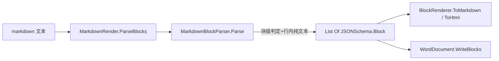

## 用户需求

优化 `text%markdown` 项目，使其能够从 markdown 文档文本解析出 `JSONSchema.Block` 块列表，作为 markdown 到 Word 等目标格式的中介。

## 产品概述

当前项目已具备「JSON → Block」(`JSONRenderer.Parse`)、「Block → markdown/HTML」(`BlockRenderer`)，但缺少「markdown 文本 → Block」方向。本任务补齐该方向，使 `markdown 文本` 可经 `Block` 列表再经 `WordDocument.WriteBlocks(blocks)` 转换为 Word 文档。

## 核心特性

- 新增 markdown 文本到 `List(Of Block)` 的解析器，覆盖块级语法：标题(ATX/setext)、段落、围栏代码块、有序/无序列表、引用块、表格、分隔线。
- 扩展支持 GFM 任务列表(tasklist)、脚注(footnote)、定义列表(deflist)、数学块(math `)、原始 HTML 块(html)、独立图片/链接行(image/link)。
- 行内语法转换为**纯文本**内容（去掉 `* _ ~` 标记，链接取显示文本、图片取 alt、代码段取原始内容），与 `WordDocument.WriteBlock` 对 `content` 纯文本的预期一致。
- 在 `MarkdownRender` 上提供 `ParseBlocks(markdown)` 门面方法，并补充往返测试验证字段完整性与下游兼容性。

## 技术栈

- 语言/框架：VB.NET（net10.0），延续 `markdown.NET5.vbproj` 现有工程（RootNamespace=Microsoft.VisualBasic.MIME.text.markdown，引用 Core + JSON-netcore5）。
- 产出命名空间：`Microsoft.VisualBasic.MIME.text.markdown.JSONSchema`（与 `Block.vb`/`BlockRenderer.vb`/`JSONRenderer.vb` 同处），复用既有 `Block` 模型，不引入新依赖。

## 实现方案

策略：新增一个自包含的「markdown → Block」解析器 `MarkdownBlockParser`，采用与现有 `MarkdownParser` 相同的两阶段递归结构（块级判定 + 行内解析），但输出结构化 `Block` 对象而非 HTML 字符串，且行内转换产出纯文本。

关键技术决策：

1. **不复用 `MarkdownParser` 的 `Render` 策略**：现有 `ParseBlocks` 将各块渲染结果拼接成单一字符串、且引用块递归返回字符串，无法保留块边界与结构化字段。若强行塞入 `BlockRender` 需大幅改造 `MarkdownParser`（高风险、易破坏已验证的 HTML 渲染）。因此采用独立的 `MarkdownBlockParser`，直接复用现有已验证的**块级判定正则与收集算法**（围栏/ATX/setext/引用/列表/表格/分隔线、`IsBlockStart`、`SplitRow`、`ParseAligns`、`MatchListItem`、`MatchFence`），以保证块级行为一致。
2. **纯文本行内转换**：新建轻量 `ParseInlinePlain`，复用现有 `ParseInline` 的记号状态机思路（escape/code span/link/image/autolink/bare url/emphasis/strikethrough），但各分支产出纯文本（链接→显示文本、图片→alt、强调→去标记保留内层、代码段→内容），避免向 Word 写入 HTML 标签。
3. **GFM/扩展块**：在块级循环新增 tasklist(`- [ ]`/`- [x]`)、footnote(`[^id]:`)、deflist(`term`/`: def`)、math(````` 或 ```` ```math ````)、raw html(块以 `<` 起且非已知内联)、独立 image/link 行(整行仅一个图片/链接) 的判定，产出对应 `Block` 类型。
4. **门面方法**：在 `MarkdownRender` 增加 `ParseBlocks(markdown) As List(Of Block)`，内部 `New MarkdownBlockParser().Parse(markdown)`，让用户以 `New MarkdownRender().ParseBlocks(md)` 一行调用，与现有 `Transform` 对称。

性能与可靠性：解析为单次线性扫描（O(n) 行遍历 + 行内 O(m) 扫描），无回溯；空/null 输入返回空列表；块类型小写化并与 `BlockRenderer`/`WordDocument.WriteBlock` 的 type 别名保持一致，未知块退化为 paragraph。

## 实现要点

- 直接复用既有正则与辅助函数（`MatchFence`/`MatchListItem`/`IsTableStart`/`SplitRow`/`ParseAligns`/`IsBlockStart`），将其复制进新解析器（避免改动 `MarkdownParser` 引发 HTML 渲染回归）；新解析器与旧 `MarkdownParser` 共处不同类，命名 `MarkdownBlockParser` 避免与根命名空间 `MarkdownParser` 冲突。
- 引用块 `content` 为单字符串：将内部行递归解析为纯文本后按 `\n` 拼接（嵌套列表/引用扁平化为文本，符合 Block 模型「平面列表」约定，与 `LLMPrompt.md` 一致）。
- 表格单元格、列表项均产出纯文本字符串数组。
- 行内转义：保留 `\` 之后的字面字符；代码段内容不转义。
- 不改动 `Render`/`HtmlRender`/`TextRender` 与 `JSONRenderer`/`BlockRenderer`，确保现有 HTML/Text 渲染与「Block → markdown/html」管线零回归。

## 架构设计



新增解析器与既有 `MarkdownParser`(HTML) 并列，共享块级正则算法但独立演进；`Block` 为统一中介模型。

## 目录结构

```
text%markdown/
├── JSONSchema/
│   └── MarkdownBlocks.vb        # [NEW] MarkdownBlockParser 类（命名空间 ...JSONSchema）。实现 Parse(markdown) As List(Of Block)：块级两阶段解析（围栏/ATX+setext 标题/引用/列表/表格/分隔线/tasklist/footnote/deflist/math/html/独立 image、link 行），复用既有块级判定算法；含 ParseInlinePlain 纯文本行内转换。空输入返回空列表，未知块退化为 paragraph。
├── MarkdownRender.vb            # [MODIFY] MarkdownRender 类新增 ParseBlocks(markdown As String) As List(Of Block) 门面，内部调用 New MarkdownBlockParser().Parse(markdown)，与 Transform 对称。
└── test/
    ├── Program.vb               # [MODIFY] Module Program 新增 markdownToBlocksTest：构造含各块的 markdown，调用 ParseBlocks，断言 type/level/content/items/headers/rows/checked 等字段，并验证 blocks.ToMarkdown 往返。
    └── MarkdownRender.Tests/
        └── BlockTests.vb        # [MODIFY] 新增 xUnit 用例：markdown→Block 各类型与边界（空文档、越界标题层级、纯文本 content 无 HTML 标签、表格列数、tasklist 勾选数组）断言。
```

## 关键代码结构

```
Namespace Microsoft.VisualBasic.MIME.text.markdown.JSONSchema

    ''' <summary>
    ''' 将 markdown 文档文本解析为 JSONSchema.Block 平面列表（content 为纯文本）。
    ''' </summary>
    Public Class MarkdownBlockParser
        Public Function Parse(markdown As String) As List(Of Block)
        ' 内部：块级两阶段递归 + ParseInlinePlain(text) As String
    End Class

End Namespace

' MarkdownRender.vb 新增门面
Public Function ParseBlocks(markdown As String) As List(Of JSONSchema.Block)
    Return New JSONSchema.MarkdownBlockParser().Parse(markdown)
End Function
```