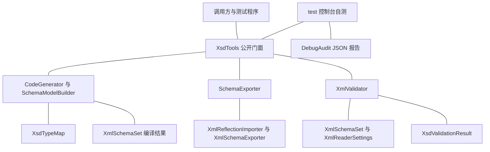

## User Requirements

完善 `xml-netcore5.vbproj` 项目的 XSD 处理能力，新增三个方法：从 XSD 文件生成 VB.NET 类定义文件（用于后续 XML 序列化与反序列化）、通过反射从 VB.NET 类定义生成 XSD 文件、使用 XSD 文件验证 VB.NET 生成的 XML 文件。已确认：XSD 语法尽量完整覆盖；反射入口为类型/程序集；配套端到端自测与 JSON 测试报告。

## 产品概述

将 `application%xml` 从「XSD 数据模型 + 读取器」补齐为可用的 XSD 工具链：给定一份 XSD 即可得到可直接参与序列化/反序列化的 VB 类源码；给定已有 VB 类型即可反向导出 XSD；序列化出 XML 后可立即用 XSD 判断其是否合法。交付物为三个可复用公开方法、一份可读的文档说明，以及一份自动记录断言的测试报告。

## Core Features

- **XSD 生成 VB 类文件**：尽量完整覆盖全局/局部元素、复杂类型的顺序/选择/全部分组、属性、简单类型枚举与数值约束、出现次数数组、内置类型映射、目标命名空间、包含与导入，并进一步支持扩展/限制继承、组与属性组、任意元素/属性、替换组；输出带序列化特性与文档注释的 `.vb` 文件。
- **边界降级**：无法被序列化模型精确表达的约束（模式、长度、通配处理细节等）以注释降级说明并明确列出限制，绝不产出不可用的代码。
- **反射生成 XSD**：以类型、泛型重载或程序集为输入，导出格式合法、声明唯一、编码统一的 `.xsd` 文件；不引入额外依赖。
- **XSD 校验 XML**：流式校验并返回含级别、消息与行列位置的结构化结果，支持正确与错误两类用例；禁用 DTD 与外部实体以保证安全。
- **统一入口与文档**：三个方法集中于同一模块，README 补充示例与「XSD 构造 → 生成结果 → 限制」覆盖矩阵。
- **端到端自测与报告**：以「类型→XSD→VB 类源码→序列化 XML→XSD 校验」闭环验证三项能力，自动记录断言并生成 JSON 测试报告，且实际编译运行验证。

## Tech Stack Selection

- 语言与框架：VB.NET（SDK 风格项目 `xml-netcore5.vbproj`），目标框架 `net10.0`（项目文件 TargetFrameworks 已声明），根命名空间 `Microsoft.VisualBasic.MIME.application.xml`。本机 `dotnet 10.0.403` 可编译验证。
- 仅用 BCL，不新增 NuGet 包（项目当前无任何 PackageReference，全库无 `System.CodeDom` 引用）：
- `System.Xml.Schema`：`XmlSchema`、`XmlSchemaSet`、`XmlSchemaObjectTable`、`XmlSchemaValidationFlags`，负责 XSD 读取、编译（自动解析 include/import、group/attributeGroup、complexContent 继承、substitutionGroup）与校验。
- `System.Xml.Serialization`：`XmlReflectionImporter`、`XmlSchemas`、`XmlSchemaExporter`、`XmlTypeMapping`、`XmlSerializer`，以及生成代码所需的 `XmlRoot`、`XmlType`、`XmlElement`、`XmlAttribute`、`XmlArray`/`XmlArrayItem`、`XmlEnum`、`XmlAnyElement`、`XmlAnyAttribute`、`XmlChoiceIdentifier` 等特性。Core 的 `XmlExtensions.GenerateXsdFromType`（`src\Extensions\Doc\XmlExtensions.vb:289`）已证明这些类型在 net10.0 可用。
- `System.Xml`：`XmlReader`/`XmlReaderSettings`、`XmlWriter`/`XmlWriterSettings`、`XmlQualifiedName`、`XmlResolver`、`ValidationType`、`XmlSeverityType`；`System.Text`：`StringBuilder`、`Encoding.UTF8`。
- 已引用的 Core：字符串 `SaveTo(path)` 扩展（`src\Extensions\Doc\Text.vb:532`）、`DebugAudit`（仅测试用）。
- 测试：现有 `test\test.vbproj`（Exe、`net10.0`，已引用 Core 与本库），使用 `Microsoft.VisualBasic.ApplicationServices.Debugging.DebugAudit`；`dotnet build` / `dotnet run` 验证。
- 明确不采用：`System.CodeDom`/`VBCodeProvider`、Roslyn/`Microsoft.CodeAnalysis`、`xsd.exe` 子进程，以及 Core 中有「多 XML 声明」缺陷的 `GenerateXsdFromType`。

## Implementation Approach

**策略**：以框架自带的 `XmlSchemaSet` 编译结果作为 XSD 的统一中间表示，而不是扩充 `xsd\XML.vb` 那套手写可序列化模型。理由：用户要求「尽量完整」覆盖 include/import、group/attributeGroup、complexContent 继承、substitutionGroup、any/anyAttribute，这些语义由 `XmlSchemaSet.Compile()` 免费完成并归一化；手写 DOM 需重写解析器、命名空间与引用解析，工作量与出错风险都高且与框架重复。`XML.vb` 保持不动，保证向后兼容与最小改动面。三条能力分别落到独立实现，再由统一门面 `XsdTools` 暴露三个方法。

- **XSD→VB 类文件**：`XmlSchema.Read` + `XmlSchemaSet.Compile()` → 遍历 `GlobalElements`/`GlobalTypes` → `SchemaModelBuilder` 递归展开编译后的 particle 与 attribute 集合，用 `StringBuilder` 输出带 `XmlSerializer` 特性与 XML 文档注释的 `.vb` 源码 → `CodeGenerator` 写盘；`XsdTypeMap` 负责内置类型到 VB 类型、QName 到类型名、关键字/非法字符转义。
- 关键映射：complexType→`Public Class`；simpleType enumeration→`Public Enum` + `XmlEnum`；simpleType restriction→底层类型并以注释保留 pattern/length/min/maxInclusive 等约束；sequence/choice/all→属性；`maxOccurs` 大于 1 或 unbounded→数组或 `List(Of T)`；complexContent extension/restriction→`Inherits` 且只声明派生新增成员；group/attributeGroup ref→从编译后组件展开；any/anyAttribute→`XmlAnyElement`/`XmlAnyAttribute`；substitutionGroup→基类属性叠加多个 `XmlElement`；abstract→`MustInherit`；nillable 值类型→`Nullable(Of T)`；choice→`XmlChoiceIdentifier` 配套枚举与字段；annotation/documentation→XML 文档注释；targetNamespace→`XmlRoot`/`XmlType` 的 `[Namespace]:=` 参数。
- **诚实降级**：`XmlSerializer` 无法表达全部 XSD facet 与 `processContents` 细节，遇到此类约束输出 remarks 注释说明，绝不生成不可编译或语义错误的代码，并在 README 记录覆盖矩阵与边界。
- **反射→XSD**：`XmlReflectionImporter.ImportTypeMapping(type)` → `XmlSchemas` + `XmlSchemaExporter.ExportTypeMapping` → `schemas.Compile` → **每个 `XmlSchema` 单独用一个 `XmlWriter` 写到一个文件**（单声明、缩进、UTF-8），从根上避免 Core 里「同一 StringWriter 反复建 XmlWriter 产生多个 XML 声明」的缺陷。提供 `Type`、`Of T`、程序集路径（遍历可序列化公共类型、每类型一个 `.xsd`）三种入口。
- **XSD 校验 XML**：`XmlSchemaSet.Add(Nothing, xsdPath)` + `Compile()`，`XmlReaderSettings` 设 `ValidationType = ValidationType.Schema`、`ValidationFlags` 含 `ProcessIdentityConstraints`/`ReportValidationWarnings`、挂 `ValidationEventHandler`，用 forward-only `XmlReader` 循环 `Read()` 强制全量校验，收集结构化 `XsdValidationResult`（级别、消息、行列号）。校验错误默认不抛异常，另提供 `ThrowIfInvalid()`。
- **性能**：XSD→VB 为单次编译 + 单遍遍历，QName→定义用一次构建的 `Dictionary` 做 O(1) 查找，避免重复线性扫描；时间 O(组件数 × 成员数)、空间 O(schema + 输出文本)，全程 `StringBuilder`。反射→XSD 每类型一次映射导出、复用 `XmlSchemas`、单缓冲 `XmlWriter`。校验为流式 O(n) 时间 / O(1) 内存，不加载 DOM，适合大 XML；错误条目设上限避免日志膨胀。
- **避免技术债**：复用现有根命名空间、`Friend`、GPL3 文件头、`SaveTo`、`DebugAudit` 约定；不修改 `.vbproj`（SDK 自动包含新 `.vb`，test 目录已被 Compile Remove 排除），不动 Core、MathML、XPath、XmlGeneric、`XML.vb`、`elementTypes.vb`、`Extensions.vb`。

## Implementation Notes

- `GenerateDocumentationFile=True`：给所有新增公开成员补 XML 文档注释，编译后检查文档与未使用导入告警。
- 命名空间：新类型放**根命名空间**（不写 `Namespace`，与 `CodeGenerator.vb`、`XmlElement.vb` 及 README 命名空间地图一致）；辅助类用 `Friend` 不暴露。实现前先检索确认根命名空间不存在 `XsdTools`、`SchemaExporter`、`XmlValidator`、`XsdValidationResult`、`SchemaModelBuilder`、`XsdTypeMap` 等同名符号。
- VB 特有陷阱：`Namespace`、`Date`、`Class`、`Error`、`Default` 等作标识符或命名参数时用方括号转义；生成的特性参数写 `[Namespace]:=`；属性类型 `Date`/`DateTime`/`TimeSpan`、`base64Binary`→`Byte()`、`QName`→`XmlQualifiedName`、`anySimpleType`→`String` 逐一映射；处理重名类型、递归自引用类型、无全局元素、无 targetNamespace、循环 include/import、空 choice/group、`maxOccurs="unbounded"` 等边界。
- 安全与可靠性：校验时 `DtdProcessing = DtdProcessing.Prohibit`、XML 读取器 `XmlResolver = Nothing` 防 XXE/外部实体；`XmlSchemaSet.XmlResolver` 只赋受控的、限定在 XSD 所在目录的解析器以支持 include/import，避免任意远程抓取；所有 reader/writer/stream 用 `Using` 释放；文件不存在、XSD 语法错（`XmlSchemaException`）、XML 格式错（`XmlException`）给出可操作异常信息，不吞异常、不打印整份 XML。
- 日志：沿用 `App.LogException` / `VBDebugger.log` 风格记录意外错误，校验事件只收集有限条消息，避免日志刷屏与敏感数据外泄。
- 写盘：复用 Core 的 `String.SaveTo(path)` 或 `System.IO.File.WriteAllText(path, text, Encoding.UTF8)`；输出目录不存在时先创建。
- 测试约定（用户规则）：用 `DebugAudit.Reset()` → 设 `MaxEvents` → `Test`/`AreEqual`/`Mark` 断言 → `SaveReport(path)` → `Return FailureCount`。**不要只用 `Check`**（它带 `Conditional("DEBUG")`，Release 下会被编译器移除），优先 `Test`/`AreEqual`（非条件、默认不抛异常）；`Require` 会抛 `DebugAssertionException`，仅在需中止时使用；仿照 `xgboost/test/Program.vb:47-55` 用 Try/Catch + `Mark` + `Test(False, ...)` 包装每组用例，保持 `ThrowOnFailure = False`。
- 兼容性：保持 `CodeGenerator` 现有公开类名与文档注释不破坏；不修正 Core 的 `GenerateXsdFromType`（超范围）；生成的 `.vb` 是纯文本、不做运行时编译（用户已确认不引入 Roslyn），测试以「文本断言 + 编译期示例模型序列化 + 校验」验证。

## Architecture Design

分层（均在 `application%xml` 内，不引入新架构模式）：

- 门面层：`XsdTools`（三个公开方法）。
- 能力层：`CodeGenerator`（XSD→VB，复用空占位类）、`SchemaExporter`（反射→XSD）、`XmlValidator` + `XsdValidationResult`/`XsdValidationError`（校验）。
- 内部支撑：`SchemaModelBuilder`（编译 schema→VB 文本）、`XsdTypeMap`（类型与标识符映射）。
- 保持不变：`xsd\XML.vb` 数据模型、MathML、XPath、XmlGeneric、Core。

数据流：XSD 文件 →(XmlSchemaSet 编译)→ SchemaModelBuilder →(StringBuilder)→ VB 类文件；Type/程序集 →(XmlReflectionImporter + XmlSchemaExporter)→ XSD 文件；XSD + XML →(XmlReaderSettings 流式)→ XsdValidationResult；测试程序串起闭环并用 `DebugAudit` 出报告。



## Directory Structure

改动集中在 `application%xml/xsd/` 新增工具文件、填充既有空占位类，并在 `test/` 补齐闭环自测；项目文件无需改动。

```
G:/pixelArtist/src/framework/mime/application%xml/
├── xsd/
│   ├── XsdTools.vb            # [NEW] 公开门面模块（根命名空间）。集中暴露三个方法：CreateClassFromXsd（XSD 生成 VB 类文件）、CreateXsdFromType / CreateXsdFromAssembly（反射生成 XSD）、ValidateXml / IsValid（校验）；负责参数校验、输出目录创建、异常包装与转发到三个能力类；所有公开成员带 XML 文档注释。
│   ├── SchemaExporter.vb      # [NEW] 反射到 XSD 实现（Public Module）。用 XmlReflectionImporter.ImportTypeMapping + XmlSchemaExporter.ExportTypeMapping + XmlSchemas.Compile，每个 XmlSchema 用独立 XmlWriter 写单个 .xsd 文件（单声明、UTF-8、缩进）；提供 Type、Of T、程序集路径三种入口；程序集入口遍历可序列化公共类型。修复并绕开 Core GenerateXsdFromType 的多声明缺陷，不复用它。
│   ├── XmlValidator.vb        # [NEW] XSD 校验 XML 实现与结果类型。构建 XmlSchemaSet（受控 XmlResolver 支持 include/import）并 Compile；XmlReaderSettings 设 ValidationType.Schema、ValidationEventHandler、DtdProcessing.Prohibit、XmlResolver=Nothing；forward-only Read 全量校验；定义 XsdValidationResult（IsValid、Errors、ThrowIfInvalid）与 XsdValidationError（Severity、Message、行与列位置）。
│   ├── SchemaModelBuilder.vb  # [NEW] Friend 类，XSD 到 VB 源码发射器。输入已编译 XmlSchemaSet，遍历 GlobalElements/GlobalTypes，递归展开 sequence/choice/all、group/attributeGroup ref、complexContent 继承、substitutionGroup、any/anyAttribute；用一次构建的 QName 字典解析类型引用；StringBuilder 输出带 XmlSerializer 特性与文档注释的可编译 VB 源码；不可表达约束降级为注释。
│   └── XsdTypeMap.vb          # [NEW] Friend 模块，XSD 内置类型到 VB 类型映射（string/int/decimal/dateTime/base64Binary/QName 等）、QName 到类型名解析、VB 关键字与非法字符转义、类型重名消歧；复用 elementTypes 枚举的 Description 约定。
├── CodeGenerator.vb          # [MODIFY] 填充现有空占位类。保留类名与「Generate the VB.NET class code based on the xsd definition」文档；新增 GenerateCode(xsdPath, ...) As String 与 GenerateClassFile(xsdPath, vbPath, ...) 等重载，内部委托 SchemaModelBuilder 与 XsdTypeMap，写盘用 String.SaveTo / WriteAllText UTF-8。
├── README.md                 # [MODIFY] 在核心特性、命名空间地图、关键类型与 API、快速上手中补充三个新方法与端到端示例；新增「XSD 构造 → 生成 VB 构造 → 限制」覆盖矩阵表，说明 facet 与 wildcard 的降级策略。
├── xsd/XML.vb                # [不修改] 既有 XSD 数据模型，保持向后兼容、缩小改动面。
├── xsd/Extensions.vb         # [不修改] 空模块，保留原状。
├── xsd/elementTypes.vb       # [不修改] 既有枚举，仅被 XsdTypeMap 参考。
├── xml-netcore5.vbproj       # [不修改] SDK 自动包含新增 .vb；Compile Remove 已排除 test 目录；无新增 PackageReference。
└── test/
    ├── Module1.vb            # [MODIFY] 将 Main 改为调用 XsdSelfTest.Run() 并返回 DebugAudit.FailureCount；删除失效硬编码路径与 Pause()，保留单一入口避免多个 Main 冲突。
    ├── SampleModel.vb        # [NEW] 内嵌示例模型（根元素类、嵌套 complexType、枚举 simpleType、数组/列表属性、XmlRoot/XmlElement/XmlAttribute 特性），供反射导出 XSD 与 XmlSerializer 序列化使用；不依赖外部 .xsd/.xml 素材。
    └── XsdSelfTest.vb        # [NEW] 端到端自测：DebugAudit.Reset / MaxEvents；class 到 xsd 到 VB 源码到序列化 xml 到校验 的正向闭环；故意非法 XML 的负向校验；含 include/import、choice、extension、substitutionGroup、any 的内嵌 XSD 覆盖用例；Try/Catch + Mark + Test 包装；SaveReport 输出 xsd-test-report.json 到 AppContext.BaseDirectory。
```

## Key Code Structures

以下为需要严格一致的公开契约（仅签名，实现见对应文件）：

```
' 公开门面：三个核心方法及其重载
Public Module XsdTools
    Public Sub CreateClassFromXsd(xsdPath As String, vbFilePath As String,
                                  Optional targetNamespace As String = Nothing)
    Public Sub CreateXsdFromType(type As Type, xsdFilePath As String,
                                 Optional defaultNamespace As String = Nothing)
    Public Sub CreateXsdFromType(Of T)(xsdFilePath As String,
                                       Optional defaultNamespace As String = Nothing)
    Public Sub CreateXsdFromAssembly(assemblyPath As String, outputDir As String)
    Public Function ValidateXml(xsdPath As String, xmlPath As String) As XsdValidationResult
    Public Function IsValid(xsdPath As String, xmlPath As String) As Boolean
End Module

Public Class XsdValidationResult
    Public ReadOnly Property IsValid As Boolean
    Public ReadOnly Property Errors As IReadOnlyList(Of XsdValidationError)
    Public Sub ThrowIfInvalid()
End Class

Public Class XsdValidationError
    Public Property Severity As XmlSeverityType
    Public Property Message As String
    Public Property LineNumber As Integer
    Public Property LinePosition As Integer
End Class
```