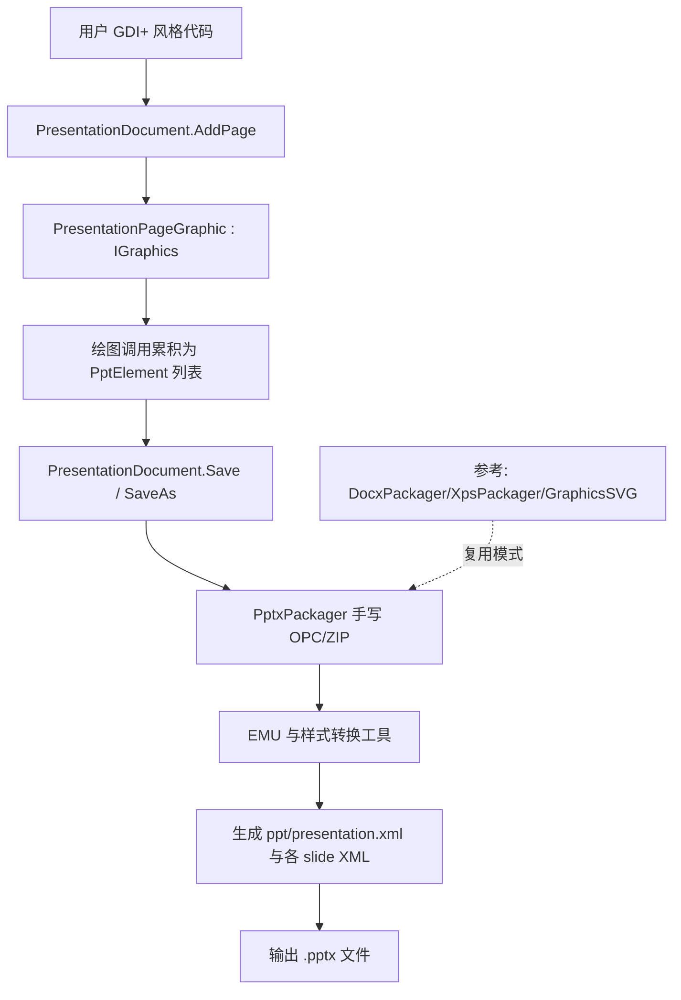

## 产品概述

在空白的 PPTX.vbproj 项目中实现一个面向 .pptx 幻灯片文件的生成模块。核心是提供类似 GDI+ Graphics 的画布对象 PresentationPageGraphic：每个实例对应一张 PPT 幻灯片，用户通过熟悉的 DrawString、DrawRectangle、FillEllipse、DrawImage、DrawTable 等绘图调用，把形状、文本、图片、表格等元素"画"到页面上。另提供 PPT 文档对象统一管理多个页面，并导出为标准 .pptx 文件。

## 核心功能

- **GDI+ 风格画布**：覆盖 IGraphics 的全部绘图方法（线条、矩形、椭圆、多边形、曲线、贝塞尔、圆弧、饼图、路径、图片、文本等），以累积方式生成对应 PPT 元素；复杂几何以近似方式映射。
- **形状与文本元素**：DrawRectangle/FillRectangle/DrawEllipse/DrawString 等生成可编辑的 PPT 形状与文本框，保留位置、尺寸、填充色、描边、字体与颜色。
- **表格元素**：扩展 DrawTable(rect, data, style) 方法，直接生成 PPT 原生表格结构，支持单元格文本与基本样式。
- **图片元素**：DrawImage 将图片嵌入为 PPT 图片元素。
- **页面与尺寸**：默认 16:9 宽屏（10 × 5.625 英寸），构造时可传入自定义尺寸；一个画布实例即一张幻灯片。
- **文档对象**：AddPage 创建并管理页面列表，Save/SaveAs 将全部页面导出为合法 .pptx 文件。
- **变换与裁剪**：支持平移/缩放/旋转等变换（烘焙进坐标），裁剪以近似方式处理。
- **控制台测试**：用 DebugAudit 记录测试结果并生成报告，验证生成的 .pptx 结构与合法性。

## 技术选型

- **语言/框架**：VB.NET、net10.0（沿用 `PPTX.vbproj` 现有 TargetFramework，无新增 NuGet 依赖）。
- **绘图抽象**：复用 `Microsoft.VisualBasic.Core` 的 `IGraphics`（`G:\pixelArtist\src\framework\Microsoft.VisualBasic.Core\src\Drawing\GDI+\Interface.vb`）及 GDI+ 类型 Pen/Brush/Font/Color/PointF/RectangleF/Matrix2D。
- **打包与 XML**：`System.IO.Compression.ZipArchive` 手写 OPC/ZIP 包；`System.Xml.Linq.XDocument` 生成各部件 XML。
- **参考模式**：`DocxPackager`、`XpsPackager`、`Workbook`、`GraphicsSVG`、`GraphicsPostScript`。

## 实现策略

- **累积式画布**：参照 `GraphicsSVG`/`GraphicsPostScript`，IGraphics 每个绘图调用不立即光栅化，而是构造元素追加到内部列表 `Friend ReadOnly Elements As New List(Of PptElement)`；保存时由 PptxPackager 统一序列化。
- **全部方法落地**：约 100 个 MustOverride 按类别分组实现——基础属性；线条/形状；填充；文本；图片；路径/曲线；裁剪/变换；状态测量。矩形、椭圆、直线、多边形、Image、字符串映射为原生 PPT 元素；Arc/Bezier/Curve/Pie/Path 采样为自由形状或多段线近似；Clear/Clip/Transform 以背景色与 Matrix2D 变换状态烘焙进坐标（参照 PostScript 的 tf()）；MeasureString 委托 `DriverLoad.MeasureTextSize`。
- **Driver 处理**：`Driver` 属性返回最小耦合的现有值（优先 `Drivers.Default`），不修改 `Drivers.vb` 枚举以避免跨项目影响；实现前先确认 IGraphics 内部对 Driver 的引用点。
- **坐标换算**：画布内部沿用 100 dpi 像素；写出时 EMU = px / dpi × 914400（100 dpi 下 1 px = 9144 EMU），统一收敛到转换工具，避免散落魔法数。
- **样式映射**：Color → srgbClr 的 RRGGBB；Pen 宽度 pt → EMU；Font → rPr（latin typeface、sz 百磅、b/i）；Brush 支持纯色填充。

## 架构设计

用户代码调用 PresentationDocument.AddPage 得到 PresentationPageGraphic，绘图调用累积为 PptElement 列表；Save 时 PptxPackager 遍历页面与元素，经 EMU/样式转换写出 PPTX 各部件并打包。



## 目录结构

```
G:\pixelArtist\src\framework\mime\application%vnd.openxmlformats-officedocument.presentationml.presentation\
├── PPTX\
│   ├── PresentationPageGraphic.vb   # [MODIFY] 核心画布：实现 Size/Driver/RenderingOrigin/TextContrast；全部 IGraphics override 累积为 PptElement；Matrix2D 变换烘焙；新增 DrawTable；Friend Elements 暴露给打包器；新增默认/自定义尺寸构造。
│   ├── PptElements.vb               # [NEW] PptElement 基类及 Shape/Text/Image/Table 元素类型；封装 GDI+ 颜色、Pen、Brush、Font 到 DrawingML 属性的映射与 EMU 换算；PptTableStyle 定义。
│   ├── PresentationDocument.vb      # [NEW] 文档对象：Pages 列表、默认 16:9 与可配置尺寸、AddPage/RemovePage、Save(filePath)/SaveAs(stream)；保存委托 PptxPackager。
│   ├── PptxPackager.vb              # [NEW] 手写 OPC/ZIP 打包：Content_Types、_rels、docProps、presentation.xml、slideMaster/Layout/theme 最小集、逐页 slide XML 及其 rels、media 图片；XDocument 序列化各 PptElement 为 DrawingML（形状/文本/graphicFrame 表格/pic）。
│   └── PPTX.vbproj                  # [MODIFY, 视需要] 仅当显式 Imports 或编译项需要时微调；保持现有 4 个 ProjectReference 不变。
└── test\
    ├── Program.vb                   # [MODIFY] 控制台测试：创建文档、多页绘制形状/文本/表格/图片、保存 pptx；用 DebugAudit.Snapshot/Test/AreEqual/Dump/SaveReport 记录结果并生成报告；校验 zip 部件存在。
    └── test.vbproj                  # [MODIFY, 视需要] 保留对 PPTX.vbproj 与 Core.vbproj 的引用以支持 DebugAudit。
```

## 关键代码结构

```
' 文档对象公开契约
Public Class PresentationDocument
    Public ReadOnly Property Pages As IReadOnlyList(Of PresentationPageGraphic)
    Public Function AddPage(Optional size As Size = Nothing) As PresentationPageGraphic
    Public Sub Save(filePath As String)
    Public Sub SaveAs(destination As Stream, Optional leaveOpen As Boolean = False)
End Class

' 元素累积基类（内部契约）
Public MustInherit Class PptElement
    Public MustOverride Sub WriteTo(slide As XElement, ctx As PptxWriteContext)
End Class

' 表格绘制（PresentationPageGraphic 新增成员）
Public Sub DrawTable(rect As Drawing.RectangleF, data As String(,), Optional style As PptTableStyle = Nothing)
```

## 实现注意事项

- **性能**：Save 时一次性遍历元素生成 XML，避免逐元素重复解析命名空间；图片字节只写入 media 一次并复用 relationship id；大页数/多元素场景用 XDocument/XmlWriter 构建而非字符串拼接。
- **日志**：测试项目复用 `ApplicationServices.Debugging.DebugAudit`，记录保存结果与元素数量；库代码不输出高频日志或敏感内容。
- **影响范围**：仅改动 PPTX 与 test 项目；保留 PresentationPageGraphic 无参构造兼容；不改动 Core 的 IGraphics/Drivers 定义。
- **近似语义**：Arc/Bezier/Curve/Pie/Clip 等以采样折线或忽略方式实现，在 XML 文档注释中明确标注，避免调用方误用。

## Agent Extensions

### Skill

- **pptx**
- Purpose: 提供权威的 PPTX/OOXML 结构知识——[Content_Types].xml、presentation.xml、slide XML、rels、最小 theme/slideMaster/slideLayout 集，以及 DrawingML 中形状、文本、表格、图片的序列化方式。
- Expected outcome: 产出可被 PowerPoint 正常打开的部件结构与 DrawingML 映射方案，指导 PptElements 与 PptxPackager 的正确实现。

### SubAgent

- **code-explorer**
- Purpose: 深入核查 DocxPackager/XpsPackager 的 Zip+XML 写入助手，以及 GDI+ 中 Pen/Brush/Font/Color 到样式属性的转换与 MeasureString 复用点。
- Expected outcome: 输出可复用的现有工具方法、路径与命名空间常量清单，最大化代码复用、减少重复实现。