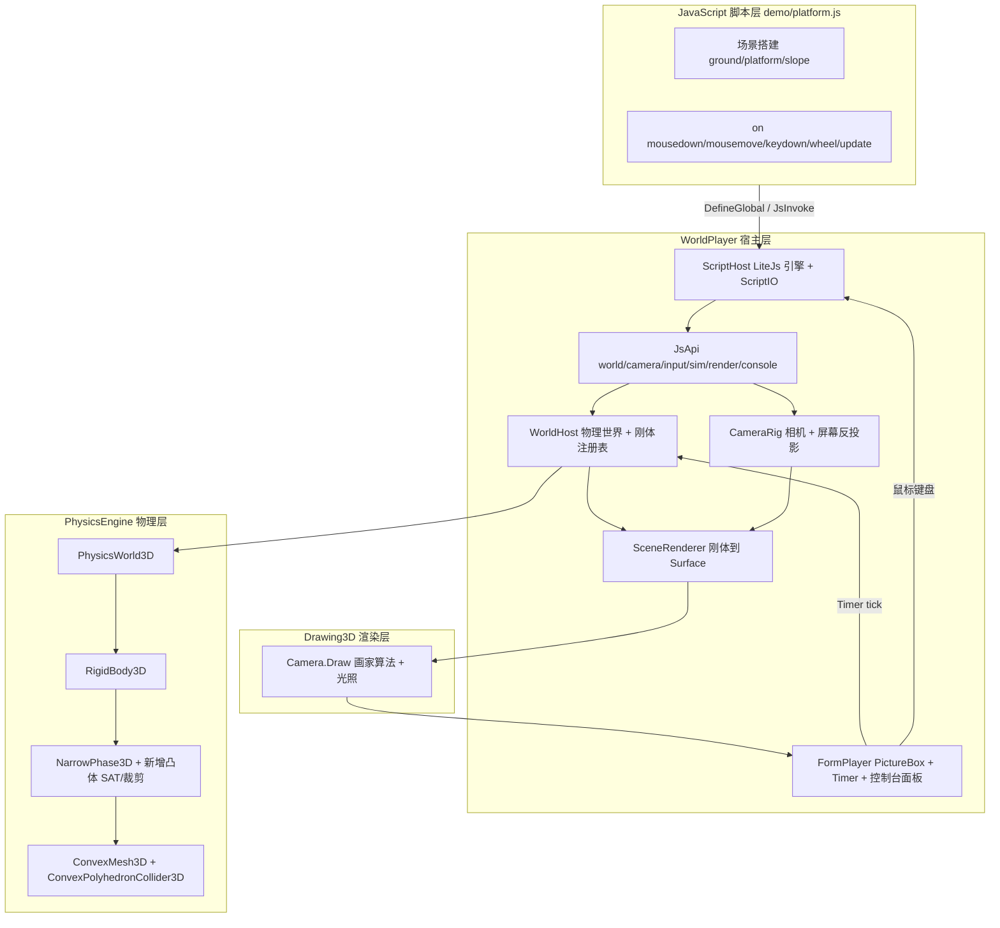

## 产品概述

把 `WorldPlayer`（VB.NET WinForms）构建成一个"由 JavaScript 脚本定义并驱动的三维物理世界模拟器"：宿主只提供引擎外壳与 API，场景搭建、物体创建、鼠标/按键交互逻辑全部由 JS 脚本编写；脚本运行后可实时观察三维世界中物体在重力下的下落、碰撞、滑动与翻滚。

## 核心功能

1. **脚本定义场景**：JS 脚本描述重力、地面、平台、斜面、静态与动态刚体（立方体、长方体、四面体、圆球、圆锥、圆柱），并指定材质（摩擦/弹性）、质量、初速度。
2. **完整的 JS 宿主 API**：`world`（增删查物体、材质、力、冲量）、`camera`（视角、屏幕→世界射线/平面反投影）、`input`（鼠标/键盘/滚轮事件回调）、`sim`（暂停/复位/重载/步进）、`render`（线框、网格、坐标轴、背景色、HUD 文本）、`console`（输出到宿主控制台面板）。
3. **事件钩子**：宿主把鼠标左键按下/移动/抬起、键盘、滚轮、每帧 update 全部 hook 进 JS 解释器，由 JS 决定行为（例如"在鼠标位置创建随机物体"），宿主不硬编码任何场景内容。
4. **物理仿真**：重力下落、与地面/平台/斜面/其他物体的碰撞约束、摩擦滑动、随机朝向导致的翻滚与转动、堆叠与静止。
5. **三维可视化**：深色科技风视口，实时渲染刚体（带光照与颜色）、地面网格、坐标轴、可选线框；右键拖拽轨道旋转、滚轮缩放；状态栏显示帧率、物体数、仿真步数。

## 测试 Demo

三维场景中有一座**带斜面的平台**（平台顶面 + 斜坡）。用户按下鼠标左键，在鼠标所指的三维位置创建随机类型（立方体/长方体/四面体/圆球/圆锥/圆柱）、随机尺寸、随机朝向、随机颜色的物体；物体在重力下落到地面、平台或斜面上，受接触面约束产生位移与旋转——全部逻辑写在 JS 中。

## 技术栈

- 宿主：`WorldPlayer.vbproj`（net10.0-windows，UseWindowsForms + UseWPF，VB.NET）
- 物理：`Engine/PhysicsEngine.vbproj`（net10.0，`Microsoft.VisualBasic.Engine.Physics`）—— 需扩充
- 脚本：`vs_solutions/JavaScript/LiteJs.vbproj`（net10.0，`Microsoft.VisualBasic.ApplicationServices.VM.JavaScript`）
- 渲染：`gr/Microsoft.VisualBasic.Imaging/imaging.NET5.vbproj` 的 `Drawing3D`（`Camera` + `Surface` + `PainterAlgorithm`，GDI+ 画家算法 + Lambert 光照）
- 无新增第三方依赖；LiteJs 需作为新的 ProjectReference 加入 WorldPlayer

## 实现思路

**总策略**：先在 PhysicsEngine 补齐"凸多面体"这条能力主线（这是 demo 成立的硬前提——当前盒-盒/盒-平面在 `NarrowPhase3D.vb:52-54` 静默返回 Nothing，立方体根本不会与地面/斜面碰撞），再在 WorldPlayer 做"LiteJs ↔ 物理世界 ↔ Drawing3D"三层桥接，最后用纯 JS 写 demo。

**关键技术决策**

1. **统一走凸多面体**：新增 `ShapeKind3D.Convex=4` + `ConvexPolyhedronCollider3D`（顶点 + 面索引）。盒=8 顶点 6 面凸体，四面体=4 面，圆锥=N 边棱锥，圆柱=N 边棱柱。于是"盒-盒 / 盒-凸 / 凸-凸"共用同一套 SAT 例程，只需写一次；球保留解析 `SphereCollider3D` 并新增"球-凸"例程。
2. **SAT + 面裁剪生成接触流形**：候选轴 = A 面法向 + B 面法向 + A 边×B 边（跳过近平行轴），取最小穿透轴；选出参考面（法向与分离轴最接近）与入射面（法向最反平行），用 Sutherland–Hodgman 把入射面多边形裁剪到参考面侧面内，保留穿透 > 0 的点（上限 4 个）。这是 Box2D/Box3D 的成熟做法，能得到"面-面"多点流形，盒子才能稳稳坐在斜面/平台上而不是抖动。
3. **回退路径**：若裁剪退化（点数 0 或数值异常），回退为"顶点穿透法"——取入射体穿透到参考体内部的顶点作为接触点，保证任何情况下都有可用流形，避免物体穿透掉落。
4. **稳定性增强**：`Manifold3D.InitSolver` 现在每帧把累积冲量清零（无 warm starting），堆叠会抖。在 `PhysicsWorld3D` 增加按刚体对 ID 的接触缓存，新接触点按位置就近继承上帧 `NormalImpulse/TangentImpulse*`。同时加入保守休眠（线速度 < 0.08、角速度 < 0.15 持续 0.6s 冻结），既防抖又省 CPU。
5. **渲染**：不自己写光栅化，直接复用 `Camera.Draw(g, surfaces, drawPath, illumination)`（内部 Parallel 旋转 + 画家算法排序 + 光照）。每帧把刚体的局部网格经四元数变换到世界，再按 **Y-up → 渲染空间旋转** `Point3D(phys.x, -phys.z, phys.y)`（det=+1 的真旋转，避免镜像导致法向/光照翻转与左右手错乱）生成 `Surface`。球体自行生成 UV 球面网格（12×8），与凸体统一走同一渲染管线。
6. **鼠标拾取**：`Camera` 没有 LookAt/Unproject，宿主用相机欧拉角构造与 `Camera.vb:189-210` 完全等价的旋转矩阵 M（行向量约定），用 Mᵀ 做反投影：`Xc=(sx-W/2-offX)·(VD+Zc)/fov`，取 Zc=0 与相机位置 (0,0,-VD) 组成射线，再与 JS 指定平面求交，暴露为 `camera.screenToPlane(...)`。
7. **JS 桥接形态**：LiteJs 无反射绑定，唯一可调用形态是 `Func(Of Object(), Object)`；对象必须用 `Dictionary(Of String, Object)` 表示。故 API 全部实现为"字典 + lambda"的对象树，事件用 `on(name, fn)` 注册到宿主字典，宿主在 WinForms 事件中以 `JsRuntime.JsInvoke` 回调。所有跨越边界的数值统一 `CDbl`。

## 实现要点（防回归）

- **不改 2D**：只动 `Collision3D/`、`RigidBody3D/`、`PhysicsWorld3D.vb`；`PhysicsWorld.vb`(2D) 与 `Collision/`、`Joints/`、`ForceFields/` 一律不碰，避免波及既有用户。
- **枚举顺序**：`ShapeKind3D` 的枚举值即窄相位"规范顺序"，`Convex` 必须追加为 4（大于 Box/Plane），分派交换时法向 A→B 不可再取反（`NarrowPhase3D.vb:28-32` 已有说明）。
- **性能**：宽相位是 O(n²)，demo 设物体上限（默认 300，超限回收最老）；渲染面数控制（圆锥/圆柱 12 段、球 12×8）；`RigidBody3D.InvInertiaWorld()` 当前每次调用都重算矩阵求逆，改为按 `Orientation` 缓存并在姿态变化时失效。
- **JS 数值**：宿主→JS 一律 `Double`（`IsNumber` 只认 Double，传 Integer 会退化）；返回空用 `JsRuntime.Undef`。
- **线程**：全部 JS 调用在 UI 线程串行执行（`JsRuntime.Io` 是 Module 静态属性，单引擎安全；勿多线程）。宿主 lambda 内自行 Try/Catch，把异常转成控制台错误文本而不是崩溃。
- **日志**：JS `console.log` 通过自定义 `ScriptIO` 子类写入宿主面板，限流（>500 行滚动截断）避免刷屏卡 UI。
- **回退开关**：`world.warmStarting(bool)`、`render.wireframe(bool)` 等可在 JS 侧关闭，便于定位物理问题。

## 架构设计



## 目录结构

```
physics/
├── Engine/                                        # PhysicsEngine.vbproj（扩充）
│   ├── Collision3D/
│   │   ├── Collider3D.vb                          # [MODIFY] ShapeKind3D 增加 Convex=4；新增 ConvexPolyhedronCollider3D（顶点/面/面法向/边表缓存、ComputeInertia、GetAABB、Support）
│   │   ├── ConvexMesh3D.vb                        # [NEW] 凸网格数据结构（Vertices/Faces）+ 工厂 CreateBox/CreateTetrahedron/CreateCone/CreateCylinder/CreateSphereMesh + 体积与惯量张量（以质心为顶点的四面体分解求和）
│   │   ├── ConvexNarrowPhase3D.vb                 # [NEW] ConvexConvex（SAT 轴枚举 + 参考面/入射面裁剪 + 顶点穿透回退）、ConvexPlane（顶点投影）、SphereConvex（最近点/浅面法向）、BoxConvex 共享例程
│   │   └── NarrowPhase3D.vb                       # [MODIFY] 分派新增 Box-Box、Box-Convex、Box-Plane、Convex-Convex、Convex-Plane、Sphere-Convex 分支
│   ├── RigidBody3D/RigidBody3D.vb                 # [MODIFY] 逆世界惯量按姿态缓存；新增休眠状态字段与 SleepTime；修正 KineticEnergy 用 InertiaWorld
│   ├── PhysicsWorld3D.vb                          # [MODIFY] Convex()/StaticConvex() 工厂、Remove(body)/Remove(label)/Clear()、按 ID/Label 索引、接触缓存 warm starting、AllowSleep 与休眠扫描、Bounds 越界回收
│   └── test/ConvexSelfTest/                       # [NEW] 控制台自测工程：盒落地静止、斜面不穿透与下滑、球-凸、惯量对称正定、SAT 深穿透、warm starting 收敛
└── WorldPlayer/                                   # WorldPlayer.vbproj（构建）
    ├── WorldPlayer.vbproj                         # [MODIFY] 新增 LiteJs.vbproj 引用；demo/*.js 以 CopyToOutputDirectory 复制到输出
    ├── FormPlayer.vb / FormPlayer.Designer.vb     # [MODIFY] PictureBox 视口 + 控制台面板 + 工具栏（打开脚本/重载/暂停/线框/清空）+ 状态栏 + Timer(16ms)
    ├── Scripting/
    │   ├── ScriptHost.vb                          # [NEW] LiteJs 封装：新建/销毁引擎、Parse+Run、异常转译、事件表与 JsInvoke 回调驱动
    │   ├── UiScriptIO.vb                          # [NEW] ScriptIO 子类，把 console.log 写入宿主控制台面板（滚动截断）
    │   └── JsApi.vb                               # [NEW] 构建 JS 全局对象树（world/camera/input/sim/render/console/on），全部 Func(Of Object(), Object)
    ├── World/
    │   ├── WorldHost.vb                           # [NEW] 持有 PhysicsWorld3D；刚体注册表（id→BodyVisual）；spawn/remove/clear；越界剔除；update 事件与物理步进
    │   └── BodyVisual.vb                          # [NEW] id/label/body/render mesh/color/wireframe 标记
    ├── Rendering/
    │   ├── CameraRig.vb                           # [NEW] 包装 Drawing3D.Camera；轨道旋转/缩放；复刻旋转矩阵并做屏幕→射线/平面反投影
    │   ├── MeshLibrary.vb                         # [NEW] 渲染网格生成（复用物理 ConvexMesh3D + UV 球面）、调色板、地面网格与坐标轴
    │   └── SceneRenderer.vb                       # [NEW] 每帧把刚体网格变换为 Surface（Y-up→渲染映射），调用 Camera.Draw，绘制 HUD
    └── demo/platform.js                           # [NEW] 测试 Demo：地面 + 带斜面平台 + 左键生成随机刚体 + 按键清空 + HUD（全部 JS）
```

## 关键代码结构

```
' Engine/Collision3D/ConvexMesh3D.vb —— 物理与渲染共享的网格契约
Public Class ConvexMesh3D
    Public Property Vertices As Vector3()      ' 局部坐标，质心为原点
    Public Property Faces As Integer()()       ' 每个面的顶点索引，按外向法右手序
    Public ReadOnly Property FaceNormals As Vector3()   ' 缓存
    Public Shared Function CreateBox(w As Double, h As Double, d As Double) As ConvexMesh3D
    Public Shared Function CreateTetrahedron(size As Double) As ConvexMesh3D
    Public Shared Function CreateCone(radius As Double, height As Double, Optional seg As Integer = 12) As ConvexMesh3D
    Public Shared Function CreateCylinder(radius As Double, height As Double, Optional seg As Integer = 12) As ConvexMesh3D
    Public Shared Function CreateSphereMesh(radius As Double, Optional segU As Integer = 12, Optional segV As Integer = 8) As ConvexMesh3D ' 仅渲染
    Public Function Volume() As Double
    Public Function InertiaAboutCentroid(mass As Double) As Matrix3x3   ' 四面体分解求和
End Class
```

```javascript
// demo/platform.js —— 宿主暴露给 JS 的全局 API 契约（宿主零硬编码场景）
world.gravity(0, -9.81, 0);
world.ground(0);                                  // 无限地面 y=0
world.addStaticBox({x:0,y:1,z:0, w:14,h:2,d:14, color:"#334155"});   // 平台
world.addStaticConvex("wedge", {x:0,y:0,z:0, mesh:"slope", ...});    // 斜面
var id = world.addBox({x:px,y:py,z:pz, w:1.2,h:1.2,d:1.2, mass:2,
                       rot:{axis:[ax,ay,az], angle:rad}, color:"#22D3EE"});
world.addSphere({...}) / addCylinder / addCone / addTetra / addCuboid
world.remove(id); world.clear(); world.count(); world.get(id);
camera.orbit(dx, dy); camera.zoom(d); camera.screenToPlane(sx, sy, nx,ny,nz, d);
sim.pause(); sim.resume(); sim.reset(); sim.reload();
render.wireframe(false); render.grid(true); render.background("#0B1220"); render.hud("...");
on("mousedown", function (x, y, button) { /* 左键在鼠标位置生成随机刚体 */ });
on("mousemove", function (x, y, dx, dy, button) { });
on("keydown", function (key) { });  on("wheel", function (delta) { });
on("update", function (dt) { });    on("reset", function () { });
```

## 设计风格

深色科技/工程仿真风格（Dark Technical HUD）。整体冷色深蓝底 + 青色高亮，视口为主，控制台为副，营造"物理仿真工作台"的专业感。

## 页面规划（单窗口）

1. **顶部工具栏**：打开脚本 / 重载(F5) / 暂停 / 线框 / 清空物体 / 重置视角，右侧显示脚本名与运行状态（运行/暂停/错误）。
2. **主视口（左，占比约 72%）**：3D 画布（PictureBox Dock.Fill），绘制地面网格、坐标轴、平台与刚体；支持左键生成、右键拖拽轨道旋转、滚轮缩放；左上角叠加半透明 HUD（物体数、FPS、步数、JS 提示文本）。
3. **控制台（右，占比约 28%）**：深色等宽字体，显示 `console.log` 与脚本/物理错误（红色），自动滚动，上限 500 行。
4. **底部状态栏**：仿真时间、刚体数、接触数、帧率、当前脚本路径。

## 交互与动效

- 物体生成瞬间为高亮青色，随后渐变为本体颜色（用刚体"年龄"插值，纯 CPU，无需动画框架）。
- 休眠刚体降低饱和度，直观体现静止状态。
- 鼠标悬停视口显示十字准星提示；右键拖拽时相机平滑插值到目标角度（每帧 15% 缓动），避免生硬跳变。
- 脚本错误时控制台红色高亮并暂停仿真，工具栏状态变"错误"。

## 响应式

窗口可自由缩放，视口与控制台按 72/28 比例自适应；视口尺寸变化时同步 `Camera.Screen` 并重算投影中心，DPI 设为 PerMonitorV2 以避免高分屏模糊。

## Agent Extensions

### SubAgent

- **code-explorer**
- Purpose：在修改 PhysicsEngine 前，快速确认 `Collider3D`/`NarrowPhase3D`/`PhysicsWorld3D` 的全部调用点与既有测试工程，避免破坏 2D 路径与既有用户代码
- Expected outcome：得到一份受影响文件清单与"不可改动"边界，确保新增 Convex 分支只做加法

### Skill

- **lsp-code-analysis**
- Purpose：实现 JS 桥接层与渲染层时，跳转核对 LiteJs 的 `Interpreter/Parser/JsRuntime/Runtime` 与 Drawing3D 的 `Camera/Surface/PainterAlgorithm` 的真实符号与重载，确认签名无误
- Expected outcome：消除 API 猜测，保证 `DefineGlobal`、`JsInvoke`、`Camera.Draw`、`SolidBrush` 等调用一次编译通过