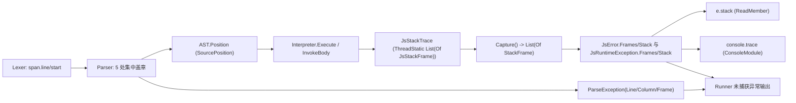

## 产品概述

为 VB.NET 编写的 LiteJs（JavaScript 解释器）补上 JS 源码级堆栈追踪：解释器执行期间维护真实的 JS 调用帧（函数名 + 文件 + 行 + 列），并复用底层库 `Microsoft.VisualBasic.ApplicationServices.Debugging.Diagnostics.StackFrame` 对象保存帧信息。所有栈文本按 Node 风格渲染：首行 `Name: message`，随后每帧一行     `at 函数名 (文件:行:列)`。

## 核心功能

- **真实 JS 帧栈**：函数调用（含匿名/箭头函数、方法调用、回调、generator/async 包装体）进出时压栈/出栈；逐语句记录当前行列，异常发生时帧指向真正出错的那一行。
- **console.trace 显示 JS 栈帧**：替换现有     `at <anonymous>` 占位实现，输出 label + 真实帧列表（保持 `trace` 级别与洋红着色）。
- **throw / 错误对象带 JS 栈**：
- 引擎错误（TypeError / ReferenceError / RangeError / SyntaxError）与脚本 `new Error('x')` / `Error('x')`（无 new）均在构造时冻结当前位置帧；
- `e.stack` 返回 Node 风格完整栈；`String(e)` 仍为 `"Name: message"`（不破坏既有输出）；
- 非 Error 的 `throw 'str'` / `throw 42`：脚本侧 `e.stack` 不适用（与 Node 一致），但宿主侧异常对象仍携带帧栈。
- **语法错误带位置**：`ParseException` 结构化保存行列并提供位置帧，宿主（LiteJs.Runner）渲染为 `SyntaxError: msg` + 位置帧，退出码 1。
- **未捕获异常输出完整栈**：Runner 的 `Catch ex As JsRuntimeException` 由只打印 message 改为打印 Node 风格完整栈。
- **Node 扩展 API**：`Error.captureStackTrace(obj, ctor?)` 把当前栈写入目标对象的 `stack` 属性；`Error.stackTraceLimit = N` 控制帧数量上限（0/负数表示不限，默认 10）。
- **try/catch 中栈依然正确**：帧在错误构造时冻结，`catch(e){ console.log(e.stack) }` 输出与抛出点一致，不受后续出栈影响。

## 视觉/输出效果

- `--plain` 后端输出可与真实 Node 输出逐行对照，例如：
`TypeError: x is not a function`
`at inner (demo.js:12:9)`
`at map (demo.js:15:3)`
`at <anonymous> (demo.js:18:1)`
- `--ansi` 后端下 `console.trace` 的标题沿用洋红级别着色，帧文本为普通前景色。

## 已知限制（本轮明确范围）

- 仅**解释器执行路径**有完整 JS 帧。CodeGenerator 转译出的独立 VB.NET 类运行时栈为空，只显示单个     `at <generated>` 占位帧；生成代码文本与其快照断言保持逐字不变。
- 语法错误只提供单帧（出错位置的 token 行列）。

## 技术栈选择

- 语言/平台：沿用 VB.NET（`OptionStrict On`/`OptionExplicit On`）、net10.0、`JavaScript\LiteJs.vbproj`。SDK 默认通配编译，新增 `.vb` 文件无需改 vbproj，**不新增任何引用**（Core 已在引用列表中）。
- 复用底层对象（用户指定）：`Microsoft.VisualBasic.ApplicationServices.Debugging.Diagnostics.StackFrame`（可继承、含 `Sub New()` 与 `Sub New(clone)`）与其配套 `Method`（同类文件 `ApplicationServices\Debugger\Exception\MethodFrame.vb`）；`Method` 的 `New(s)` 会按 `.` 拆分，JS 函数名可能含 `.`，因此必须用属性初始化器逐字段赋值。
- 位置来源：`Token` 继承 `CodeToken(Of TokenType)`，其 `span.line` / `span.start` 已是 1 基行列（`Token.Location` 即 `"{line}:{start}"`），无需改动词法器即可拿到位置。

## 实现方案

整体为「位置信息 → 帧载体 → 解释器切面 → 错误冻结 → 宿主渲染」五段式，不引入新架构模式。

1. **位置信息（AST 轻量盖章）**：新增 `SourcePosition` 结构（`Line`/`Column`/`None`），给 `Expression`、`Statement` 两个空基类各加一个可写 `Position` 属性（默认 `None`）。解析器**只在 5 个集中入口**盖章：`ParseStatement`（语句，供逐行位置）、`ParseCallOrMember`（调用点，写入 `CallExpr.Position`）、`ParseFunctionRest` / `ParseMethodBody` / `ParseArrowBody`（函数体位置，写入 `FuncExpr.Position`）。**不给节点构造函数加参数**，避免几十处签名连锁改动。`ParseFunctionDecl` / `ParseClassDecl` 用已有名字补全帧名。
2. **帧载体 `Runtime\JsStackTrace.vb`**：`JsStackFrame : Inherits StackFrame`，额外保存 `FunctionName` 与 `Column`（Core 的 `StackFrame` 只有 `File`/`Line(String)`/`Method`）；线程静态 `List(Of JsStackFrame)` 帧栈，提供 `PushFrame`/`PopFrame`/`UpdatePosition`/`Capture`/`Reset` 与 `StackTraceLimit`，并提供 Node 风格 `Format`/`FormatWithHeader`。`Capture()` 返回 `List(Of StackFrame)`（子类实例，栈顶在最前，尊重 `StackTraceLimit`，深度上限 500 超出后附 `... (N frames truncated)`）。
3. **解释器切面**：`Interpreter.SourceFile`（默认 `ProcessModule.ScriptFile`，空则渲染为 `<anonymous>`）；`Run(program)` 起始 `Reset()` + 压入根帧（`<anonymous>`），`Try ... Finally` 中弹帧并清零；`Execute(s, env)` 进入前写栈顶帧行列（纯整型字段写入）；`InvokeBody(f, closure, args)` 用 `Try ... Catch ReturnSignal ... Finally PopFrame()` 保证异常/返回展开时帧正确回退。可选增强：`EvalCall` 设置线程静态「待定被调名」，使 `arr.map(function(){})` 的帧名显示 `map`（Node 的名字推断），必须在正常与异常路径都清除该提示。
4. **错误冻结栈**：`JsError` 增加 `Frames As List(Of StackFrame)` 与 `Stack As String`（Node 风格），并提供 `Capture(name, message, original, frames)`（`frames` 为 Nothing 时取 `JsStackTrace.Capture()`）；`JsRuntimeException` 增加 `Frames` / `Stack` / `FullMessage`，构造函数加 `Optional frames As List(Of StackFrame) = Nothing`（Nothing 时自动捕获；payload 是 `JsError` 时沿用其 `Frames`，避免二次捕获）。由此 `FsModule`、`ClrInterop`、`ResolveHostGlobal`、`throw` 等所有既有构造点自动获得帧栈，无需逐处修改。
5. **接入 JS 可见面**：`ReadMember` 的 `JsError` 分支 `Case "stack"` 由 `err.ToString()` 改为 `err.Stack`（`JsStr`/`DisplayJson`/`console.log(e)` 的退化路径仍走 `ToString()`，逐字不变）；`ConstructBuiltin` 与 `BuiltinErrorCtor` 的 Error 族改用 `JsError.Capture(...)`；仿 `_mathProps` 增加 `Error` 静态属性表（`stackTraceLimit`），并在 `JsSet` 中为 `NativeObject` 增加写回分支，使 `Error.stackTraceLimit = 3` 生效；`Error.captureStackTrace(obj, ctor?)` 走 `BuiltinErrorCtor` 的分发。
6. **渲染与宿主**：`ConsoleModule.Trace` 用 `JsStackTrace.Capture()` + Node 格式化替换占位（无帧时输出 `<generated>`）；`LiteJs.Runner` 的 `Catch ex As JsRuntimeException` 打印 `ex.Stack`，新增 `Catch ex As ParseException` 打印 `SyntaxError: msg` + 位置帧（退出码 1），`--html/--plain/--ansi` 与 Finally 落盘逻辑不动。

## 实现要点（执行细节）

- **性能**：`Execute` 是解释器最热路径（每条语句一次），位置戳记只允许「一次 `SourceFile` 状态判断 + 两个整型字段写入」，禁止分配/字典/字符串拼接；push/pop 为 `List` 尾部操作；帧复制只在错误构造与 `console.trace` 时发生。
- **线程安全**：帧栈必须 `<ThreadStatic>`（VB 的 `<ThreadStatic>` 字段不能带初始化器，沿用 `_io`/`_thisValue` 的惰性 getter 写法），保证同进程多引擎互不串栈；`Reset()` 挂在 `Interpreter.Run` 起始，并在 `JsRuntime.Io` 的 setter 中兜底。
- **VB 陷阱**：`Exception` 已有 `StackTrace` 属性，故 `JsRuntimeException` 上的新成员必须命名为 `Stack`/`Frames`/`FullMessage`（不得用 `StackTrace`）；`StackFrame.Line` 是 `String`，写时用 `InvariantCulture` 数字字符串以保持 `GetBreakpointHashCode` 可用；`Method` 类型是 `...Debugging.Diagnostics.Method`（不是 `Language.Java.Method`），用 `New Method With {.Method = name, .[Module] = "", .[Namespace] = ""}` 赋值以免被 `.` 拆分；`StackFrame.ToString()` 是 `"Method at File:line Line"` 风格，**不得**用于本轮的 Node 风格渲染。
- **blast radius 控制**：不修改 `CodeGenerator.vb` 与其生成代码文本（`test\artifacts\GeneratedScript.vb` 及 `NodeApiCodegenTests`/`ArtifactSyncTests`/`LiteJsClrInteropTests` 的签名断言必须原样通过）；`JsRuntimeException.Message`/`Describe`、`JsError.ToString()`、`JsStr(JsError)`、`console.log` 的格式说明符行为一律保持不变；既有测试文件不改动；不删除 `.codebuddy`。
- **栈正确性**：帧在错误**构造时**冻结（`e.stack` 是快照），因此 `try { f() } catch(e) { console.log(e.stack) }` 在帧已弹空后依然正确 —— 验证时必须专门覆盖该场景。
- **兜底**：`PopFrame` 下溢静默忽略；`Capture()` 对空帧返回空列表而非 `Nothing`；`SourceFile` 为 Nothing/空串时统一渲染 `<anonymous>`。

## 架构设计



## 目录结构

```
JavaScript/
├── Runtime/
│   ├── JsStackTrace.vb        # [NEW] JsStackFrame(继承 Core StackFrame, +FunctionName/Column) 与线程静态帧栈：
│   │                          #   PushFrame/PopFrame/UpdatePosition/Capture/Reset、StackTraceLimit、
│   │                          #   Node 风格 Format/FormatWithHeader（4 空格缩进 + "at fn (file:line:col)"，
│   │                          #   无帧时 "<generated>"，文件名缺省 "<anonymous>"，深度上限 500 + truncated 标记）。
│   │                          #   复用 ApplicationServices.Debugging.Diagnostics.StackFrame/Method；VB 陷阱：
│   │                          #   ThreadStatic 不能带初始化器、Line 是 String、Method 需属性初始化器赋值
│   ├── JsError.vb             # [MODIFY] 新增 Frames/Stack 与 Shared Capture(...)；ToString() 保持 "Name: message" 逐字不变
│   ├── JsRuntimeException.vb  # [MODIFY] 新增 Frames/Stack/FullMessage；ctor 增 Optional frames（Nothing 时自动捕获，
│   │                          #   payload 为 JsError 时沿用其 Frames）；Message/Describe 不变；避免与 Exception.StackTrace 重名
│   ├── ConsoleModule.vb       # [MODIFY] Trace 用 JsStackTrace.Capture + Node 格式化替换 "    at <anonymous>" 占位，
│   │                          #   保留 level="trace" 与 label 语义
│   └── Runtime.vb             # [MODIFY] ReadMember 的 JsError 分支 stack -> err.Stack；ConstructBuiltin 的 Error 族
│                              #   与 BuiltinErrorCtor 改用 JsError.Capture；新增 Error 静态属性表(stackTraceLimit)
│                              #   与 captureStackTrace 分发；JsSet 为 NativeObject 增加写回分支使 stackTraceLimit 可赋值；
│                              #   Io setter 兜底 JsStackTrace.Reset()
├── Language/
│   ├── SourcePosition.vb      # [NEW] SourcePosition 结构（Line/Column/None，可为空判定）
│   ├── ParseException.vb      # [MODIFY] 新增 Line/Column 与位置帧（保留 New(message) 重载，兼容既有 throw 点）
│   ├── Parser.vb              # [MODIFY] 在 ParseStatement / ParseCallOrMember / ParseFunctionRest /
│   │                          #   ParseMethodBody / ParseArrowBody 五处集中盖章 Position；语法错误统一带行列
│   └── Lexer.vb               # [MODIFY] ParseException 抛点改为带行列的结构化构造（已有 _line/_col 可用）
├── AST/
│   └── Ast.vb                 # [MODIFY] Expression 与 Statement 基类各加可写 Position As SourcePosition（默认 None）
└── Interpreter.vb             # [MODIFY] 新增 SourceFile；Run 内 Reset + 根帧 <anonymous> + Finally 清理；
                               #   Execute 前写栈顶帧行列；InvokeBody push/PopFrame(Finally)；
                               #   EvalCall 可选设置被调名提示以复现 Node 的名字推断
└── LiteJs.Runner/
    └── Program.vb             # [MODIFY] Interpreter.SourceFile = scriptPath；未捕获异常打印 Node 风格完整栈；
                               #   新增 Catch ex As ParseException -> "SyntaxError: msg" + 位置帧，退出码 1
```

## 关键代码结构

```
' Language\SourcePosition.vb —— AST 位置戳记（解析器盖章、解释器逐语句更新）
Public Structure SourcePosition
    Public ReadOnly Line As Integer
    Public ReadOnly Column As Integer
    Public Shared ReadOnly None As New SourcePosition(0, 0)
    Sub New(line As Integer, column As Integer)
    Public ReadOnly Property HasValue As Boolean      ' Line > 0
End Structure
```

```
' Runtime\JsStackTrace.vb —— 复用 Core StackFrame 保存帧信息（增加列号与 JS 函数名）
Public Class JsStackFrame
    Inherits Microsoft.VisualBasic.ApplicationServices.Debugging.Diagnostics.StackFrame

    Public ReadOnly Property FunctionName As String     ' JS 函数名，匿名 -> "<anonymous>"
    Public ReadOnly Property Column As Integer          ' Core StackFrame 无列号，Node 风格需要
End Class

Public Module JsStackTrace
    Public Property StackTraceLimit As Integer          ' 默认 10，<=0 表示不限
    Public ReadOnly Property Depth As Integer
    Public Function PushFrame(name As String, file As String, line As Integer, column As Integer) As JsStackFrame
    Public Sub PopFrame()
    Public Sub UpdatePosition(line As Integer, column As Integer)   ' 只写栈顶帧，热路径零分配
    Public Function Capture() As List(Of StackFrame)                ' 栈顶在最前，尊重 StackTraceLimit
    Public Sub Reset()
    Public Function Format(frames As List(Of StackFrame)) As String                       ' "    at fn (file:line:col)"
    Public Function FormatWithHeader(name As String, message As String,
                                     frames As List(Of StackFrame)) As String             ' Node 风格两段式
End Module
```

## Agent Extensions

### SubAgent

- **code-explorer**
- Purpose: 以 medium 力度复核两类易漏清单：①`Parser.vb`/`Lexer.vb` 中所有 `ParseException` 抛点与 5 个盖章入口的真实上下文（确认 `span.line`/`span.start` 取用方式、匿名函数与命名函数的构造路径），②全仓库所有 `New JsRuntimeException(` / `New JsError(` 构造点，确认「在 ctor 内自动捕获帧」不会遗漏或重复捕获，并核对既有测试对这些错误文本的断言。
- Expected outcome: 给出「必须保持不变的行为清单」与「需附加位置/帧的完整抛点清单」，避免改动后 117 个既有测试或生成代码文本快照回归。