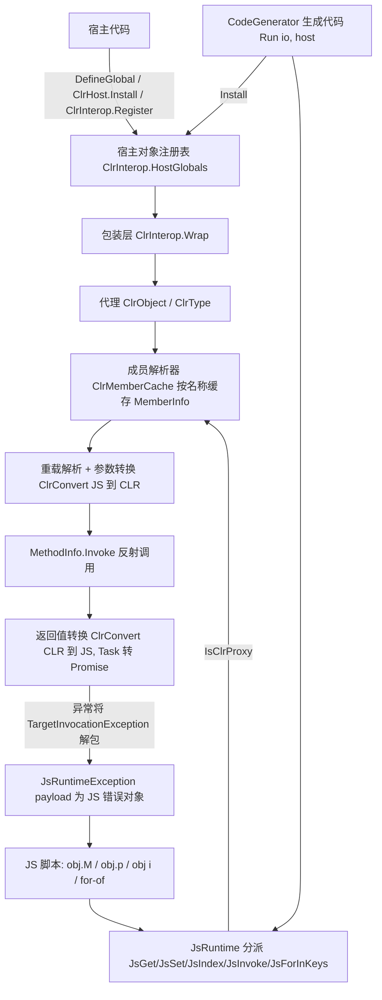

## Product Overview

为 JavaScript 引擎新增一个反射桥接能力：宿主可以把一个 .NET 对象实例（或一个类型）注入到脚本运行环境中，引擎通过反射自动获得其公开成员，使脚本能够像操作原生 JS class 实例一样操作该对象。该能力对两条执行路径（直接解释执行、脚本翻译为 .NET 代码后执行）行为完全一致。

## Core Features

- **注入对象**：宿主按名字把对象实例（或类型）放入 JS 全局环境，脚本中直接以该名字访问，无需额外声明。
- **属性与字段读写**：`obj.Name` 读取、`obj.Name = value` 写入；公开字段与公开属性同等对待；只读属性被写入、只写属性被读取时给出明确错误。
- **方法调用**：`obj.Method(a, b)` 支持继承来的方法；同名重载按实参数量与类型择优分派；支持变长参数（params）与可选参数。
- **静态成员与构造**：注入类型对象时，其静态成员可访问；`new` 可调用其构造函数创建实例，`instanceof` 可判定实例关系。
- **索引与集合**：`obj[i]` 走对象的索引器；可枚举对象能被 `for-of` 遍历、被展开运算符展开，`length` 给出元素数量；`for-in` 与 `Object.keys` 列出可见成员名。
- **通用工具一致**：`typeof` 返回 `object`，`console.log` 有可读显示，`JSON.stringify` 序列化可见成员（方法被跳过），`delete` 对桥接成员给出明确拒绝。
- **成员可见性控制**：默认暴露全部公开成员；可选标注机制用于隐藏成员、起别名或切换为"仅暴露显式标注成员"的白名单模式。
- **类型转换**：数字、字符串、布尔、空值与常见 .NET 基础类型（含枚举、日期、Guid、可空类型）双向转换；返回值中的嵌套对象继续以可点号访问的桥接对象返回。
- **异步与错误**：返回任务（Task）的方法结果表现为脚本 Promise；被调用方抛出的 .NET 异常变成脚本可捕获的错误对象（保留类型名与消息），也可从脚本再抛回宿主。
- **明确不支持**：把脚本函数转换为 .NET 委托（如回调式/LINQ 参数）暂不支持，命中时给出清晰的错误提示而非静默失败。

## 行为效果示意

脚本侧写法与普通 JS 对象无异：`host.title`、`host.title = 'x'`、`host.add(1, 2)`、`host.items[0]`、`for (const it of host.items) { ... }`、`if (o instanceof T)`、`try { host.boom(); } catch (e) { console.log(e.message); }`、`host.fetch().then(v => ...)`。

## Tech Stack Selection

- 语言/框架：沿用项目现有技术栈 —— VB.NET（net10.0），无新增 NuGet 包。
- 反射：`System.Reflection`（`Type`/`PropertyInfo`/`FieldInfo`/`MethodInfo`/`ConstructorInfo`/`ParameterInfo`），委托分派用 `MethodInfo.Invoke`；`System.Threading.Tasks` 处理 Task。
- 测试：现有 xUnit 工程 `JavaScript/test/LiteJs.Tests.vbproj`。
- 不改动 `Lexer/Parser/Token/TokenType`：本功能不引入新的 JS 语法，仅新增"值模型 + 运行时反射"，因此无需新 AST 节点，翻译路径天然复用同一套 `JsRuntime` 分派。

## Implementation Approach

核心思路是"**新增一种值模型参与者，并挂接到既有全部分派点**"，而不是新建独立执行通道：

1. **代理类型**：新增 `ClrObject`（包装 CLR 实例，值类型为装箱副本）与 `ClrType`（包装 `System.Type`）。二者都是独立类，*不继承* `Dictionary(Of String, Object)`/`List(Of Object)`，因此绝不会被现有 `IsJsObject`/`IsJsArray` 误判，只需在分派点显式加分支。
2. **单一分派入口**：所有成员读写/调用/枚举都收敛到新文件 `Runtime/ClrInterop.vb` 内的成员解析器。`Runtime.JsRuntime` 的 `JsGet/JsIndex/JsSet/JsSetIndex/JsInvoke/JsForInKeys/JsTypeOf/JsStr/JsTruthy/JsEq/JsStrictEq/JSON 序列化/delete/for-of 迭代` 只需在分支首位加 `If ClrInterop.IsClrProxy(x) Then ...`，逻辑集中、无重复实现（DRY + SoC）。
3. **宿主 API 三层**：`ClrInterop.Wrap/Unwrap`（显式包装/解包）、`ClrInterop.Register(name, value)`（进程级宿主对象注册表，解释器与生成代码共用）、`ClrHost`（批量 `Add` + `Install` 的便捷容器）。`Interpreter.DefineGlobal(name, value)` 对"非 JS 原生值"自动包装，保证既有调用点零改动即可用。
4. **成员缓存**：按 `Type` 缓存一次反射扫描结果（`Dictionary(Of String, ClrMemberSet)`，含属性/字段/方法集/索引器 + 特性别名/隐藏过滤）。热路径为字典查表，避免每次访问都走 `GetProperties()/GetMethods()`（反射枚举昂贵）；重载解析对"唯一候选"额外走 O(1) 快路径，多候选时才 O(m) 打分。
5. **类型转换与错误边界**：`ClrConvert` 负责双向转换、`TargetInvocationException` 解包、异常→脚本错误对象、Task→Promise。所有桥接调用抛出的 .NET 异常一律规范化为 `JsRuntimeException`（payload 为带 `name`/`message` 的 JS 错误对象，并保留原始异常供宿主回溯）——这是**必需**的，因为解释器与生成代码的 `catch` 都只识别 `JsRuntimeException` 并取其 `Payload`，原始异常会直接穿透脚本的 try/catch。
6. **翻译路径一致性**：本项目不新增 AST，翻译产物调用的是同一批 `JsRuntime` 入口，故收尾只需为生成的入口追加一个可选宿主注入参数，并让生成代码的"未知全局标识符"解析落到宿主注册表。演示脚本 `artifacts/demo.js` 与 `artifacts/GeneratedScript.vb` 同步更新（`ArtifactSyncTests` 做字节一致校验，用 `LITEJS_REGEN_ARTIFACTS=1` 重新生成）。
7. **明确的范围外与取舍**：`Function` → .NET 委托不支持，命中委托形参时抛可读错误；`Task` 未在等待超时内完成时降级报错（默认同步等待 `ClrInterop.TaskWaitTimeoutMs`，超时抛"Task did not complete synchronously"）；值类型（struct）属性写入只作用于该代理持有的装箱副本，此语义需在文档与测试中固定。

### Key technical decisions

- **不使用 DynamicObject / ExpandoObject**：会与现有 `Dictionary` 判等、`JSON` 序列化、`Object.keys` 等分支产生语义混淆；独立类型更可控。
- **不默认做 camelCase↔PascalCase 隐式映射**：用户明确只选了"精确名称 + 特性别名"，隐式转换会带来同名歧义与调试困难；需要别名时用标注显式声明。
- **`for-in`/`Object.keys` 列成员名，`for-of`/展开列元素**：严格对齐 JS 语义（前者是属性枚举，后者是迭代协议），避免"可枚举对象"二义性。
- **代理返回而非急切深拷贝**：嵌套对象保持可继续点号访问（用户明确要求），转换按需发生。

## Implementation Notes

- **改动面收敛**：`Runtime.vb` 只在既有 `If TypeOf ... Then` 分派链**最前面**插分支，不重排既有分支顺序，避免行为回归；`JsValue` 重载统一委托到 `Object` 重载（代理是 `Object`，其 `VarType` 为 `Object`）。
- **必须在同一处完成的判定**：`IsJsFunction` 需将 `ClrType` 计为可构造/可调用的值（供 `new` 使用），`IsJsObject`/`IsJsArray` 保持不认代理（避免被 JS 原生路径吞掉）。
- **性能**：成员字典与重载解析结果缓存于 `Type` 粒度；`JSON.stringify` 与 `Object.keys` 枚举时逐个成员 getter 用 try/catch 包裹，单个成员异常跳过而不中断整体；避免在 `JsGet` 热路径内做 `GetMethods()` 全量枚举。
- **日志**：复用 `JsRuntime.Io`/`ScriptIO`，仅在成员解析失败且需要提示候选签名时输出诊断信息，不打印对象全量内容。
- **错误语义**：只读属性写入/只写属性读取 → JS `TypeError`；未知成员 → 返回 `undefined`（不抛错，符合 JS 属性访问语义），但在**调用**未知成员时抛 `TypeError: xxx is not a function`；`delete` 桥接成员 → `TypeError`，并给出"cannot delete a CLR member"的可操作信息。
- **blast radius**：`Run(io)` 的宿主参数为 `Optional`，既有调用方与既有 artifact 调用不变；`DefineGlobal` 对 JS 原生值（`Func(Of Object(), Object)`、`BuiltinMethod`、`Dictionary`、`List`、`JsValue` 标量、`Nothing`）保持原样直通，只对 CLR 实例/`Type` 自动包装。
- **待实现时二次核实**：`CodeGenerator` 对"未知全局标识符"的现有解析路径（必须确认能路由到宿主注册表，否则需补 `JsRuntime` 的全局回退解析）；`JsError` 的错误对象形状（新增承载原始异常的位置）；`Function`/`Edit` 类匿名类型不要被当作可暴露成员源。

## Architecture Design



## Directory Structure

```
JavaScript/
├── LiteJs.vbproj                       # 预计无需改动（VB SDK 默认通配包含新增 .vb）；构建前确认新增文件已被纳入编译
├── Runtime/
│   ├── ClrInterop.vb                   # [NEW] 桥接门面与宿主 API。Module ClrInterop：IsClrProxy/IsClrType、Wrap（幂等包装，JS 原生值直通）、Unwrap（返回 Target，宿主侧解包）、Register/TryGetHostGlobal（进程级宿主对象注册表，解释器与生成代码共用）、Options（白名单模式开关）与 TaskWaitTimeoutMs；含 Class ClrHost（Add(name, value) 逐个包装、Install() 批量写入注册表）。是所有桥接语义的唯一对外入口。
│   ├── ClrObject.vb                    # [NEW] 代理类型。NotInheritable Class ClrObject（Target As Object、TargetType As System.Type），内值类型为装箱副本并注释写回限制；NotInheritable Class ClrType（UnderlyingType As System.Type）。并提供供 Runtime 调用的成员访问接口：GetMember(name, ByRef value)、SetMember(name, value)、GetIndex(index)/SetIndex(index, value)（走索引器）、TryGetInvoker(name, args, ByRef invoker)（重载解析后返回统一调用委托）、MemberKeys()（for-in / Object.keys 用）、EnumerateValues()（for-of / 展开用，IEnumerable 惰性物化并缓存）、ForJson()（序列化用，跳过方法）。构造函数/静态成员分派也在此实现。
│   ├── ClrMemberCache.vb               # [NEW] 反射扫描与缓存。按 Type 缓存 Dictionary(Of String, ClrMemberSet)；ClrMemberSet 持有 Property/Field/Indexer/MethodInfo 集合并应用可见性规则：默认收集全部 public（含继承）成员，剔除 get_/set_ 访问器方法与 Finalize；应用 [JsName] 别名、[JsIgnore] 隐藏；白名单模式下仅保留 [JsExpose] 标注成员。同时实现重载解析打分（精确匹配 < 隐式拓宽 < 显式/解析转换；paramArray 与 IsOptional/HasDefaultValue 参与数量匹配；委托形参直接拒绝并给出可读错误），唯一候选走 O(1) 快路径。
│   ├── ClrConvert.vb                   # [NEW] 双向值转换与边界处理。CLR→JS：数值/字符串/布尔/Nothing、Char→单字符串、Decimal→Double、枚举→数值、Guid→字符串、DateTime/DateTimeOffset→JsDate、Array/IList(Of Object)→List(Of Object)，其余对象→ClrObject 代理；Task/Task(Of T)→JsPromise（已完成直接结算，未完成按 TaskWaitTimeoutMs 同步等待，超时抛错）。JS→CLR：按目标参数类型做数值/字符串/Char/枚举（按名或数值）/Boolean/Nullable/日期/数组与 List 元素级转换；ClrObject 解包 Target；Function→委托抛"delegate parameters are not supported by the CLR bridge"。异常规范化：解包 TargetInvocationException，转 JsRuntimeException（payload 为 JS 错误对象，name 取 CLR 异常类型名、message 取 Message，并保留原始异常供宿主回溯）。struct 写回限制在此与代理接口处注释说明。
│   └── ClrAttributes.vb                # [NEW] 可选标注。JsNameAttribute(name)（别名，补偿不做隐式驼峰映射）、JsIgnoreAttribute（隐藏成员）、JsExposeAttribute（白名单模式下的显式暴露标记）；AttributeUsage 覆盖类/结构/属性/字段/方法。默认策略为"全暴露"，标注可选项。
├── Runtime/Runtime.vb                  # [MODIFY] 在既有分派链最前插入代理分支：JsGet/JsIndex/JsSet/JsSetIndex/JsInvoke/JsForInKeys/JsTypeOf（代理→"object"）/JsStr 与 JsDisplay（可读显示）/JsTruthy/JsEq 与 JsStrictEq（按 Target 标识判等）/JSON 序列化路径/Object.keys/delete（拒绝并抛 TypeError）/for-of 迭代（元素序列）；IsJsFunction 纳入 ClrType；新增 TryResolveGlobal(name, ByRef value) 供生成代码解析宿主全局。保持既有分支顺序与语义不变。
├── Interpreter.vb                      # [MODIFY] DefineGlobal(name, value)：对非 JS 原生值自动 ClrInterop.Wrap；构造函数内把宿主注册表纳入全局种子；新增 InstallHost(host As ClrHost)（或等价方法）打通批量注入。
├── CodeGenerator.vb                    # [MODIFY] 生成的入口追加可选宿主参数（Optional host As ClrHost 别名 = Nothing，默认不改变既有行为）并在方法首部 Install；未知全局标识符的解析落到 ClrInterop.TryGetHostGlobal / JsRuntime.TryResolveGlobal，使注入对象在翻译产物中同样可见。
├── test/
│   ├── ClrHostFixture.vb               # [NEW] 测试用宿主类型集：可读写属性、只读属性、public 字段、重载方法（Int32/Double/String 变体）、params 方法、可选参方法、索引器、IEnumerable 成员、静态成员与构造函数、抛异常的方法、返回 Task(Of T) 的方法、返回嵌套 CLR 对象的属性、struct 类型属性、带 [JsName]/[JsIgnore]/[JsExpose] 的成员。
│   ├── LiteJsClrInteropTests.vb        # [NEW] 桥接测试。解释器行为：成员读写、只读报错、重载分派、params、索引器、for-of/展开/length、for-in 与 Object.keys、typeof/JSON.stringify/delete、new 与 instanceof、静态成员、Task→Promise（then/await）、异常 try/catch（e.name/e.message）与再抛回宿主、委托形参拒绝、白名单与别名、struct 写回语义。CodeGenerator 结构断言：翻译含代理调用时不抛 NotSupportedException、含预期 JsRuntime 分派调用、入口带可选宿主参数、宿主全局解析路径正确。
│   ├── ArtifactSyncTests.vb            # [MODIFY] 适配新入口签名/演示脚本（可能需在调用 Run 处传入宿主），保持字节一致校验逻辑
│   └── artifacts/demo.js               # [MODIFY] 增加桥接用法演示（通过注入的宿主对象读写成员/调用方法），作为翻译路径的编译期校验样本
│   └── artifacts/GeneratedScript.vb    # [MODIFY] 由 LITEJS_REGEN_ARTIFACTS=1 重新生成，纳入编译期检查
└── README.md                           # [MODIFY] 宿主互操作章节：注入方式（DefineGlobal 自动包装 / ClrInterop.Register / ClrHost）、成员可见性规则与标注、类型转换表、Task 降级策略、struct 写回限制、委托形参不支持；同步修正与实现不符的旧描述。
```

## Key Code Structures

```
' 共享门面：解释器与生成代码共用的唯一入口
Public Module ClrInterop
    Public Function IsClrProxy(value As Object) As Boolean          ' ClrObject 或 ClrType
    Public Function Wrap(value As Object) As Object                ' 幂等：JS 原生值直通，CLR 实例/Type 包装
    Public Function Unwrap(value As Object) As Object              ' 宿主侧解包，返回 Target
    Public Function Register(name As String, value As Object) As Object   ' 写入 HostGlobals
    Public Function TryGetHostGlobal(name As String, ByRef value As Object) As Boolean
    Public Property Options As ClrInteropOptions                   ' 白名单模式等
    Public Property TaskWaitTimeoutMs As Integer                   ' 未完成 Task 的同步等待上限
End Module

Public NotInheritable Class ClrObject
    Public ReadOnly Target As Object            ' CLR 实例；值类型为装箱副本（写入不回写原存储）
    Public ReadOnly TargetType As System.Type
    ' Runtime.Vb 分派点的落点（内部由 ClrMemberCache / ClrConvert 实现）
    Public Function GetMember(name As String, ByRef value As Object) As Boolean
    Public Sub SetMember(name As String, value As Object)
    Public Function GetIndex(index As Object) As Object
    Public Sub SetIndex(index As Object, value As Object)
    Public Function TryGetInvoker(name As String, args As Object(), ByRef invoker As Func(Of Object(), Object)) As Boolean
    Public Function MemberKeys() As List(Of String)      ' for-in / Object.keys
    Public Function EnumerateValues() As List(Of Object) ' for-of / 展开（IEnumerable 惰性物化并缓存）
    Public Function ForJson() As Object                  ' 序列化视图：可见属性/字段，跳过方法
End Class

Public NotInheritable Class ClrType
    Public ReadOnly UnderlyingType As System.Type         ' new 走构造函数重载解析；instanceof 走 IsInstanceOfType
End Class
```

## Agent Extensions

### SubAgent

- **code-explorer**
- Purpose: 在实现前完整枚举 `JsRuntime` 中所有需要对代理类型新增分支的分派点（`JsGet/JsIndex/JsSet/JsSetIndex/JsInvoke/JsForInKeys/JsTypeOf/JsStr/JsDisplay/JsTruthy/JsEq/JsStrictEq/JSON 序列化/delete/for-of 迭代/Object.keys`），并确认 `CodeGenerator` 对未知全局标识符的现有解析路径、`JsError` 对象形状、`DefineGlobal` 的全部既有调用点与既有宿主互操作测试。
- Expected outcome: 输出一份"分派点清单 + 既有调用点清单 + 未知全局解析路径结论"，作为实现时不可遗漏的核对表，避免出现某个分派点未接入代理导致语义不一致。

### Skill

- **lsp-code-analysis**
- Purpose: 对 `JsGet`/`JsSet`/`JsInvoke`/`IsJsObject`/`IsJsFunction` 等关键符号做引用与实现定位（find references / call hierarchy），在改动 `Runtime.vb` 后做影响面分析，确认没有其他调用点绕过新增的代理分支。
- Expected outcome: 得到关键符号的引用清单与影响面结论，用于验证改动完整性与回归风险。