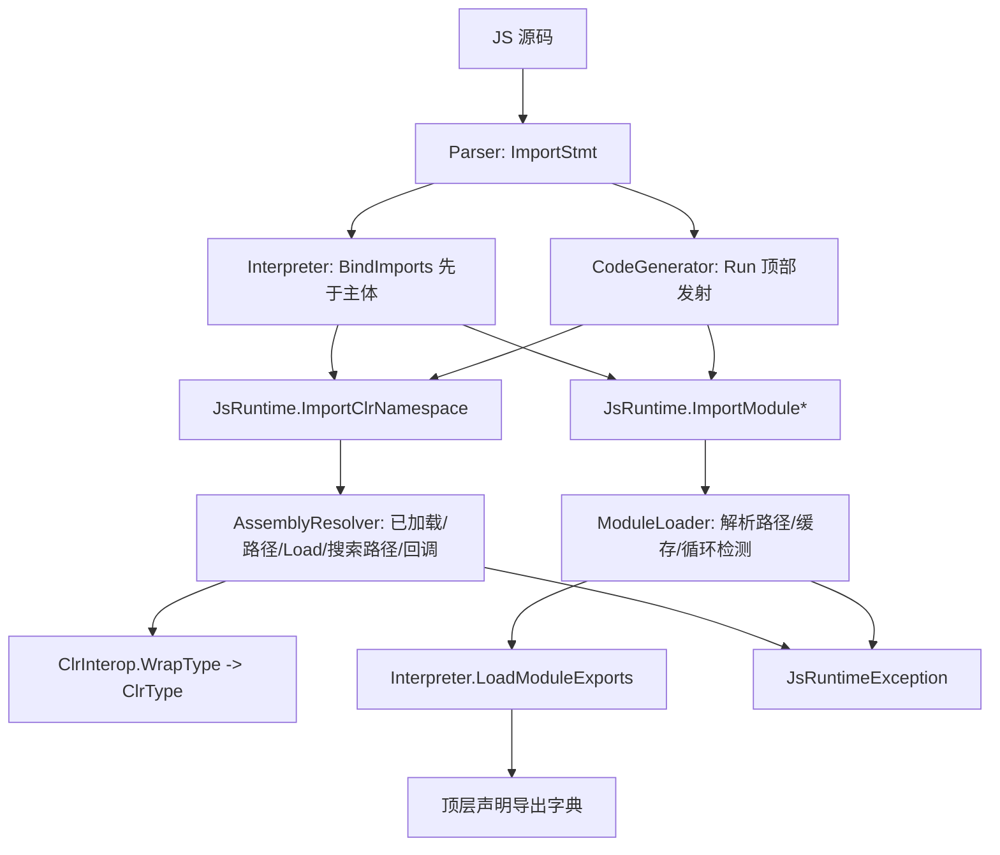

## Product Overview

为 LiteJs 引擎新增 `import` 语句，做两件事：一是通过反射打开 .NET CLR 程序集，把指定命名空间的类型引入脚本（`import Foo.Bar as ns from 'x.dll'` → `ns.Type.Method(...)`）；二是从相对路径加载其它 `.js` 模块。导入在脚本主体执行前生效，解释执行与"翻译为 VB.NET 后执行"两条路径行为一致。

## Core Features

- **CLR 命名空间导入**：程序集可按简单名解析、经宿主探测目录/解析回调定位，或由脚本直接给出 dll 路径；别名下是该命名空间的 public 直属类型（类/结构/枚举/接口/静态类），开放泛型定义不列入。拿到类型后可直接静态调用、`new` 构造、`instanceof` 判定。
- **省略别名**：`import Foo.Bar from 'x.dll'` 自动以末段 `Bar` 绑定。
- **脚本模块导入**：`import * as ns from './m.js'`、`import {a, b as c} from './m.js'`、`import x from './m.js'`（等价命名空间对象）、`import './m.js'`（仅执行副作用）；相对路径以导入方脚本所在目录为基准，支持绝对路径与省略扩展名（依次尝试 `.js`、`index.js`）。
- **模块语义**：按绝对路径缓存，同一模块只执行一次；循环导入给出明确错误；模块内看不到导入方的脚本级变量，只能看到全局环境；因不支持 `export`，模块导出面 = 顶层 `var/let/const/function/class` 声明。
- **受限位置**：`import` 只允许出现在脚本顶层；写在块内或函数内报语法错误。
- **错误可捕获**：写法错误、程序集/命名空间/模块不存在、绑定名不存在，都以脚本可捕获的错误报告，消息含 spec、路径与已尝试的位置。
- **别名形态自然**：别名是普通 JS 对象/类型引用——`Object.keys(ns)` 列出类型名、`typeof ns === 'object'`、`typeof ns.MethodDecompiler === 'function'`。

## 行为效果

```javascript
import Microsoft.VisualBasic.ApplicationServices.Development.VisualStudio.IL as msil from 'Microsoft.VisualBasic.ApplicationServices.Development.VisualStudio.dll';
import * as utils from './utils.js';
import { add as plus } from './math.js';

var syntax = msil.MethodDecompiler.Decompile(method);
console.log(typeof msil.MethodDecompiler, Object.keys(msil).length, utils.helper(), plus(1, 2));
```

## Tech Stack Selection

- 沿用现有技术栈：VB.NET / net10.0 / 仅 BCL，不新增 NuGet 包。
- 反射：`System.Reflection`（`Assembly`/`AssemblyName`/`Assembly.Load`/`LoadFrom`/`GetExportedTypes`）。
- 测试：现有 xUnit 工程 `test/test.vbproj`（已 ProjectReference `VisualStudio.NET5.vbproj`，示例 dll 在输出目录内）。

## Implementation Approach

导入是"编译期语法 + 运行期解析"两段式：Parser 只产出 `ImportStmt`，所有解析语义集中在 Runtime 层，解释器与生成代码调用同一批入口，不新增第三条执行路径。

1. **语法层**：`import` 加入 `Lexer.Keywords`（成为保留字），`as`/`from` 继续保持上下文关键字（按文本匹配）。新增 `ImportStmt`，用 `Kind` 区分五种形态；`ParseImport` 统一处理，按 `from` 字符串是否以 `.dll` 结尾判定 CLR / 模块语义，非 dll 源上出现点分名或裸 `as` 直接报错。顶层限制用 Parser 内部"是否处于模块顶层"的标记控制。
2. **运行期入口**（单一语义源）：在 `JsRuntime` 增加 `ImportClrNamespace` / `ImportModuleNamespace` / `ImportModuleNamed` / `ImportModuleSideEffect` 四个薄入口，生成代码直接调用它们。
3. **CLR 解析**：新增 `Runtime/AssemblyResolver.vb`，按 6 步顺序解析——已加载程序集匹配 → 显式路径 `LoadFrom` → `Assembly.Load(AssemblyName)` → 宿主探测目录逐个试 `简单名.dll` → 宿主回调 `ClrInterop.AssemblyResolver` → 失败抛脚本错误（消息列出尝试过的位置）。命名空间映射用 `GetExportedTypes()` 过滤 `Namespace = ns`、`Not IsNested`、`Not IsGenericTypeDefinition`，映射为 `类型简名 → ClrInterop.WrapType(t)` 的 `Dictionary(Of String, Object)`。
4. **模块加载**：新增 `Runtime/ModuleLoader.vb`，负责路径规范化与回退、绝对路径缓存、`_loading` 集合做循环检测，并把"执行模块"委托给注入的执行器（由 `Interpreter` 提供），因此模块共享 realm 全局但不继承导入方脚本变量；生成代码导入的模块同样由解释器执行，避免运行期编译依赖。
5. **解释器**：`Run` 中先 `BindImports`（别名定义到 realm 全局），再 `HoistFunctions`/执行主体，执行阶段跳过 `ImportStmt`；以 `SourceFile` 所在目录作为模块基准目录。
6. **翻译器**：`Generate()` 在 `host.Install()` 之后、`EmitHoistedVars` 之前发射导入调用，别名用 `scope.DefineLocal` 声明为局部（必须早于函数 lambda，VB 闭包按声明顺序捕获）；`GenStmt` 跳过 `ImportStmt`；重新生成 artifact 以保证编译期校验。

### 关键决策与取舍

- **不支持 `export`**（用户未勾选）：模块导出面定义为顶层声明，`import x from` 绑定命名空间对象而非 `default`，README 明确标注该偏差。
- **命名空间扁平**（用户选定）：不做子命名空间树，不暴露嵌套类型，因此无需改动 `ClrType` 的成员查找。
- **基准目录**：`JsRuntime.ScriptBaseDirectory`（线程静态，默认 `AppContext.BaseDirectory`）由解释器按 `SourceFile` 覆盖；生成代码的 `Run` 签名保持不变，避免再次变更 artifact 契约。
- **性能**：程序集按 spec 缓存、命名空间映射按 `(assembly.FullName, ns)` 缓存、模块按绝对路径缓存；一次类型扫描 O(T) 只发生一次，脚本内每次访问类型仅是字典查找。
- **失败语义**：一律包装为 `JsRuntimeException`（payload 为 `JsError`），name 用 `Error`/`SyntaxError`/`TypeError`，消息含 spec、解析路径与尝试列表，便于定位。
- **进程级静态状态**（程序集缓存、搜索路径、模块缓存）提供 `Clear` 以便测试互不污染。

## Implementation Notes

- 模块作用域必须是 `New Environment(_globals, isFunctionScope:=True)`：模块看不到导入方脚本变量，但 `Object`/`Array`/内置对象与宿主注册表全局是同一次元。
- 模块导出收集只取顶层 `VarStmt`（逐 declarant 取值）、`FuncDeclStmt`、`ClassDeclStmt`；执行后从模块作用域读值，随后其作用域即可丢弃。
- 生成代码里导入别名必须是 `Dim` 局部且位于所有函数 lambda 之前；`EmitHoistedVars` 已跳过已在作用域中的名字，故导入先发射不会与 `var` 冲突。
- `import` 变为保留字属破坏性变更（原先可作标识符），在 README 兼容性说明中记录。
- 失败信息不打印对象内容，只打印 spec/路径/类型名，避免日志噪音与泄漏。
- 涉及文件：Parser/Interpreter/CodeGenerator 三处改动面较大，改完用引用查询确认没有其它语句分派路径（如 `HoistedVars` 收集）漏掉 `ImportStmt`。

## Architecture Design



## Directory Structure

```
JavaScript/
├── Language/Lexer.vb                    # [MODIFY] Keywords 增加 "import"（保留字；as/from 保持上下文关键字）
├── Language/Parser.vb                   # [MODIFY] 语句分派加 Case "import"；新增 ParseImport 处理五种形态；顶层限制标记；各错误分支带位置
├── AST/Ast.vb                           # [MODIFY] 新增 ImportKind 枚举、ImportBinding、ImportStmt（Kind/NamespaceName/Alias/Bindings/Specifier）
├── Runtime/AssemblyResolver.vb          # [NEW] 程序集解析六步顺序、搜索路径与回调、按 spec 缓存；ImportNamespace(ns, spec, baseDir) 生成"类型名→ClrType"字典并缓存
├── Runtime/ModuleLoader.vb              # [NEW] 模块路径解析（.js/index.js 回退、绝对路径）、执行缓存、循环导入检测、BaseDirectory/Executor 环境、Clear
├── Runtime/Runtime.vb                   # [MODIFY] 四个 import 入口 + ScriptBaseDirectory；委托 AssemblyResolver/ModuleLoader
├── Runtime/ClrInterop.vb                # [MODIFY] AddAssemblySearchPath/ClearAssemblySearchPaths/AssemblyResolver 属性（宿主扩展点）
├── Interpreter.vb                       # [MODIFY] Run 先绑定导入（别名入 realm 全局），设置基准目录；LoadModuleExports；执行阶段跳过 ImportStmt
├── CodeGenerator.vb                     # [MODIFY] 发射导入调用与别名局部声明（host.Install 之后、hoisted vars 之前）；GenStmt 跳过 ImportStmt
├── test/LiteJsImportTests.vb            # [NEW] Parser 六种形态与错误分支、CLR 导入与静态调用、程序集解析三条路径、ES 模块（命名/默认/副作用/缓存/循环/缺失）、CodeGenerator 结构断言
├── test/artifacts/demo.js               # [MODIFY] 增加真实 import 示例（VisualStudio IL 命名空间 + MethodDecompiler 调用）
├── test/artifacts/GeneratedScript.vb    # [MODIFY] 由 LITEJS_REGEN_ARTIFACTS=1 重新生成（编译期校验）
└── README.md                            # [MODIFY] 新增 import 章节（两种形式、解析顺序、扁平命名空间、无 export 的导出面、缓存/循环、LoadFrom 安全提示、保留字变更）与测试计数
```

## Key Code Structures

```
' 语法与运行期共享的契约：Parser 产出、Interpreter/CodeGenerator 消费
Public Enum ImportKind
    ClrNamespace      ' import Foo.Bar as ns from 'x.dll'
    NamespaceObject   ' import * as ns from './m.js'
    DefaultAlias      ' import x from './m.js'  (无 export：等价命名空间对象)
    NamedBindings     ' import {a, b as c} from './m.js'
    SideEffect        ' import './m.js'
End Enum

Public NotInheritable Class ImportStmt
    Inherits Statement
    Public ReadOnly Kind As ImportKind
    Public ReadOnly NamespaceName As String          ' CLR 点分命名空间
    Public ReadOnly Alias As String                  ' CLR 别名 / * as / 默认位
    Public ReadOnly Bindings As List(Of ImportBinding)
    Public ReadOnly Specifier As String              ' from '...'
End Class

' 生成代码调用的统一入口（单一语义源）
Public Module JsRuntime
    Public Function ImportClrNamespace(namespaceName As String, assemblySpec As String) As Object
    Public Function ImportModuleNamespace(specifier As String) As Object
    Public Function ImportModuleNamed(specifier As String, name As String) As Object
    Public Sub ImportModuleSideEffect(specifier As String)
    Public Property ScriptBaseDirectory As String
End Module
```

## SubAgent

- **code-explorer**
- Purpose: 实现前核对全部接入点与影响面——`Lexer.Keywords` 与关键字判定、`Parser.ParseStatementCore` 语句分派与顶层限制的可行挂点、`Interpreter.Run`/`Execute`/`HoistFunctions`/`Environment` 的作用域构建方式、`CodeGenerator.Generate` 序言发射位置与 `Scope.DefineLocal` 用法、`CollectHoistedVars` 对未知语句的处理、既有 artifact 与测试辅助函数。
- Expected outcome: 输出"分派点 + 语句类型遍历点 + 作用域构建点"清单（含行号与原文片段），作为实现时的核对表，避免 `ImportStmt` 在某条既有遍历路径上被遗漏或误判为未知语句。

## Skill

- **lsp-code-analysis**
- Purpose: 改动 `Parser.ParseStatementCore`、`Interpreter.Run`、`CodeGenerator.GenStmt/ResolveIdent` 后做引用与调用层级分析，确认没有其它路径（如变量提升收集、异步函数体遍历、模块导出收集）绕过 import 处理，并核对 `ClrInterop.WrapType`/`JsRuntime.ResolveHostGlobal` 等既有入口的调用点。
- Expected outcome: 关键符号的引用清单与影响面结论，用于验证改动完整性与回归风险，确保"解释器与翻译器双路径一致"落实到位。