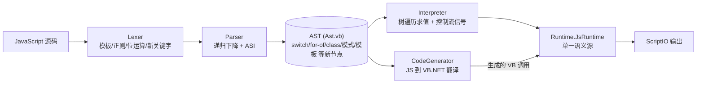

## User Requirements

用户拥有一个纯 VB.NET 实现的 JavaScript 解释器工程（`JavaScript/LiteJs.vbproj`：Lexer → Parser → AST → 树遍历解释器，并附带同一 AST 的 JS→VB.NET 代码翻译器），当前仅覆盖 ES5 核心子集。用户要求完善其中缺失的 JavaScript 语法支持。经澄清确认的范围：

1. **核心语法补全 + 语义修正**：switch、for-of、模板字符串、位运算、`??`/`?.`、展开/剩余/默认参数、解构、对象字面量增强、逗号、`in`/`instanceof`/`delete`/`void`、标签、数字分隔符，以及 `typeof null` / `var` 提升 / `!=` codegen 等缺陷修复
2. **class 面向对象**：class/extends/super/new/this/instanceof、prototype 链、方法 this 绑定、静态成员、getter/setter
3. **正则 + Date/Error + 内置库补全**：正则字面量与 RegExp、Error 层级、Date，以及 String/Array/Object/Math/Number 方法补全
4. **async/await + Promise**：引擎无事件循环，采用同步驱动微任务队列策略
5. **生成器**：`function*`/`yield`，采用 eager 预计算语义（无限生成器不可用，需文档注明）

**明确不做**：模块系统 import/export。

**CodeGenerator parity（已确认）**：新增语法必须同时在 JS→VB.NET 翻译路径中实现，两条路径共用 `Runtime.JsRuntime` 单一语义源，行为一致。

**测试策略（已确认）**：全量——解释器行为 xUnit 用例（对照真实 JS 输出）+ CodeGenerator 结构断言（不抛 NotSupportedException、含预期运行时调用）+ 维护 `test/artifacts/GeneratedScript.vb` 编译期检查。本地无 Roslyn 包，测试中不可动态编译生成的 VB 代码，禁止新增 NuGet 包。

## Product Overview

LiteJs 是轻量级 JavaScript 脚本引擎：JS 源码解析为 AST 后既可树遍历解释执行，也可翻译为可编译的 VB.NET 程序，两条路径共用同一套动态语义（弱类型转换、真值判断、相等比较、成员访问、内置对象）。本次完善后，脚本可使用 switch/for-of/模板字符串/位运算/空值合并/可选链/展开/剩余与默认参数/解构/对象字面量增强/class 继承/正则/Promise/async-await/生成器等现代语法；`typeof null`、`var` 作用域提升等既有语义缺陷被修正；翻译产物与解释执行输出逐字节一致。

## Core Features

- **语句**：switch/case/default（含贯穿语义）、for-of、标签语句与标签 break/continue
- **表达式**：模板字符串、位运算（`& | ^ ~ << >> >>>`）、`??`、`?.`、展开运算符、剩余/默认参数、数组/对象解构（嵌套、默认值、rest）、对象字面量简写/方法/getter/setter/计算键、逗号运算符、`in`/`instanceof`/`delete`/`void`
- **面向对象**：class 声明与表达式、extends/super、new、this 动态绑定、instanceof、原型链、静态成员、访问器
- **内置能力**：正则字面量与 RegExp、Error 层级、Date、String/Array/Object/Math/Number 方法补全
- **异步与迭代**：Promise、async/await（同步微任务驱动）、`function*`/yield（预计算式生成器）
- **双路径一致**：所有新语法同时支持解释执行与 JS→VB.NET 翻译，输出一致
- **语义修正**：`typeof null` 返回 `object`、var 函数级提升、箭头函数词法 arguments、`!=`/`!==` 翻译产物可编译等

## Tech Stack Selection

- **语言/运行时**：VB.NET（`Option Strict/Explicit/Infer On`，`LangVersion latest`），.NET 10（`net10.0`），RootNamespace/AssemblyName = `Microsoft.VisualBasic.ApplicationServices.VM.JavaScript`
- **依赖**：仅 BCL + 工程内已有引用（`..\..\Microsoft.VisualBasic.Core\src\Core.vbproj` 提供 `JsValue`/`NestedScriptEnvironment`/`ScriptSlot`/`CodeToken`；`mime\application%json\JSON-netcore5.vbproj` 提供 JSON DOM；`dev\VisualStudio\VisualStudio.NET5.vbproj`）。**零新增第三方依赖**（本地无 Roslyn，测试不得动态编译）
- **正则**：`System.Text.RegularExpressions`（BCL）；**日期**：`System.DateTime`（BCL）
- **测试**：xUnit 2.9.3 + Microsoft.NET.Test.Sdk 18.10.1（`JavaScript/test/LiteJs.Tests.vbproj`）

## Implementation Approach

**总体策略**：按「Lexer token → AST 节点 → Parser → Interpreter → Runtime 辅助 → CodeGenerator → 测试」顺序，在单一语义源 `Runtime.JsRuntime` 上为两条路径同步实现；五个 tier 依次交付，每 tier 独立 `dotnet build` + `dotnet test` 可验证；Tier 0 先修已核实缺陷，为后续改动建立干净的回归基线（现有 22 个测试保持全绿）。

**关键决策与权衡**：

1. **模板字符串**：Lexer 扫描反引号产出结构化 Token（熟值串 + `${}` 表达式源子串列表），Parser 对每个表达式源递归 `Parse`。词法不做表达式解析，保持词法/语法分离；支持 `${}` 嵌套与 `\n`/`\``/`\${` 等转义；模板内含换行合法。
2. **正则字面量歧义消解**：Lexer 记录前一有效 token 类型——标识符/数字/字符串/`)`/`]`/`}` 之后为除法，否则为正则起点（acorn/esprisma 同款启发式），一次扫描完成，无回溯成本。`TokenType.Regex` 存 `(source, flags)`；.NET Regex 互译，JS 标志 `gimsuy`；exec/test 维护 `lastIndex`；`String.match/replace($1 与函数替换器)/split/search/matchAll` 在 Runtime 实现。
3. **可选链短路**：`MemberExpr`/`CallExpr` 增加 `Optional` 标志；链根用内部异常 `OptionalChainShortCircuit` 短路至 `undefined`——与项目既有控制流信号模式（`BreakSignal`/`ContinueSignal`/`ReturnSignal`）一致；CodeGenerator 侧用同一公有异常 + IIFE `Try/Catch`，两路径同语义。
4. **class 轻量原型链**：实例 = `Dictionary(Of String, Object)` + `__proto__` 键指向原型字典，`JsGet` 沿链查找；class = 构造函数 `Func(Of Object(), Object)` + 原型字典（`NativeObject` 容器）；方法调用在 CallExpr 处按 callee 形态传入 receiver（`JsInvoke` 增加带 receiver 重载），`FuncExpr.IsArrow` 区分词法 this；`super.m()` 经 `JsSuperGet` 沿 home object 原型链查找。**不引入新值表示**，最大化复用现有 Dictionary/List/Func/JsValue 模型，CodeGenerator 无需新值类型。
5. **Promise + async/await**：同步微任务队列（解释器内 `List` + drain 循环）；async 函数返回 `JsPromise`；`await` 对已结算 promise 直接取值，未结算则驱动队列直至结算。引擎无 IO/事件循环，所有 promise 同步结算，语义自洽；README 注明与浏览器事件循环差异。
6. **生成器**：eager 预计算——首次 `next()` 前执行完函数体、收集 yield 值序列；树遍历解释器无协程挂起能力，此为实现成本与语义保真度的合理折中；XML 文档注明无限生成器不可用。
7. **展开/解构走运行时辅助**（`JsBuildArgs`/`JsArrayFrom`/`JsObjFrom` + `SpreadMarker`；Pattern 绑定辅助）：Parser 不做脱糖，AST 保真，CodeGenerator 与解释器共用同一辅助函数，天然保证双路径一致。
8. **Tier 0 语义修正**（均为已核实缺陷）：`JsNe`/`JsStrictNe` 补齐（Object + JsValue 双 overload，修 CodeGenerator 348/350 行引用不存在函数的问题）；`typeof null` → `"object"`（`JsTypeOf` 两个重载的 DBNull/Nothing 分支）；var 函数级提升（`Environment` 增加函数边界标记 + `DefineVar`）；箭头函数不再定义自有 `arguments`（词法继承）；`UpdateExpr` 对未声明变量走隐式全局 NaN 而非 ReferenceError。

**性能**：`JsValue` 热路径零装箱不变，新运算符优先提供 JsValue 重载；位运算 `ToInt32`/`ToUint32` 一次转换；Regex 实例缓存于 `JsRegExp` 对象；模板字符串一次扫描成型；for-of 对 `List(Of Object)`/String 直接索引 O(n)；解构/展开 O(n) 无重复遍历。已知取舍：方法调用按访问点绑定 receiver 会为每次方法访问分配轻量包装——本引擎以正确性优先，可接受。

**可靠性**：所有新错误路径抛 `JsRuntimeException`（可被 JS try/catch 捕获）；解析错误带 `行:列`；const/只读语义沿用 `Environment.CheckReadOnly`；Promise 拒绝、生成器错误走同一异常体系。

**避免技术债**：不新增值表示与 NuGet 依赖；CodeGenerator 复用既有 IIFE 表达式模式、`Scope` 重命名、`_loopExit/_loopCont` 栈、`IndentWriter`、`VbString`；新分支仅追加在 `GenStmt`/`GenExpr` 既有 If-ElseIf 链中，保持既有代码风格；既有 AST 节点公开字段语义不变（仅追加新字段）。

## Implementation Notes

- **VB 陷阱（源自 README 踩坑记录 + 代码现状）**：`Runtime.vb` 模块内裸 `Math.xxx` 被字段遮蔽，必须写 `System.Math.xxx`；VB `Imports` 别名不能指向泛型构造类型（生成代码用 `Imports JsValue = System.Object`）；同一方法内所有 lambda 局部变量须方法级唯一（BC30616）→ 新节点生成的临时变量一律走 `Scope.UniqueName`；三字符引号字面量 `""""c`。
- **改动前影响分析**：修改共享类型（`FuncExpr` 参数模型、`MemberExpr` Optional、`CodeGenerator.GenExpr` 分发链、`Runtime.vb` 重载集）前先用 `[skill:lsp-code-analysis]` 查全部引用点；跨文件影响面（Environment 函数边界、Scope 重命名与 class/闭包交互）用 `[subagent:code-explorer]` 做 medium 力度分析。
- **关键字分层**：保留字（switch/case/default/class/extends/super/instanceof/delete/void）加入 `Lexer.Keywords`；上下文关键字（of/get/set/async/await/yield/static/from/as）保持 Identifier，Parser 按文本匹配——否则 `var of = 1`、`obj.get` 等合法代码被破坏。
- **ASI 交互**：新语句（switch/class/label/for-of）必须接入 `ConsumeStatementEnd`；`return`/`throw`/`=>` 后换行规则保持现状；模板字符串内含换行合法；正则标志后无 ASI。
- **CodeGenerator 编译约束**：新生成的表达式必须在 `Option Strict On` 下可编译——新运行时辅助须同时提供 Object 与 JsValue 重载（生成代码走 Object 边界）；switch 用 `If + GoTo` 标签链保留 fallthrough（VB `Select Case` 无 fallthrough 且用松散比较，不可用）。
- **测试约束**：不得新增 NuGet 包；e2e 编译期检查靠 `test/artifacts/GeneratedScript.vb`（SDK globbing 自动编译进测试程序集），收尾任务将其扩展为覆盖新语法的代表性产物并与 CodeGenerator 实际输出保持一致。
- **Blast radius**：现有 22 个测试是回归基线，任何 tier 完成后必须全绿；不改变现有公开 API 语义，仅追加。

## Architecture Design

现有管线：`JS 源码 → Lexer → Parser → AST →（Interpreter 树遍历 | CodeGenerator → VB.NET 源码）`，Interpreter 与生成代码共用 `Runtime.JsRuntime` 单一语义源。本次扩展点如下：



- **Lexer**：新增 `Template`/`Regex` token 类型；位运算、`??`、`?.`、`...`、数字分隔符、保留字表扩充
- **AST**：语句新增 `SwitchStmt`/`ForOfStmt`/`LabeledStmt`/`ClassDeclStmt`；表达式新增 `TemplateExpr`/`SequenceExpr`/`NewExpr`/`SpreadElement`/`ThisExpr`/`SuperExpr`/`YieldExpr`/`AwaitExpr` + Pattern 体系；`FuncExpr` 扩展 `Defaults`/`RestParam`/`IsArrow`；`MemberExpr`/`CallExpr` 增加 `Optional`
- **Interpreter**：新语句分发、可选链短路捕获、标签栈、this/super 绑定、微任务 drain、var 提升执行路径
- **Runtime**：`JsNe`/`JsStrictNe`、位运算、nullish、spread 辅助、原型链（`JsGet`/`JsSet`/`JsNew`/`JsInstanceOf`/`JsSuperGet`）、`BoundMethod`/`AccessorProperty`、`JsPromise`、`JsGenerator`、`JsRegExp`、Date/Error 内置、内置库补全
- **CodeGenerator**：`GenStmt`/`GenExpr` 新分支全部经 `JsRuntime` 辅助，与解释器逐字节一致

## Directory Structure

```
JavaScript/
├── Language/
│   ├── TokenType.vb        [MODIFY] 新增 Template/Regex token 类别（Value 承载熟值+表达式源 / source+flags）
│   ├── Lexer.vb            [MODIFY] 反引号模板扫描、正则字面量上下文歧义消解、位运算/??/?./.../数字分隔符、保留字表扩充（上下文关键字保持 Identifier）
│   └── Parser.vb           [MODIFY] T1 全部语句/表达式 + class 声明/表达式解析 + 标签 + 解构目标回溯 + 对象字面量增强 + for-of
├── AST/
│   └── Ast.vb              [MODIFY] SwitchStmt/ForOfStmt/LabeledStmt/ClassDeclStmt/SequenceExpr/NewExpr/TemplateExpr/SpreadElement/ThisExpr/SuperExpr/YieldExpr/AwaitExpr、ArrayPattern/ObjectPattern/RestElement/AssignmentPattern、FuncExpr 扩展（Defaults/RestParam/IsArrow）、MemberExpr/CallExpr Optional 标志、ClassMember
├── Interpreter.vb          [MODIFY] 新语句分发、可选链短路捕获、标签栈、this/super/new 绑定、微任务 drain、var 提升执行路径、MakeFunction 支持默认/剩余参数/箭头语义
├── Environment.vb          [MODIFY] 函数作用域边界标记 + DefineVar（var 与 for-init var 就近函数作用域定义）
├── CodeGenerator.vb        [MODIFY] GenStmt/GenExpr 全量新分支（switch→If+GoTo 链保 fallthrough、for-of→For Each、模板→拼接、可选链→IIFE Try/Catch、解构→临时变量绑定、class→原型字典构造、async/generator→Promise/迭代器辅助）
├── Runtime/
│   ├── Runtime.vb          [MODIFY] JsNe/JsStrictNe、位运算 ToInt32/ToUint32、JsNullish、JsBuildArgs/JsArrayFrom/JsObjFrom、原型链 JsGet/JsSet/JsNew/JsInstanceOf/JsSuperGet、typeof null 修正、String/Array/Object/Math/Number 方法补全（find/some/every/flat/splice/at/padEnd/replaceAll/match/trig 等）、Error/Date 派发
│   ├── JsRuntimeException.vb [MODIFY] RangeError 等工厂 + Error 构造（name/message payload）
│   ├── BoundMethod.vb      [NEW] 方法 this 绑定（Target + Receiver），供 JsInvoke 带 receiver 重载消费
│   ├── AccessorProperty.vb [NEW] getter/setter 存取器对（Get/Set 委托），存于对象字典，JsGet/JsSet 识别调用
│   ├── OptionalChainShortCircuit.vb [NEW] 可选链短路信号异常（解释器与生成代码共用的公有类型）
│   ├── JsRegExp.vb         [NEW] .NET Regex 封装（source/flags/lastIndex/exec/test，实例缓存）
│   ├── JsDate.vb           [NEW] Date 内置（DateTime 封装 + 访问器）
│   ├── JsPromise.vb        [NEW] Promise 状态机 + 同步微任务队列 drain
│   └── JsGenerator.vb      [NEW] eager 预计算生成器迭代器（yield 序列 + next/value/done）
├── test/
│   ├── LiteJsTests.vb      [MODIFY] 每特性解释器行为用例（对照真实 JS 输出）+ CodeGenerator 结构断言（不抛 NotSupportedException、含预期 JsRuntime 调用）
│   └── artifacts/GeneratedScript.vb [MODIFY] 扩展为覆盖新语法的代表性翻译产物（与 CodeGenerator 实际输出一致，保持编译期检查有效）
└── README.md               [MODIFY] 更新支持列表、eager 生成器/同步 Promise 语义说明、移除不存在的 LiteJs.Cli 描述
```

## Key Code Structures

```
' ---- AST：解构模式体系（声明与赋值两条路径共用）----
Public MustInherit Class Pattern
End Class
Public NotInheritable Class ArrayPattern : Inherits Pattern
    Public ReadOnly Elements As List(Of Pattern)   ' Nothing = 空位
    Public ReadOnly Rest As String                 ' "...rest" 或 Nothing
End Class
Public NotInheritable Class ObjectPattern : Inherits Pattern
    Public ReadOnly Properties As List(Of KeyValuePair(Of String, Pattern))
    Public ReadOnly Rest As String
End Class
Public NotInheritable Class AssignmentPattern : Inherits Pattern
    Public ReadOnly Target As Pattern
    Public ReadOnly [Default] As Expression        ' 默认值表达式
End Class

' ---- AST：函数与类节点扩展 ----
Public NotInheritable Class FuncExpr : Inherits Expression
    Public ReadOnly Name As String
    Public ReadOnly Parameters As String()
    Public ReadOnly Defaults As Expression()       ' 与 Parameters 对齐，Nothing = 无默认值
    Public ReadOnly RestParam As String            ' "...args" 或 Nothing
    Public ReadOnly IsArrow As Boolean             ' 词法 this / arguments
    Public ReadOnly Body As List(Of Statement)
End Class

Public NotInheritable Class ClassDeclStmt : Inherits Statement
    Public ReadOnly Name As String
    Public ReadOnly SuperName As String            ' Nothing = 无继承
    Public ReadOnly Constructor As FuncExpr        ' 可能为 Nothing
    Public ReadOnly Members As List(Of ClassMember)' 方法/getter/setter/字段/静态成员
End Class

' ---- Runtime：关键辅助与新类型（签名级）----
Public Function JsNe(a As Object, b As Object) As Boolean          ' + JsValue 重载
Public Function JsBitAnd(a As Object, b As Object) As Object       ' ToInt32 语义；同理 Or/Xor/Not/Shl/Shr/Ushr
Public Function JsNullish(a As Object, b As Func(Of Object)) As Object   ' ?? 短路
Public Function JsBuildArgs(ParamArray parts As Object()) As Object()    ' SpreadMarker 展开
Public Function JsInvoke(f As Object, args As Object(), receiver As Object) As Object  ' this 绑定
Public Function JsNew(ctor As Object, args As Object()) As Object  ' 建实例 + 设 __proto__ + 跑构造
Public Function JsInstanceOf(obj As Object, ctor As Object) As Boolean
Public NotInheritable Class JsPromise      ' State/Value/回调队列；同步微任务 drain
Public NotInheritable Class JsGenerator    ' eager 预计算 yield 序列 + Next()/value/done
Public NotInheritable Class BoundMethod    ' Target + Receiver
Public NotInheritable Class AccessorProperty   ' Getter/Setter 委托对
Public NotInheritable Class OptionalChainShortCircuit : Inherits Exception
```

## Agent Extensions

### Skill

- **lsp-code-analysis**
- Purpose: 在修改共享类型前做语义级引用查找——`FuncExpr` 参数模型、`MemberExpr` Optional 标志、`CodeGenerator.GenExpr`/`GenStmt` 分发链、`Runtime.JsRuntime` 重载集（如新增 `JsInvoke` 带 receiver 重载后的全部调用点），防止漏改调用方导致编译破坏或双路径行为漂移
- Expected outcome: 得到每个被改符号的完整定义/引用清单，改动无遗漏，既有 22 个测试保持全绿

### SubAgent

- **code-explorer**
- Purpose: 对跨文件影响面做 medium 力度影响分析——Environment 函数作用域边界改动对 Interpreter 各执行路径的影响、CodeGenerator Scope 重命名与 class/闭包/标签交互的影响、新 token 类型对 Lexer 消费方（Parser）的波及
- Expected outcome: 输出受影响文件与调用链清单，指导按序修改与回归验证顺序