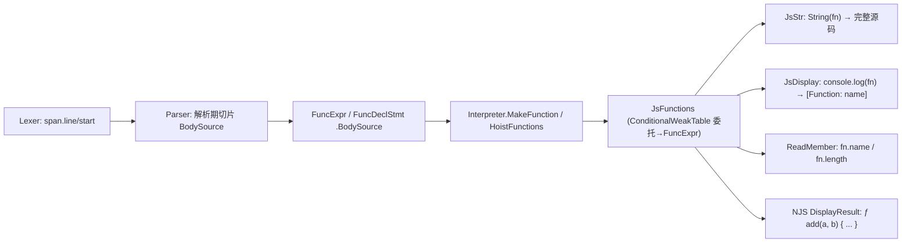

## 需求概述

修复 REPL 中把函数值打印出来时的崩溃，并让函数值显示出它的源码，从而与 DevTools/Node 的交互体验一致。

## 核心功能

- 在 REPL 输入函数名（如输入函数声明 `add` 后单打 `add`）不再抛 “Conversion from type 'Func(Of Object(),Object)' to type 'String' is not valid.”，而是回显函数源码，形式为 `ƒ add(a, b) { throw \` ${a}+ ${b} -> ${a+b}\` }`（DevTools 风格，带 ƒ 前缀、签名与函数体）。
- 字符串化语义与 Node 对齐：`String(fn)`、`'x' + fn`、`%s` 输出完整函数源码（`function add(a, b) { ... }`，匿名函数 `function (a) { ... }`，箭头 `(a, b) => a + b`，方法 `m() { ... }`）；`console.log(fn)`、`%o`、`%j` 输出 `[Function: name]`。
- 函数值暴露 `fn.name`（声明名，匿名/箭头取赋值位置推断名，确实无名时为空串）与 `fn.length`（首个默认值形参或剩余参数之前的形参个数）。
- 同名崩溃一并修掉：任何此前会走到非法字符串转换分支的运行时值（Promise、访问器属性、其它内部对象）都改为安全显示（如 `[object Promise]`），不再中断脚本或 REPL 会话。
- 没有源码可用的函数（宿主注入的委托、转译生成的代码）安全退化（如 `[Function: name]` / `ƒ name(...) { [generated] }`），不报错。
- 覆盖函数声明的多行书写：函数体跨行时回显保留原始源码（含换行），与用户书写的源码一致。

## 视觉/输出效果

REPL 会话（交互或管道输入）中输出示例：

```
> function add(a, b) { throw `${a}+${b} -> ${a+b}` }
undefined
> add
ƒ add(a, b) { throw `${a}+${b} -> ${a+b}` }
> add.name
'add'
> add.length
2
> console.log(add)
[Function: add]
undefined
> String(add)
function add(a, b) { throw `${a}+${b} -> ${a+b}` }
```

函数回显在交互会话中保持彩色（函数体用青色系高亮，与既有的字符串绿色、数值黄色、null/undefined 暗色风格一致）；管道会话不着色，输出可直接与 node 输出逐行对照。

## 边界与约束

- 只改变显示与属性读取，不改变调用、闭包、`typeof`、`instanceof`、`JSON.stringify`（函数成员继续被省略/转 null）等既有语义。
- 既有测试全绿（117 个用例，含 `Point.name`、`String(new TypeError('t'))`、CLR 互操作 `String(host)` 等显示断言不得变化）。
- 新增回归测试覆盖本次修复与退化路径。

## 技术栈

- 语言/平台沿用 VB.NET（`OptionStrict On`/`OptionExplicit On`）、net10.0；改动落在 `JavaScript\LiteJs.vbproj`（引擎）与 `NJS\NJS.vbproj`（REPL 宿主）。
- 不新增任何包/工程引用；仅需 BCL 的 `System.Runtime.CompilerServices.ConditionalWeakTable(Of Object, FuncExpr)` 做“委托 → AST 节点”弱键映射。
- 注意：测试工程已被用户重命名为 `JavaScript\test\test.vbproj`（AssemblyName 仍为 `LiteJs.Tests`），`LiteJs.slnx` 已同步，新增测试文件靠 SDK 通配编译自动纳入。

## 根因与总体方案

根因：`Runtime.vb` 的 `JsStr` 末尾是 `Return CStr(x)`；VB 的 `CStr` 对非 `IConvertible`/非 String 对象抛 `InvalidCastException`，而解释器里的 JS 函数值就是 `Func(Of Object(), Object)` 委托，`console.log`/REPL 回显走到 `JsDisplay → JsStr` 即崩。凡落到该行的未知运行时值（`JsPromise`、`AccessorProperty` 等）都是潜在同类崩溃；同时 `CStr` 目前还兼顾 `Single/Integer/Long/Decimal` 数值显示，替换时不能丢。

方案分四条链路：

1. **显示层修复**：`JsStr` 补安全分支（数值 → `Convert.ToString(…, InvariantCulture)`；`Func(Of Object(), Object)` → 有源码时输出完整 JS 源码，无源码时 `[Function: name]`；内置函数 → `function NAME() { [native code] }`；兜底 → `[object 类型名]`）；`JsDisplay` 对函数值与 `BuiltinMethod` 输出 `[Function: name]`，与 Node 的 inspect 对齐。
2. **源码来源**：`Parser` 持有源串与行首偏移表，在解析期把“函数体源码切片”写入 AST（`FuncExpr.BodySource`、`FuncDeclStmt.BodySource`）。只在“解析体之前/之后”各记一次 token 下标，右端取下一个 token 的起始偏移，天然规避字符串/模板字面量 token 文本长度不一致的问题。
3. **运行时关联**：新增 `Runtime\JsFunctions.vb`，用 `ConditionalWeakTable` 建立“委托 → `FuncExpr`”映射，在 `Interpreter.MakeFunction` 返回前统一注册（generator/async 分支返回的是包装 lambda，注册同一个 `FuncExpr`），并集中提供源码/名字/形参数/签名的格式化。
4. **宿主回显**：`NJS\Program.vb` 的 `DisplayResult` 增加函数分支，输出 `ƒ 名字(参数) 函数体`（generator 用 `ƒ*`、async 前置 `async`、箭头表达式体补 `=>`），内置方法输出 `ƒ name() { [native code] }`；保持既有着色策略与“管道不着色”。

关键权衡：

- 只截取**函数体源码**而不截取整段函数源码：函数体起始位置在解析处天然可得（`_pos`），无需给 5 个创建点从调用方传“头部 token 下标”，改动面最小；`String(fn)`/REPL 的“名字 + 形参列表”由 AST 字段组合，代价是“方法简写 vs function 关键字”与“形参默认值文本”这两处与 Node 原始文本略有差异（可接受，且不影响用户诉求的 `ƒ add(a, b) { ... }` 形态）。
- 用弱键表而非给 `FuncExpr`/委托加字段：委托类型 `Func(Of Object(), Object)` 不可派生，表是唯一低侵入关联方式；`ConditionalWeakTable` 弱键避免函数值长期持有导致 AST 泄漏，且线程安全，无需 ThreadStatic（映射是引擎无关的、按值本身的）。
- `String(fn)` 与 `console.log(fn)` 采用不同形式，是为了“可直接与 node 输出 diff”（本项目宿主的既定目标）。

## 实现细节

1. **`Runtime.vb` — `JsStr`（约 257-278 行）**：在 `ClrBoundMethod` 之后、`Return CStr(x)` 之前插入安全分支，并把兜底替换为 `[object <JS 类型名>]`；类型名映射建议：`JsPromise → Promise`、`AccessorProperty → Object`、其余取 CLR 类型名去掉前缀。`Single/Integer/Long/Decimal` 显式用 `Convert.ToString(x, Globalization.CultureInfo.InvariantCulture)`（保持既有数值显示：整数无小数点）。`Func(Of Object(), Object)` 分支委托给 `JsFunctions.SourceOf(x)`。
2. **`Runtime.vb` — `JsDisplay`（约 298-308 行）**：新增 `Func(Of Object(), Object)` 与 `BuiltinMethod` 分支 → `JsFunctions.Inspect(x)`，返回 `[Function: name]`（无名则 `[Function]`，内置取 `BuiltinMethod.Name`）。注意 `%o/%O/%j` 与 `console.log` 都走它，必须与 node 一致；`ClrObject`/`BufferInstance` 既有分支不变。
3. **`Runtime.vb` — `ReadMember`**：先读清现有 `BuiltinMethod` 分支（含 `JsPromise`/`JsGenerator`/`JsError` 等相邻分支）后**只新增 case**：`BuiltinMethod` 加 `name`（→ `DirectCast(x, BuiltinMethod).Name`）；新增 `Func(Of Object(), Object)` 分支，`name` → `JsFunctions.DisplayName`、`length` → `CDbl(JsFunctions.Arity)`；其余属性仍返回 `Undef`。严禁改动 `Number.isInteger` 等静态方法所依赖的既有返回值（`Point.name` 走的是 `JsClass` 分支，不得触碰）。
4. **`AST\Ast.vb`**：`FuncExpr` 增加可写 `Public Property BodySource As String`（函数体源码，含 `{ }` 或箭头表达式文本）；`FuncDeclStmt` 同理增加（否则函数声明提升后源码丢失）。
5. **`Language\Parser.vb`**：

- 增加 `Private ReadOnly _source As String` 与 `Private ReadOnly _lineStarts As Integer()`（构造时按 `vbLf` 切分算行首偏移）；私有构造函数加 `source` 参数，`Public Shared Function Parse(source As String)` 传入（先 grep `New Parser(` 确认调用点只有这一处，`ParseEmbeddedExpression` 走静态 `Parse` 天然正确）。
- 新增 `Private Function SourceSlice(startIndex As Integer, nextIndex As Integer) As String`：左端 = `_tokens(startIndex)` 的 `(span.line, span.start)` → 偏移，右端 = `_tokens(nextIndex)` 的偏移（`nextIndex` 越界则取源串长度），`Substring(...).TrimEnd()`。
- 在 6 处 `New FuncExpr(...)` 写完 Position 的位置补 `.BodySource`：`ParseFunctionRest`、`ParseMethodBody`、`ParseArrowBody`（块体与表达式体两条返回路径）、`ParseObjectProperty` 的 getter/setter 内联与对象方法内联、`ParseObjectProperty` 里 async/generator 方法（经 `ParseMethodBody` 返回后赋值）。统一写法：解析体之前 `Dim bodyStart = _pos`，构造时 `With { .BodySource = SourceSlice(bodyStart, _pos) }`。
- `ParseFunctionDecl`：把 `f.BodySource`（并建议一并把 `f.Position`）复制进 `FuncDeclStmt`。

6. **`Runtime\JsFunctions.vb`（新增，命名空间 `Runtime`）**：

- `Register(value As Object, f As FuncExpr)` / `TryGetNode(value, ByRef f As FuncExpr) As Boolean`；
- `DisplayName(value) As String`（`Name` → `InferredName` → `""`）；
- `Arity(value) As Integer`（遍历 `Parameters`，遇到 `Defaults(i) IsNot Nothing` 即停；`RestParam` 不计入；未注册 → 0）；
- `SignatureOf(value)`（`name(a, b)`，匿名时为 `"""` + 参数 + `)`)；
- `BodyOf(value)`（`BodySource`）；
- `SourceOf(value)`（`String(fn)` 语义：箭头 → `(a, b) => body`；有名字的非箭头 → `function name(params) body`；匿名 → `function (params) body`；`IsAsync`/`IsGenerator` 加 `async ` / `function* ` 前缀；未注册 → `[Function: name]`）；
- `Inspect(value)`（`[Function: name]`，同时服务 `Func` 与 `BuiltinMethod`）；
- 全部方法对未注册对象安全退化，绝不抛异常。

7. **`Interpreter.vb`**：`MakeFunction` 改为先算 `Dim fn As Func(Of Object(), Object) = …`（三条分支），再 `JsFunctions.Register(fn, f)`，最后 `Return fn`；`HoistFunctions` 构造提升用的 `FuncExpr` 时补 `.BodySource = f.BodySource`（并补 `.Position = f.Position`）。**不得改动解释执行语义**（帧栈、closure、generator/async 包装保持原样）。
8. **`NJS\Program.vb` — `DisplayResult`**：新增 `Func(Of Object(), Object)` 分支 → `Paint("ƒ " & signature & " " & body, AnsiColor.BrightCyan, colorize)`（generator `ƒ*`、async 前缀、箭头表达式体补 `=> `；无源码时 `ƒ name(...) { [generated] }`）；新增 `BuiltinMethod` 分支 → `ƒ name() { [native code] }`。保持 `Paint` 的“非交互不着色”。
9. **性能**：源码切片只在解析期发生（每函数 O(1)，靠行首偏移表）；`ConditionalWeakTable` 与显示分支只在打印/属性读取的冷路径触发；`JsStr` 新增分支全部排在既有数值/字符串判断之后，热路径不受影响；`BodySource` 使每个函数多持有一份体文本，量级可忽略。

## 兼容性与红线

- `CodeGenerator` 与生成代码文本零改动（新增 AST 属性不参与生成）；`test\artifacts\GeneratedScript.vb` 及 `NodeApiCodegenTests`/`ArtifactSyncTests`/`LiteJsClrInteropTests` 的签名断言原样通过。
- `console.log` 的格式说明符语义不变：`%s` → `JsStr`（函数现在给出源码，正是 Node 语义）、`%o/%j`/普通参数 → `JsDisplay`。
- 既有 117 个测试必须全绿；执行前先 grep 测试里是否出现 `[function` 字面量断言（本次把内置函数的 `JsStr` 由 `[function: x]` 升级为 Node 的 `function x() { [native code] }`，若无断言依赖即可安全升级，若有则保留原文本并记录）。
- `console.trace` / `e.stack` / REPL 多行续行 / 管道 UTF-8 读取等本会话既有能力不得回归。
- 不改动既有测试文件；不删除 `.codebuddy`。

## 架构设计



## 目录结构

```
JavaScript/
├── AST/Ast.vb                      # [MODIFY] FuncExpr 增可写 BodySource；FuncDeclStmt 增可写 BodySource
├── Language/Parser.vb              # [MODIFY] 持有 _source/_lineStarts；SourceSlice；6 处创建点写 BodySource；
│                                   #   ParseFunctionDecl 把 BodySource(+Position) 复制进 FuncDeclStmt
├── Runtime/JsFunctions.vb          # [NEW] 委托→FuncExpr 弱键映射（Register/TryGetNode）与格式化：
│                                   #   DisplayName / Arity / SignatureOf / BodyOf / SourceOf / Inspect；
│                                   #   未注册对象一律安全退化
├── Runtime/Runtime.vb              # [MODIFY] JsStr 安全分支（数值/函数/兜底 [object X]，内置函数 native code 形式）；
│                                   #   JsDisplay 函数与 BuiltinMethod → [Function: name]；
│                                   #   ReadMember 增 Func 分支（name/length）与 BuiltinMethod 的 name（仅新增 case）
├── Interpreter.vb                  # [MODIFY] MakeFunction 对三个分支的返回值统一 JsFunctions.Register；
│                                   #   HoistFunctions 传递 BodySource/Position（执行语义不变）
└── test/LiteJsFunctionValueTests.vb # [NEW] 回归测试：String(fn)/console.log(fn)/fn.name/fn.length/方法/箭头/
                                    #   无源码委托退化/Promise 与访问器不再崩/既有行为防回归
NJS/
└── Program.vb                      # [MODIFY] DisplayResult 增函数分支（ƒ name(params) body，generator/async 前缀）
                                    #   与 BuiltinMethod 分支（ƒ name() { [native code] }），保持着色开关
```

## 关键代码结构

```
' Runtime\JsFunctions.vb —— 委托与 AST 的弱键关联 + 统一格式化
Public Module JsFunctions
    Public Sub Register(value As Object, f As FuncExpr)
    Public Function TryGetNode(value As Object, ByRef f As FuncExpr) As Boolean
    Public Function DisplayName(value As Object) As String     ' Name → InferredName → ""
    Public Function Arity(value As Object) As Integer          ' 首个 default/rest 之前
    Public Function SignatureOf(value As Object) As String     ' "add(a, b)"
    Public Function BodyOf(value As Object) As String          ' "{ throw ... }"
    Public Function SourceOf(value As Object) As String        ' String(fn) 语义
    Public Function Inspect(value As Object) As String         ' "[Function: add]"
End Module
```

显示矩阵（对齐 Node）：

| 表达式 | our 输出 | node 输出 |
| --- | --- | --- |
| `String(add)` / `'x' + add` / `%s` | `function add(a, b) { ... }` | 同 |
| `String(console.log)` | `function log() { [native code] }` | 同 |
| `console.log(add)` / `%o` | `[Function: add]` | 同 |
| `add.name` / `add.length` | `'add'` / `2` | 同 |
| REPL 单打 `add` | `ƒ add(a, b) { ... }` | 同（DevTools 风格） |
| `String(Promise.resolve(1))` | `[object Promise]` | `[object Promise]` |


## Agent Extensions

### SubAgent

- **code-explorer**
- Purpose: 实施前做一次“medium”力度的只读核对，锁定三类易漏清单：①`Parser.vb` 中所有 `New FuncExpr(` / `ParseFunctionDecl` 创建点及其“函数体起始 token”上下文（确认在何处记录 bodyStart 与下一个 token 下标），②`Runtime.vb` 里 `ReadMember` 的 `BuiltinMethod` 现有分支与相邻分支（`JsPromise`/`JsGenerator`/`JsError`）的真实 case 列表，③所有可能落到 `JsStr` 末尾 `CStr(x)` 的运行时值类型清单，以及测试中是否出现 `[function`、`String(` 作用于函数值的断言。
- Expected outcome: 给出“必须保持不变的返回值/文本清单”与“需补安全分支的值类型清单”，确保新增分支不破坏 `Point.name`（JsClass）、`Number.isInteger` 静态方法、`String(new TypeError('t'))`、CLR 互操作 `String(host)` 等既有断言，也不会遗漏某个仍会崩溃的值类型。