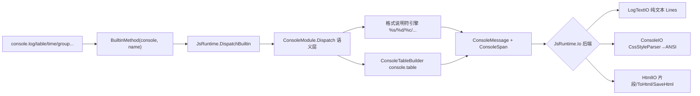

## 产品概述

完善 VB.NET 编写的 JavaScript 解释器（LiteJs）对 JavaScript 标准 `console` 的模拟：把当前只支持 `console.log` 的薄弱实现重构为完整的 console 语义实现，并为输出端增加"富文本"能力，使 `console` 的 CSS 样式输出能够在 HTML 与 CLR 终端两种场景下正确呈现，宿主可选择输出后端。

## 核心功能

- 补齐全部标准 console API：`log/debug/info/warn/error/assert/clear/count/countReset/dir/dirxml/group/groupCollapsed/groupEnd/table/time/timeEnd/timeLog/trace/profile/profileEnd/timeStamp`
- 支持格式说明符：`%s` `%d` `%i` `%f` `%o` `%O` `%c`（CSS 样式）`%%`，以及额外参数按空格追加；未知说明符保持字面文本
- `console.table` 以带边框的等宽字符表格呈现数组、对象数组、对象字面量与标量输入，支持列筛选；中英混排按字符显示宽度对齐
- `console.count/countReset` 计数、`console.time/timeEnd/timeLog` 计时、`console.group/groupEnd` 缩进分组、`console.assert` 断言失败提示
- 新增富文本输出管道：一条日志由"样式片段序列"组成，纯文本后端退化为纯文本、CLR 终端后端渲染为颜色/加粗/下划线、HTML 后端渲染为内联样式
- 新增 HTML 输出后端：既可将每次输出渲染为携带内联样式的 HTML 片段，也可包装为完整可独立打开的 HTML5 终端页面并落盘保存
- CLR 终端后端支持 CSS 样式输出（前景/背景色、加粗、下划线、删除线、反色），并按日志级别自动着色
- 宿主可选择输出后端（HTML 文件 / ANSI 终端 / 纯文本）

## 视觉呈现

- HTML 输出为深色终端风格页面：等宽字体、暗色背景、输出行按日志级别显示左侧色条；`%c` 指定的颜色、加粗、下划线等样式以 CSS 内联样式真实呈现
- CLR 终端输出：样式片段转换为 ANSI 转义序列（前景/背景色、加粗、下划线、删除线、反色），`warn` 显示为黄色、`error`/断言失败显示为红色
- 纯文本后端：不含任何样式控制字符，逐行保存可读文本，保持既有测试与 diff 行为

## 技术栈选择

- 语言/平台：VB.NET（`OptionStrict On`）、net10.0，沿用现有 `JavaScript\LiteJs.vbproj`（SDK 风格默认通配编译，新增 `.vb` 文件无需改 vbproj，且该文件仅含 `Compile Remove`，不会排除新文件）
- 复用底层库（`LiteJs.vbproj` 已引用 `..\..\Microsoft.VisualBasic.Core\src\Core.vbproj`，无需新增引用或 NuGet）：
- `Microsoft.VisualBasic.ApplicationServices.Terminal.TablePrinter`：`ConsoleTableBuilder` + `ConsoleTableBuilderExtensions`（`From(List(Of Object()))`、`From(List(Of List(Of Object)))`、`From(ConsoleTableBaseData)`、`WithColumn`、`WithFormat`、`Export()`、`RealLength`）
- `Microsoft.VisualBasic.ApplicationServices.Terminal`：`AnsiEscapeCodes`、`ConsoleFormat`、`AnsiColor`、`TextSpan`、`UnicodeWidth`

## 实现方案

整体为"抽象层 → 语义层 → 接入层 → 宿主开关"四段式，不引入新架构模式，完全对齐现有 `FsModule.vb` 的"专用模块文件 + Dispatch 表 + 私有参数辅助"风格。

1. **抽象层（`ScriptIO.vb` 扩展）**：保留 `MustOverride Sub WriteLine(text As String)`（现有测试与生成代码全部依赖），新增富文本模型 `ConsoleSpan`（文本 + 原始 CSS 样式字符串）、`ConsoleMessage`（级别 + 片段序列 + 纯文本）与两个 `Overridable` 成员 `WriteMessage(msg)`、`Clear()`。默认实现委托给 `WriteLine(msg.PlainText)`，因此 `LogTextIO` 无需改动即保持逐行纯文本（不引入 ANSI/HTML 字符），零破坏。
2. **语义层（新增 `ConsoleModule.vb`）**：`MakeConsole()` 返回 console 单例对象（保持字段名与 `NativeObject` 行为，使 `typeof console === "object"`、`typeof console.log === "function"` 不变），`Dispatch(method, args)` 用 `Select Case` 覆盖全部标准 API，`Case Else` 抛 `TypeError`（现状是静默输出，属缺陷修复）。内含格式说明符引擎：**仅当第一个参数为字符串时才解析** `%s/%d/%i/%f/%o/%O/%c/%%`，未知与尾部 `%` 保持字面且不消费参数，`%c` 消费下一个参数作为 CSS 并生成带样式片段（不进入纯文本），额外参数按空格追加——由此保证既有 200+ 条 `console.log` 断言逐字节不变。
3. **状态隔离**：count/time/group 状态放在 `ConsoleModule` 的 `ThreadStatic` 字段（计数器 `Dictionary(Of String, Double)`、计时器 `Stopwatch` 表、缩进层级、profile 事件记录），并暴露 `Reset()`；在 `JsRuntime.Io` 的 **setter** 中调用 `Reset()`——该属性同时被 `Interpreter` 构造与 `CodeGenerator` 生成代码的 `Run` 设置，一处接入即覆盖两条执行路径，避免单例状态跨脚本运行污染。`<ThreadStatic>` 字段不能在声明处初始化，需沿用 `_io` 的"getter 内惰性初始化"写法。
4. **`console.table`**：用 `ConsoleTableBuilder` 构造，`Format = ConsoleTableBuilderFormat.Default`；输入归一化为 `List(Of Object())` + 表头列名（对象数组取键首次出现顺序并集；二维数组取 `"0","1"...`；对象字面量以键作首列；标量/空输入回退为 `console.log` 语义）；第二个参数 `columns` 用于筛选/排序列；整块表格作为**一条** `ConsoleMessage`（单片段、内部含换行），`LogTextIO` 侧表现为一行含多行的文本，`HtmlIO` 用 `pre` 保真。
5. **CSS→ANSI（`CssStyleParser.vb` + `ConsoleIO`）**：把 CSS 声明串解析为 `ConsoleFormat`（`Foreground/Background As AnsiColor?`、`Bold`、`Underline`、`Strikeout`、`Inverted`），颜色支持 `#RGB`/`#RRGGBB`/`rgb()/rgba()`/命名色：先走 `AnsiColor.TryParse`（内置 16 色名 + `#RRGGBB`），未命中再走 `Drawing.Color.FromName` 并**校验已知色名**（未知名会返回透明黑，需回退到默认前景色，避免正文不可见）。`ConsoleIO` 逐片段用 `ConsoleFormat` 拼接 ANSI 转义序列（直接复用 `AnsiEscapeCodes.AppendAnsiEscapeSequence` / `TextSpan`），日志级别着色作为**父样式**、`%c` 样式作为子样式经 `ConsoleFormat.Combine(parent, child)` 合并；每个片段结束追加 `AnsiEscapeCodes.Reset`，保证不污染后续输出。无样式时输出与现状完全一致（保留 `[error] `/`[warn] ` 前缀）。
6. **HTML 后端（新增 `HtmlIO.vb`）**：`WriteMessage` 把片段渲染为 `span style="..."` 并做 HTML 转义（`&`、`<`、`>`、`"`），按级别包一层语义 class；保留片段缓冲；`ToHtml()` 返回完整 HTML5 独立文档（内嵌终端主题 CSS、等宽字体栈、深色背景、行级色条），`SaveHtml(path)` 落盘（UTF-8），`Clear()` 清空缓冲。
7. **宿主开关（`LiteJs.Runner\Program.vb`）**：在既有"第一个 `*.js` 参数即脚本"的解析逻辑上叠加 `--html <out.html>`（使用 `HtmlIO`，运行结束 `SaveHtml`）、`--ansi`（显式 `ConsoleIO`，即当前默认）、`--plain`（`LogTextIO`，便于与 node 输出 diff）；未知参数继续作为脚本参数传给 `process.argv`。

性能与可靠性：所有拼接使用 `StringBuilder`/`List`，复杂度为 O(输出字符总数)；表格为 O(行×列)；格式说明符为单趟手写扫描（无正则回溯风险）；状态字典读写均摊 O(1)；`ConsoleIO.Clear()` 用 try/catch 包裹 `IOException`，在重定向/无终端环境下安全降级；`HtmlIO` 不做磁盘 I/O 直到显式保存。

## 架构设计



## 目录结构

```
JavaScript/
├── Runtime/
│   ├── ScriptIO.vb          # [MODIFY] 抽象层扩展：新增 ConsoleSpan/ConsoleMessage 富文本模型；ScriptIO 增加
│   │                        #   Overridable WriteMessage(msg)/Clear()（默认委托 WriteLine(msg.PlainText)）；
│   │                        #   LogTextIO 保持 Lines 纯文本并新增 Messages 供样式断言；
│   │                        #   ConsoleIO 重写 WriteMessage：逐片段经 CssStyleParser 转 ConsoleFormat，用
│   │                        #   AnsiEscapeCodes/TextSpan 输出 ANSI，级别着色为父样式、%c 为子样式经
│   │                        #   ConsoleFormat.Combine 合并，片段后补 Reset；Clear() 调 System.Console.Clear()
│   │                        #   并 try/catch IOException 降级。必须保留 WriteLine(String) 抽象与 [warn]/[error] 前缀
│   ├── ConsoleModule.vb     # [NEW] console 语义实现，结构对齐 FsModule.vb：MakeConsole() 单例 + Dispatch(method, args)
│   │                        #   覆盖全部标准 API；私有 Arg/Str 辅助；ThreadStatic 状态（计数/计时/缩进/profile）
│   │                        #   + Reset()（在 JsRuntime.Io setter 中调用）；%c 等格式说明符引擎；
│   │                        #   console.table 基于 ConsoleTableBuilder（务必 WithColumn 设表头、Export().TrimEnd）
│   │                        #   格式化输出复用 JsRuntime.JsDisplay/JsStr/JsTruthy；未知方法抛 JsRuntimeException.TypeError
│   ├── CssStyleParser.vb    # [NEW] CSS 声明串 → ConsoleFormat/AnsiColor：color/background(-color)/font-weight/
│   │                        #   font-style/text-decoration；颜色支持 #RGB/#RRGGBB/rgb()/rgba()/命名色，
│   │                        #   优先 AnsiColor.TryParse，未命中用 Drawing.Color.FromName 且必须校验色名有效
│   │                        #   （未知名返回透明黑）；同时保留原始 CSS 文本供 HtmlIO 直出
│   └── HtmlIO.vb            # [NEW] HtmlIO : Inherits ScriptIO：片段渲染（HTML 转义 + 内联 style + 级别 class）、
│   │                        #   片段缓冲、ToHtml() 完整 HTML5 终端页面（内嵌深色主题 CSS/等宽字体/行级色条）、
│   │                        #   SaveHtml(path) UTF-8 落盘、Clear() 清空
│   └── Runtime.vb           # [MODIFY] ConsoleBuiltin 改由 ConsoleModule.MakeConsole() 构造（字段名不可改，CodeGenerator
│                            #   直接引用）；BuiltinConsole 改为委托 ConsoleModule.Dispatch；Io setter 增加状态重置；
│                            #   保留 JsDisplay/DisplayJson 等既有显示逻辑
├── Interpreter.vb           # [MODIFY] 构造中设置 JsRuntime.Io 后（或依赖 Io setter）确保 console 状态已重置；
│                            #   保持 Io 属性与 GlobalIdentifiers 初始化顺序不变
└── LiteJs.Runner/
    └── Program.vb           # [MODIFY] 新增 --html <out.html> / --ansi / --plain 后端开关（默认 ConsoleIO 不变），
                             #   运行结束按后端落盘/输出；保留脚本参数透传与 usage 文案
```

## 关键代码结构

```
Namespace Runtime
    ''' <summary>一条日志中的富文本片段：纯文本 + 原始 CSS 声明（Nothing 表示无样式）。</summary>
    Public Class ConsoleSpan
        Public Property Text As String
        Public Property Css As String
    End Class

    ''' <summary>一条 console 输出：日志级别 + 样式片段序列 + 纯文本退化形式。</summary>
    Public Class ConsoleMessage
        Public Property Level As String                  ' log/debug/info/warn/error/assert/trace/group...
        Public Property Spans As New List(Of ConsoleSpan)
        Public ReadOnly Property PlainText As String     ' 各 Span.Text 直接拼接，供 LogTextIO/纯文本后端
    End Class

    Public MustInherit Class ScriptIO
        Public MustOverride Sub WriteLine(text As String)
        Public Overridable Sub WriteMessage(message As ConsoleMessage)
            WriteLine(message.PlainText)
        End Sub
        Public Overridable Sub Clear()
        End Sub
    End Class
End Namespace
```

```
' ConsoleModule：与 FsModule 同构的语义层入口（Runtime.vb 的 BuiltinConsole 委托到此处）
Public NotInheritable Class ConsoleModule
    Public Shared Function MakeConsole() As NativeObject
    Public Shared Function Dispatch(method As String, args As Object()) As Object
    Public Shared Sub Reset()
End Class
```

## 实施要点

- **必须显式设置表格列**：`ConsoleTableBuilder` 在 `Column` 为 `Nothing` 时 `PopulateFormattedColumnsRows` 会触发 NullReferenceException，务必先 `WithColumn(表头)` 再 `Export()`；`Export()` 内部用 `AppendLine`，结果需 `TrimEnd`。
- **结构体陷阱**：`AnsiColor` 默认值 `HasValue=True` 但颜色码为 `Nothing`（`ConsoleFormat.Combine` 注释已明确），合并样式前必须判空颜色码；`ConsoleFormat.Foreground/Background` 为 `AnsiColor?`。
- **兼容性红线**：`console.log(a, b)` 空格连接、数组 `[1,2,3]`、对象 `{"a": 1}`、循环引用 `[Circular]`、`typeof console.log === "function"`、`LogTextIO.Lines` 纯文本逐行——均须逐条保持；`ConsoleBuiltin` 字段名与 `ScriptIO` 生成代码签名（`Run(io As LiteJsRuntime.ScriptIO, Optional host As LiteJsRuntime.ClrHost = Nothing)`）不可改动。
- **向后兼容的破坏面控制**：不修改 `CodeGenerator.vb`、不修改 `test\artifacts\GeneratedScript.vb`、不新增/改动 vbproj；不删除 `.codebuddy` 目录。仅对 `ConsoleBuiltin` 的构造与 `BuiltinConsole` 的委托体做最小替换。
- **边界与容错**：`console.timeEnd` 未注册标签、`console.countReset` 无标签、`console.groupEnd` 层级为 0 时只输出告警不抛错；`%c` 结尾缺样式参数时按空样式处理；`ConsoleIO` 在输出重定向场景不崩溃。
- **日志与诊断**：新增代码不写日志到宿主 stdout，避免与脚本输出混杂；异常统一转 `JsRuntimeException.TypeError`（与 `FsModule.Dispatch` 的 `Case Else` 风格一致）。

## 设计风格

为 HtmlIO 生成的"HTML 终端页面"设计一套深色、精致、可独立打开的呈现方案（这是 `ToHtml()` 输出的单个自包含 HTML5 文档，不是多页 Web 应用）。采用现代终端美学：近黑蓝渐变背景、玻璃拟态终端卡片、等宽字体输出区、行级日志级别色条、微光边框与轻柔的入场动画，保证在浏览器打开即为成品级视觉，同时文本内容可随时复制。

## 页面规划（单页三区块 + 一个工具条）

HTML 终端文档为单屏布局，自上而下分为：

1. 顶栏：脚本标题、运行时间/输出行数信息、后端徽章，左侧为窗口控制点装饰。
2. 输出区：`pre` 保留原格式的行流，每行左侧按级别显示色条，`%c` 样式以内联 `style` 真实生效；行内容自适应换行不破坏对齐。
3. 工具条：复制全部输出、下载 HTML、切换行号显示。悬停有轻微发光与位移反馈。
4. 页脚状态栏：输出行数、生成时间、渲染后端与主题名，使用次级灰色小字。

## 交互与响应

- 每行输出按索引做 20ms 递增的淡入位移动画，营造"日志刷屏"质感；
- 输出区滚动条细化为暗色细条，长内容滚动流畅；
- 宽度自适应：窄屏下顶栏信息折叠为图标，输出区保持等宽不换行破坏表格。

## 可访问性

- 行级别色条同时附带 `aria-label` 文本（如 "warning"），颜色不是唯一语义载体；
- 前景/背景对比度满足可读性，禁用动画偏好（`prefers-reduced-motion`）时关闭入场动画。

## Agent Extensions

### Skill

- **lsp-code-analysis**
- Purpose: 通过语义分析列出 `ScriptIO`、`LogTextIO`、`ConsoleIO`、`ConsoleBuiltin`、`BuiltinConsole` 的定义与全部引用/实现点，确认重构影响面（含 `CodeGenerator.vb` 生成代码模板、`Interpreter.vb`、`LiteJs.Runner` 与测试工程）。
- Expected outcome: 得到完整的引用清单，确保 `WriteLine(String)` 抽象、生成代码签名与字段名零破坏，不遗漏任何调用点。
- **playwright-cli**
- Purpose: 在实现完成后打开 HtmlIO 生成的终端 HTML 文件并截图，验证深色主题、行级色条与 `%c` 内联样式（颜色/加粗/下划线）真实渲染正确。
- Expected outcome: 输出可视化截图与渲染结论，确认 HTML 后端产物可独立打开且样式生效。

### SubAgent

- **code-explorer**
- Purpose: 以 medium 力度复核生成代码产物（`test\artifacts\GeneratedScript.vb`）、现有测试对 console 输出的断言以及 runner 参数解析逻辑，作为回归基线核对。
- Expected outcome: 给出需保持不动的行为清单与潜在冲突点，避免改动后现有测试失败。